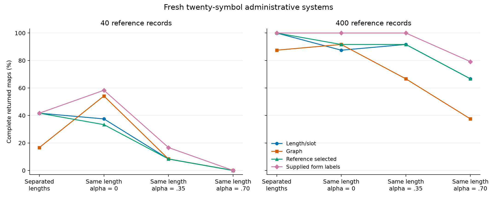

# Recovery after length and role separation weaken

The reference-selected decoder loses complete maps when administrative slot distributions share more probability mass, especially with a small reference. At 400 reference records, its recovery changes from 22 of 24 same-length maps at zero shared mass to 16 of 24 at .70. At 40 records, the corresponding counts are 8 and 0. These are fresh generated systems with known identities and a fixed mapping budget.

The generator has three forms and twenty symbols. The separated design uses four disjoint symbol pools and lengths 4, 5 and 6. The common-length designs extend the first two forms to six slots. Shared mass alpha blends each slot's pool distribution with one common twenty-symbol background. Positive alpha gives all slots full symbol support. Twelve matched systems supply two reference sizes and two mixture conditions per variant; training contains 640 encoded records in every condition. [Protocol](PROTOCOL.md), [saved parameters](main-v1/parameters.json).

| Reference records | Variant | Fixed slot | Fixed graph | Reference selected | Supplied form labels |
|---:|---|---:|---:|---:|---:|
| 40 | Separated lengths | 10/24 | 4/24 | 10/24 | 10/24 |
| 40 | Same length, alpha 0 | 9/24 | 13/24 | 8/24 | 14/24 |
| 40 | Same length, alpha .35 | 2/24 | 2/24 | 2/24 | 4/24 |
| 40 | Same length, alpha .70 | 0/24 | 0/24 | 0/24 | 0/24 |
| 400 | Separated lengths | 24/24 | 21/24 | 24/24 | 24/24 |
| 400 | Same length, alpha 0 | 21/24 | 22/24 | 22/24 | 24/24 |
| 400 | Same length, alpha .35 | 22/24 | 16/24 | 22/24 | 24/24 |
| 400 | Same length, alpha .70 | 16/24 | 9/24 | 16/24 | 19/24 |

Counts measure the returned bijection against the hidden identity map. Each denominator contains twelve systems and their two mixture conditions. The supplied-form diagnostic receives an additional form label on both reference and encoded records. Ordinary mapping and reference selection receive the record symbols and boundaries. [Reviewed aggregates](review-v1/verification.json).

Reference selection changes with the visible process. For same-length forms at zero shared mass, eleven of twelve large references choose graph; two of twelve small references do so. With .35 or .70 shared mass, every reference chooses slot. When a form label is unavailable, mixing forms can make one position informative about another. The competing scores preserve different parts of that record distribution. The fixed graph method recovers 13 small-reference maps at zero shared mass, while reference selection recovers 8, so predictive model choice still incurs a mapping cost in this condition. [Every choice and likelihood](review-v1/reference-choices.json).

Across both reference sizes and mixture conditions, .70 shared mass lowers selected complete recovery by 29.17 percentage points relative to common-length zero overlap, with a matched-system 95% percentile interval of −45.83 to −14.58. Symbol accuracy falls by 13.96 points, interval −20.63 to −7.60. The zero-overlap common-length contrast with separated forms is −8.33 recovery points, interval −25.00 to 10.42. These twelve-system intervals describe the declared generator and fitting procedure. [Paired comparisons](review-v1/paired-comparisons.json).

The supplied-label comparison holds the records fixed and changes the conditioning field. At common length and zero shared mass, it improves complete recovery over reference selection by 16.67 points, interval 4.17–29.17, and symbol accuracy by 7.08 points, interval 3.33–11.04. At .70 mass it improves symbol accuracy by 6.56 points, interval 1.46–11.15, while its complete-recovery improvement of 6.25 points has interval −2.08 to 16.67. [Label benefits](additional-v1/label-benefits.json).

The independent review retains thirty linear conditions with sixty exact equality witnesses. All occur at reference size 40; fifteen ordinary tied conditions enter the selected outputs. In each failed returned map, the true map scores below the selected optimum: this holds for all 88 ordinary-slot failures, all 73 supplied-label failures and all 105 graph failures. The score comparison identifies a finite-data or model problem that additional optimization of the same objective would preserve. The graph search remains a finite search; the linear optima have independent dual certificates. [Alternative maps](review-v1/linear-alternatives.json), [objective diagnostics](additional-v1/summary.json), [linear truth comparisons](additional-v1/wrong-linear-truth-equalities.json).

Each point summarizes 24 conditions. The first step changes form lengths by adding slots; the remaining steps change shared probability mass on six-slot forms. Supplied form labels are a stronger-input diagnostic. Exact counts and uncertainty remain in the linked tables and JSON outputs.

This control makes the conditioning variable a concrete research target. An observed object class, face role or operational stage can be tested on the same symbolic records through a supplied-label comparison. A useful next computation would estimate form membership from the reference without supplying labels, then test that model on fresh systems. The present endpoints give the observations, failures and labelled comparison needed to evaluate that extension.
