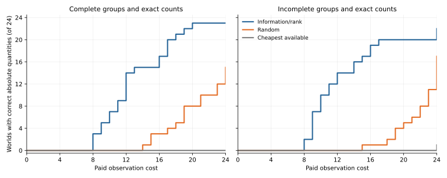

# Choosing which physical evidence to acquire next

A sequence of whole/part inspections and independent counts can recover hidden quantity labels more efficiently when the next observation is chosen from the surviving constraints. In this simulation, an information/rank rule identified correct absolute quantities in 23 of 24 complete-data worlds, compared with 15 for random selection and none for cheapest-first selection. With incomplete contents, the counts were 22, 17 and 1. The [protocol](PROTOCOL.md) preceded execution; [methods](METHODS.md) describe the positive quantity set, exact proofs and acquisition scores.

Each world has six renamed labels, balanced label frequencies and newly generated quantities. Inference receives no known value bag or quantity upper bound. An inspection reveals a physical relation, and a count measures a named object. Costs and availability are supplied before selection; unopened responses, concealed values and withheld tests remain outside the selector. The conditions share these assumptions and vary completeness, measurement accuracy or whether labels denote quantity at all. Archaeological collection observations are described separately in the [source and measurement note](SOURCE_AND_MEASUREMENTS.md).

## Main comparison

There are 24 independent generated worlds per condition, three policies per world and a paid budget of 24 units. A policy continues to the budget boundary, so first identification cost is distinct from total paid cost. The [frozen results](main/results.json) contain all 360 policy records. The [paired analysis](main-analysis/analysis.json) preserves identification curves, common-success cost comparisons, count actions and false solutions.

| Condition | Correct absolute quantities: information/rank | Random | Cheapest available | Other observed outcome |
|---|---:|---:|---:|---|
| Complete groups, exact counts | 23/24 | 15/24 | 0/24 | One world had no available count; information/rank identified its ratios. |
| Incomplete groups, exact counts | 22/24 | 17/24 | 1/24 | Two information/rank worlds retained relative ambiguity. |
| Valid noisy count intervals | 1/24 | 1/24 | 0/24 | Information/rank retained 22 scale intervals and one unfixed scale. |
| Counts reported with insufficient uncertainty | 0/24 | 0/24 | 0/24 | Information/rank produced a wrong unique absolute answer in 21 worlds; random did so in 14 at some point. |
| Ownership labels | 0/24 | 0/24 | 0/24 | All three policies rejected the positive quantity model in all 24 worlds. |

Information/rank acquired a correct absolute vector earlier in all 15 complete-data worlds where both it and random succeeded. Its mean saving on those paired worlds was 6.47 cost units. In the 17 common successes with incomplete contents, its mean saving was 9.82; it was faster in 16 and slower in one. These comparisons describe the generated sample and the declared costs.



The [all-available diagnostic](main-all-available-review.json) opens every accessible observation after the frozen run and removes the budget cap. One incomplete world remains ambiguous even with all available evidence. The other incomplete information/rank failure becomes identifiable with additional acquisition. This separates a collection limit from a budget/policy failure.

## Measurement errors and preserved ambiguity

An exact constraint system can uniquely identify the wrong scale when an erroneous count is treated as exact. In world `2026103200`, information/rank inferred `(6, 3, 8, 1, 2, 4)` at cost 14; the true quantities were `(12, 6, 16, 2, 4, 8)`. All ten withheld whole/part relations had zero residual, while the two withheld counts had residuals −2 and −8. The [record](main/undercovered_counts-2026103200-information_rank.json) and [case summary](main-analysis/analysis.json) retain the full observation sequence. Three random-policy worlds later rejected a previously wrong unique answer after another observation contradicted it.

The main endpoint retains 21 final cases with more than one relative assignment. [Ambiguity certificates](main-ambiguity-certificates.json) give two strictly positive rational vectors for each case, check every acquired equality/inequality exactly and show that their normalized ratios differ. The interval refinement below retains seven further such cases, with [separate certificates](precision-ambiguity-certificates.json).

## Refining the interval score

The original rule scores a prospective interval as zero when the current range is narrower than one reported interval. A shifted interval can still trim that range. The [post-outcome refinement protocol](PRECISION_REFINEMENT_PROTOCOL.md) replaces that score with `w/(w+2r)`, derived from mean interval overlap under a uniform distribution of compatible measurement centres. It was written before testing 24 fresh valid-interval worlds.

The [new endpoint](precision-refinement/results.json) compares four policies on those same worlds. The overlap rule identified correct absolute quantities in 6/24; the original information/rank, random and cost policies each identified 0/24. It preserved the correct ratios in all 24. The [paired analysis](precision-analysis/analysis.json) shows a narrower final scale range in 15 worlds and equal widths in nine, with none wider. Mean range width relative to the true scale fell from `47/192` to `1765/10368`; median width fell from `1/6` to `1/12`. Eighteen refined-policy worlds retained scale intervals. The original failed policy remains in both endpoints.

## Checks, sources and reuse

[Main arithmetic review](main-review.json) checked 3,801 states, 3,441 actions and 35,312 distinct saved exact certificates. [Classification review](main-classification-review.json) independently checked ranks, relative/absolute uniqueness, withheld evaluations and first identification costs. The corresponding refinement reviews checked [993 states and 9,766 certificates](precision-refinement-review.json), plus [classification and evaluation claims](precision-refinement-classification-review.json). Concealed-data replacement checks passed [15 original-policy cases](selection-boundary-review.json) and [eight refinement cases](precision-boundary-review.json). Every numerical planning optimum was also checked exactly during execution; state proofs are stored in full and the planning certificate stream has a saved digest.

The new collection route is the official Louvre accession [SB 1940](https://collections.louvre.fr/ark:/53355/cl010175973), with an inside/outside class-count record and six token catalogue lookup identifiers. The [source note](SOURCE_AND_MEASUREMENTS.md), [source manifest](source-acquisition.json) and [exact design illustration](susa-design-calculation.json) connect those observations to concrete measurement requests. Downloaded notices remain local. These simulations quantify evidence requirements under an additive quantity model; they supply methods and a collection plan for testing that model on physical records.

Run the source with Python, NumPy and SciPy from the project root. Each command requires a fresh output directory:

```powershell
python src/six_hour/physical_acquisition.py --worlds 24 --output <new-directory>
python src/six_hour/physical_acquisition.py --precision-refinement --condition valid_intervals --seed-offset 500 --worlds 24 --output <new-directory>
python experiments/2026-10-02-six-hour/physical-acquisition/verify_run.py <run-directory> --output <new-review.json>
python experiments/2026-10-02-six-hour/physical-acquisition/verify_classification.py <run-directory> --output <new-classification-review.json>
```

Frozen protocol snapshots retain relative links from their original source directory, `physical-acquisition/`, when stored in run subdirectories. Their bytes remain unchanged. The [retrospective](RETROSPECTIVE.md) records the gauge repair, unsuccessful interval rule, source retrieval routes, software checks and remaining collection requirements.
