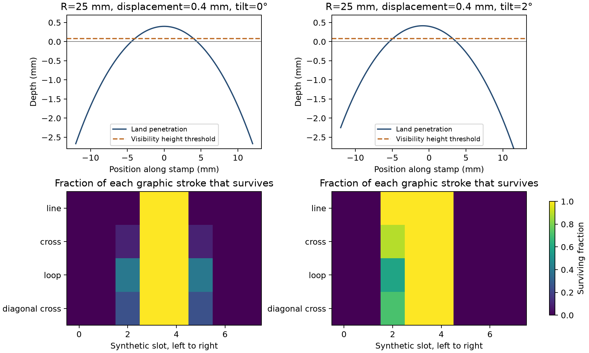

# Stamp contact, curvature and visible endpoints

A flat stamp can leave different parts of its graphics visible on a curved vessel. This model gives a precise condition under which that process preserves equal first and last graphic frequencies: the graphics and their placement must have the stated reversal symmetry, and the collection must give equal weight to opposite pressing angles and break sides. A consistent pressing angle can produce unequal endpoint frequencies in the same model. The result identifies physical measurements needed when interpreting positional patterns on stamped pottery.

The current numerical result is [reviewed/results.json](reviewed/results.json), derived from the [exact stroke-length refinement](analytic-refinement/results.json). The run contains 4,320 primary configurations and an initial sensitivity study with 8,748 groove, blur and retention configurations. All graphics are invented line arrangements. The calculation supplies a testable preservation model; its numerical effect sizes apply to the declared simulation grid.

## Results

The table uses the eight-slot, 24×8 mm frame. Endpoint total variation is half the sum of absolute differences between the first and last class probabilities. Configurations have equal prior weight; their contribution to an observed collection is then weighted by the chance that enough graphics survive.

| Pressing and preservation pool | At least one visible graphic: endpoint TV | At least three: endpoint TV | At least three: retained-row probability |
|---|---:|---:|---:|
| Centred, intact | 0 | 0 | 0.62844 |
| Balanced negative and positive tilt, intact | 0 | 0 | 0.79474 |
| Positive tilt, intact | 0.02894 | 0.03085 | 0.83632 |
| Balanced tilt, left quarter removed | 0.00987 | 0.00749 | 0.68621 |
| Balanced tilt, equally weighted left and right removal | 0 | 0 | 0.68621 |

In the centred intact pool, curvature still changes which classes are frequent. Requiring three visible graphics gives first and last probabilities of 0.25851, 0.26680, 0.22170 and 0.25299 for line, cross, loop and diagonal cross, compared with an input probability of 0.25 each. Shape-dependent visibility and endpoint asymmetry are therefore separate measurements. [The current diagrams](illustrations/record.json) show an individual contact example and the centred pool with at least one visible graphic.

The primary sampled run had six class/slot decisions close enough to the 80% visibility threshold to change at four times the sampling resolution. Exact segment integration resolved them in a separate endpoint. Its largest survival-fraction difference from the original run was 0.00349. The [analytic checks](analytic-refinement/analytic-verification.json) compare 648 exact configurations with numerical quadrature and verify reversal symmetry. The original run remains available in [main/](main/results.json).

## Physical basis

The acquired Harappa drawing shows H-1714, registration H2000-4487/9438-01, with a flat rectangular inscribed face. Its face measures about 13.02×6.79 mm relative to the printed 30 mm bar. Allowing two pixels of uncertainty at each chosen endpoint gives bounds of 12.48–13.57 mm and 6.34–7.26 mm. The [measurement record](H1714-drawing-measurement.json) identifies the original source pixels and assumptions. The three-slot simulation frame of 14×8 mm was fixed before this measurement.

The [Beas Mapping Project photograph](https://www.harappa.com/beas/mapping-project) shows stamped curved pottery fragments whose inscription footprints meet fracture boundaries. The acquired photograph has four fragments; the accompanying text reports five. Neither witness supplies the radius or groove geometry needed to fit a contact model. The model consequently varies radius, angle, groove depth, retained relief and imaging blur as declared inputs. [The sources](SOURCES.md) explain which observations motivated the model and which mechanics remain to be measured.

## Reuse and next measurement

[METHODS.md](METHODS.md) defines the equations, probability calculation and checks. [PHYSICAL-TEST-PROTOCOL.md](PHYSICAL-TEST-PROTOCOL.md) specifies a prospective experiment with a measured matrix, curved clay coupons and paired pressing angles. Its first target is the boundary of transferred relief. Testing that boundary comes before using a fitted model to explain an archaeological endpoint pattern.

The active code is [stamp_geometry.py](../../../src/six_hour/stamp_geometry.py). Every numerical endpoint has a code snapshot. The [retrospective](RETROSPECTIVE.md) records acquisition limits, a missing plotting dependency, the sampling correction and the empty-pool schema review. Bulk source witnesses and the temporary plotting runtime remain under ignored `local-witness/`. Run [verify.py](verify.py) to check tracked results and local source hashes; its report is [verification.json](verification.json).
