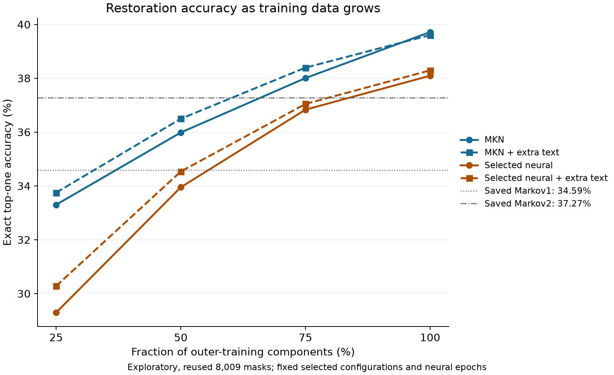

# Modern restoration on the preserved Paper 001 masks

Modified Kneser–Ney reaches 39.7178% exact top-one and 4.581891 bucket bits on all 8,009 masks. The highest top-one among the primary procedures is 41.1662% for `ensemble/extra1/loss`; the lowest native bucket loss is 4.347675 bits for `ensemble/extra1/loss`. These are Exploratory comparisons on a reused benchmark. [Aggregate results](aggregate-results.json), `models.*.summary`.

The saved population, artifacts, targets, components and folds reproduce exactly. The broader export links 144–159 existing benchmark training strings per fold to test strings through other observed faces. The matched comparison retains the required saved folds; extra text excludes all such connections. This limits an independence claim for the broader register. [Benchmark audit](benchmark-audit.json), `correspondence`; [graph audit](extra-graph-audit.json), `outer`.

## Accuracy, probability loss and calibration

Primary choices minimize three-inner-fold loss. Neural probabilities average three seeds. Native bucket loss uses each fitted training vocabulary; common-alphabet loss pools added codes back into the original full outer-training UNKNOWN event. Exact top-k uses fine-code identity. Five-bin ECE compares top-label mass with exact correctness.

| Procedure | Top-one % | Top-five % | Top-ten % | Native bits | Common bits | ECE % |
|---|---:|---:|---:|---:|---:|---:|
| Markov1, saved | 34.5861 | 58.4592 | 65.4264 | 5.119435 | 5.119435 | 2.5564 |
| Markov2, saved | 37.2706 | 58.8713 | 65.4514 | 5.247171 | 5.247171 | 4.3506 |
| MKN | 39.7178 | 61.6806 | 68.7601 | 4.581891 | 4.581891 | 5.2751 |
| GRU | 38.0946 | 61.1312 | 68.4355 | 4.604726 | 4.604726 | 3.2543 |
| Transformer | 34.1990 | 56.6238 | 64.3526 | 4.966507 | 4.966507 | 5.6137 |
| Conditioned neural | 38.5067 | 61.6931 | 68.5104 | 4.599931 | 4.599931 | 3.5384 |
| Log ensemble | 40.7916 | 63.4162 | 70.4457 | 4.390518 | 4.390518 | 2.2678 |
| MKN + extra | 39.6054 | 62.4048 | 69.2596 | 4.556616 | 4.282874 | 4.1888 |
| GRU + extra | 38.0322 | 61.8804 | 69.0348 | 4.561707 | 4.309755 | 1.8991 |
| Transformer + extra | 34.6860 | 57.3605 | 65.7510 | 4.874785 | 4.612094 | 4.8855 |
| Conditioned neural + extra | 38.6315 | 61.8429 | 69.0848 | 4.560452 | 4.318193 | 2.6181 |
| Log ensemble + extra | 41.1662 | 64.2652 | 70.9077 | 4.347675 | 4.092267 | 0.9805 |

Every table entry comes from `aggregate-results.json`, `comparators` or `models.<family>/extra<0|1>/loss.summary`. Configuration and inner candidate losses are in `fold_selection`; detailed probabilities remain local.

The benchmark-only GRU gives 38.0946% top-one and 4.604726 bits; the transformer gives 34.1990% and 4.966507 bits. Loss selection chooses MKN order 3 and discount scale 1 in all ten outer fold/regime combinations. The tables compare each family with the same saved first- and second-order queries.
Paired differences below are new minus saved comparator. Accuracy differences are percentage points, and loss differences are bits. Intervals use 2,000 paired component resamples with seed 23101. They condition on the fitted models and transcription population.

| Procedure | Comparator | Top-one difference [95% interval] | Native loss difference [95% interval] |
|---|---|---:|---:|
| MKN | Markov1 | +5.1317 [+4.2887, +5.9878] | -0.5375 [-0.5852, -0.4914] |
| MKN | Markov2 | +2.4472 [+1.8235, +3.1171] | -0.6653 [-0.7158, -0.6163] |
| GRU | Markov1 | +3.5086 [+2.6693, +4.3420] | -0.5147 [-0.5656, -0.4635] |
| GRU | Markov2 | +0.8241 [-0.1377, +1.7990] | -0.6424 [-0.7113, -0.5754] |
| Transformer | Markov1 | -0.3871 [-1.2642, +0.5172] | -0.1529 [-0.2240, -0.0828] |
| Transformer | Markov2 | -3.0715 [-4.1359, -1.9796] | -0.2807 [-0.3690, -0.1973] |
| Conditioned neural | Markov1 | +3.9206 [+3.0477, +4.7955] | -0.5195 [-0.5728, -0.4639] |
| Conditioned neural | Markov2 | +1.2361 [+0.2859, +2.1612] | -0.6472 [-0.7164, -0.5780] |
| Log ensemble | Markov1 | +6.2055 [+5.3988, +7.0157] | -0.7289 [-0.7705, -0.6867] |
| Log ensemble | Markov2 | +3.5210 [+2.7801, +4.2661] | -0.8567 [-0.9103, -0.8052] |
| MKN + extra | Markov1 | +5.0194 [+4.1143, +5.9370] | -0.5628 [-0.6123, -0.5142] |
| MKN + extra | Markov2 | +2.3349 [+1.6496, +3.0638] | -0.6906 [-0.7454, -0.6373] |
| GRU + extra | Markov1 | +3.4461 [+2.6415, +4.3219] | -0.5577 [-0.6115, -0.5031] |
| GRU + extra | Markov2 | +0.7616 [-0.1374, +1.7341] | -0.6855 [-0.7560, -0.6182] |
| Transformer + extra | Markov1 | +0.0999 [-0.7511, +0.9830] | -0.2447 [-0.3092, -0.1776] |
| Transformer + extra | Markov2 | -2.5846 [-3.6449, -1.5342] | -0.3724 [-0.4560, -0.2914] |
| Conditioned neural + extra | Markov1 | +4.0454 [+3.1873, +4.9311] | -0.5590 [-0.6143, -0.5056] |
| Conditioned neural + extra | Markov2 | +1.3610 [+0.4090, +2.3271] | -0.6867 [-0.7554, -0.6173] |
| Log ensemble + extra | Markov1 | +6.5801 [+5.7417, +7.4341] | -0.7718 [-0.8174, -0.7279] |
| Log ensemble + extra | Markov2 | +3.8956 [+3.1808, +4.6509] | -0.8995 [-0.9563, -0.8453] |

`models.*.paired.<comparator>.strata` also gives paired top-five, top-ten, common-alphabet loss and ECE intervals for every position and frequency stratum.

MKN improves accuracy and loss over both saved Markov comparators. Its ECE is 5.2751%, compared with 2.5564% for first order. The rare-target and boundary rows below locate that calibration cost. [Full MKN contrasts](aggregate-results.json), `models.classical/extra0/loss.paired`.

## Additional text and metadata

The observed export contains 5,680 faces. Complete, nonempty strings absent from the benchmark produce 1,533 extra candidate faces and 3,304 tokens. The graph uses every face, including unusable ones, to retain conservative transitive links. After excluding the held-out closure, one representative per extra string enters fitting. [Input audit](benchmark-audit.json), `extra_candidate_faces`, `extra_candidate_tokens` and `outer_extra`.

| Outer fold | Connected faces excluded | Faces retained | Face tokens retained | Distinct texts added | Tokens added | Short texts added | Multiline texts added |
|---|---:|---:|---:|---:|---:|---:|---:|
| 0 | 807 | 726 | 1777 | 504 | 1419 | 369 | 72 |
| 1 | 828 | 705 | 1760 | 503 | 1424 | 367 | 73 |
| 2 | 818 | 715 | 1767 | 506 | 1427 | 371 | 73 |
| 3 | 824 | 709 | 1763 | 501 | 1419 | 365 | 73 |
| 4 | 820 | 713 | 1763 | 502 | 1419 | 367 | 73 |

Inner fitting excludes the outer test closure and the inner validation closure. The independent breadth-first audit finds zero violations in all 5 outer and 15 inner allocations. Direction and multiline composition are recorded in `outer_extra[*].added_directions` and `added_multiline_texts`. Multiline faces use the export’s flattened reading order; uncertain line continuity can affect transfer.

| Family | Extra minus no-extra top-one, points [95% interval] | Native loss, bits [95% interval] | Common loss, bits [95% interval] |
|---|---:|---:|---:|
| MKN | -0.1124 [-0.5327, +0.2930] | -0.0253 [-0.0468, -0.0039] | -0.2990 [-0.3398, -0.2592] |
| GRU | -0.0624 [-0.6376, +0.5294] | -0.0430 [-0.0691, -0.0179] | -0.2950 [-0.3367, -0.2540] |
| Transformer | +0.4870 [-0.0377, +1.0084] | -0.0917 [-0.1150, -0.0690] | -0.3544 [-0.3954, -0.3149] |
| Conditioned neural | +0.1249 [-0.5009, +0.7537] | -0.0395 [-0.0655, -0.0127] | -0.2817 [-0.3204, -0.2421] |
| Log ensemble | +0.3746 [-0.1224, +0.8573] | -0.0428 [-0.0621, -0.0227] | -0.2983 [-0.3360, -0.2609] |

These are separately selected procedures within each training regime. Additional text can change vocabulary, contexts, domain and selected settings. Common-alphabet loss compares the same target events; the native loss also includes finer prediction events when the extra pool supports a previously unseen fine code. [Direct contrasts](aggregate-results.json), `direct_contrasts.*extra_minus_noextra`.

The conditioned model adds object type, site, region and motif together to the best unconditioned family selected inside each outer training set. It retunes duration on inner folds. The measurement concerns the joint predictive contribution of those fields and representative metadata; it does not isolate any single field.

| Text regime | Conditioned minus selected unconditioned top-one, points [95% interval] | Native loss, bits [95% interval] |
|---|---:|---:|
| Benchmark only | +0.4120 [-0.1645, +0.9707] | -0.0048 [-0.0271, +0.0157] |
| With extra | +0.5993 [+0.0507, +1.1660] | -0.0013 [-0.0228, +0.0194] |

## Data size and model capacity

The curve keeps the full-training inner-selected family, configuration and duration. Component subsets are nested at 25%, 50%, 75% and 100%; the extra pool stays fixed in the added-text regime. Each cell is exact top-one percent / native bucket bits.

| Training fraction | MKN | MKN + extra | Selected neural | Selected neural + extra |
|---|---:|---:|---:|---:|
| 25% | 33.3000 / 5.2277 | 33.7495 / 5.2081 | 29.2920 / 5.4165 | 30.2784 / 5.3788 |
| 50% | 35.9845 / 4.9434 | 36.4964 / 4.9040 | 33.9493 / 5.0414 | 34.5361 / 4.9813 |
| 75% | 38.0072 / 4.7214 | 38.3943 / 4.6864 | 36.8336 / 4.7669 | 37.0458 / 4.7314 |
| 100% | 39.7178 / 4.5819 | 39.6054 / 4.5566 | 38.0946 / 4.6047 | 38.2944 / 4.5726 |

[Learning-curve outputs](learning-curves.json), `models.*.summary`, contain OOV rates, strata, seed outcomes and exact training counts. Loss pooling changes as subset vocabularies grow, so these loss values do not by themselves identify a ceiling.

| Procedure | 100% minus 75% top-one, points [95% interval] |
|---|---:|
| MKN | +1.7106 [+1.0908, +2.3346] |
| MKN + extra | +1.2111 [+0.6420, +1.7887] |
| Selected neural | +1.2611 [+0.6018, +1.9207] |
| Selected neural + extra | +1.2486 [+0.6200, +1.9072] |

The 75%-to-100% accuracy increment is positive in 4 of four curves; its interval is entirely above zero in 4. These final increments directly answer whether performance is still rising under the declared procedure.

A positive final increment supports acquiring more suitable training data for the tested procedure. Neural training also takes more optimizer steps at larger subsets because the number of epochs stays fixed. The curve therefore combines data size with that training budget. The full benchmark has 205 singleton target types, all unseen in their benchmark-only training folds. They receive zero exact credit under a training-only candidate alphabet. [Frequency strata](aggregate-results.json), `models.classical/extra0/loss.summary.frequency_strata.1`.

Configuration comparisons below pool inner losses across the five outer training sets, weighting by their query counts. They compare the declared small and larger configurations before outer evaluation.

| Family | Regime | Small parameters | Larger parameters | Small inner bits | Larger inner bits |
|---|---|---:|---:|---:|---:|
| GRU | Benchmark | 130,013–135,417 | 654,365–665,145 | 4.811001 | 4.859391 |
| GRU | Extra | 154,331–160,121 | 702,875–714,425 | 4.763605 | 4.785829 |
| Transformer | Benchmark | 128,669–132,281 | 387,997–395,193 | 5.896250 | 5.363678 |
| Transformer | Extra | 144,923–148,793 | 420,379–428,089 | 5.801678 | 5.221172 |

Parameter ranges reflect the inner training vocabularies. The GRU comparison changes width and depth together; both transformer configurations use two layers.

Transformer early stopping selects the maximum 45 epochs in 119 of 180 inner seed fits. That cap leaves longer-training behavior untested. The tested widths and curves support a bounded comparison of these models and data; they do not establish an information-theoretic limit or the best possible neural architecture. [Training diagnostics](training-diagnostics.json), `groups`.

## Position, frequency and seed spread

The table shows benchmark-only MKN. The aggregate file gives the same fields and paired differences against both comparators for every procedure. Frequency bins use target counts across the whole 8,009-query benchmark.

| Stratum | Queries | Top-one % | Top-five % | Top-ten % | Bits | ECE % |
|---|---:|---:|---:|---:|---:|---:|
| position/initial | 1596 | 21.7419 | 47.5564 | 53.6341 | 6.058616 | 10.1927 |
| position/internal | 4817 | 39.5474 | 61.6151 | 69.8568 | 4.519297 | 5.5279 |
| position/final | 1596 | 58.2080 | 76.0025 | 80.5764 | 3.294085 | 3.5113 |
| frequency/1 | 205 | 0.0000 | 0.0000 | 0.0000 | 14.673334 | 30.6532 |
| frequency/2-4 | 412 | 2.4272 | 7.5243 | 12.6214 | 11.114137 | 28.4093 |
| frequency/5-19 | 991 | 12.7144 | 28.5570 | 36.2260 | 7.595225 | 21.0426 |
| frequency/20+ | 6401 | 47.5707 | 72.2700 | 79.6126 | 3.371729 | 2.2670 |

| Neural procedure | Seed top-one range, % | Seed loss range, bits |
|---|---:|---:|
| GRU | 36.4715–37.0333 | 4.803251–4.834740 |
| Transformer | 33.0378–33.3750 | 5.118415–5.170519 |
| Conditioned neural | 36.7711–37.1832 | 4.828482–4.837968 |
| GRU + extra | 36.7961–37.1957 | 4.748437–4.776849 |
| Transformer + extra | 32.9879–34.7859 | 4.978441–5.094921 |
| Conditioned neural + extra | 36.9210–37.4079 | 4.759485–4.798948 |

The main neural scores average probabilities; the seed range reports individual fitted seeds. Neither range refits vocabulary, fold construction or configuration selection.

## Secondary accuracy selection

| Procedure | Loss-selected top-one % / bits | Top-one-selected top-one % / bits |
|---|---:|---:|
| MKN | 39.7178 / 4.581891 | 39.5305 / 4.592913 |
| GRU | 38.0946 / 4.604726 | 38.4068 / 4.616828 |
| Transformer | 34.1990 / 4.966507 | 34.1990 / 4.966507 |
| Conditioned neural | 38.5067 / 4.599931 | 38.5067 / 4.599931 |
| Log ensemble | 40.7916 / 4.390518 | 40.6917 / 4.397472 |
| MKN + extra | 39.6054 / 4.556616 | 39.4306 / 4.573877 |
| GRU + extra | 38.0322 / 4.561707 | 38.2320 / 4.562323 |
| Transformer + extra | 34.6860 / 4.874785 | 34.6860 / 4.874785 |
| Conditioned neural + extra | 38.6315 / 4.560452 | 38.6315 / 4.560452 |
| Log ensemble + extra | 41.1662 / 4.347675 | 40.9040 / 4.376544 |

Secondary selection changes the configuration or ensemble weight using inner accuracy; neural epoch selection remains loss-based. [Secondary outputs](aggregate-results.json), `models.<family>/extra<0|1>/top1` and `fold_selection`.

## Verification, precedents and the carry-forward model

The scalar review reconstructs all stored classical probabilities in 13 distinct outer configurations, with brute-force complete-sequence checks on sampled corpus queries. It reproduces 102 neural seed checkpoints and checks hidden-query inputs throughout the test population. Independent multiplication and normalization reconstruct 14 ensemble arrays, including the repaired disk-interruption output. Toy cases cover every n-gram order, all boundary positions, continuation counts, normalization and neural padding. [Verification](verification.json), `classical`, `neural`, `ensemble` and `self_tests`. External review remains pending.

The literature comparisons are in [RELATED-WORK.md](RELATED-WORK.md). Yadav’s 74% is 90%-mass candidate coverage; Venkatesh and Farghaly’s 63% is top-ten; Tiwari’s 2.60 is next-token perplexity. Ithaca and Aeneas restore spans in known languages, while the Linear B study tests a small recurrent model and finds negative transfer in its synthetic-gap assay. Their outcome definitions prevent a direct cross-paper ranking.

The single frozen carry-forward recipe is `ensemble`, extra text `True`, selected from pooled inner loss 4.523950 bits. Modal configurations and median selected epochs determine its full-data fit. The manifest records 2233 training texts and 9744 tokens, hashes, counts/weights and seeds. The adaptive outer procedure’s score is separate from this final full-data recipe. [Frozen record](frozen-model/manifest.json), `chosen`, `recipe`, `files`; [training identities](frozen-model/training-register.json). Future targets must be acquired and screened before testing it without retuning.

The frozen loader verifies all payload and fitting-code hashes. Its sample of 3 strings covers 21 masks. Fixed-batch hidden replacement leaves every sampled probability exactly unchanged. Changing batch size produces a maximum rounding difference of 6.99e-08. The first mixed-batch record remains preserved. [Refined verification](frozen-inference-v2-verification.json), [dated verification amendment](VERIFICATION-AMENDMENT-2026-10-07.md).

Counts, weights, query predictions, source downloads and extracted source text stay in the assigned local raw directory. Rights for the derivative corpus remain unresolved. Source identity, access failures and the successful Aeneas author-PDF route are in [sources.json](sources.json).
