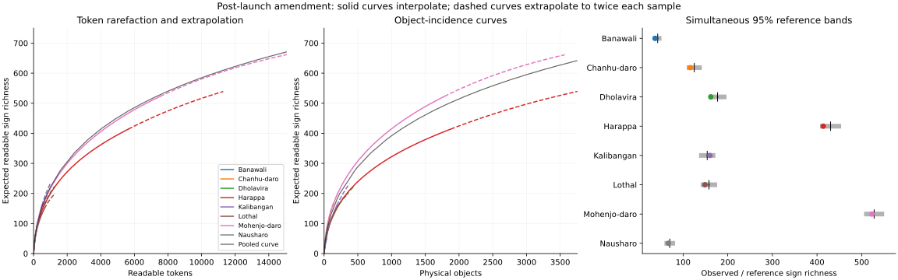
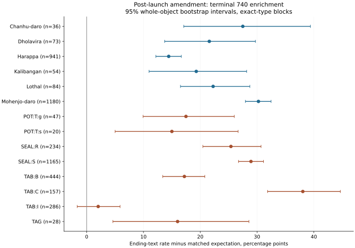

# Sign frequency, motif concentration and seal dimensions

Sign 740 accounts for 1,928 of 19,946 observed positions (9.67%), or 10.67% of 18,067 readable positions. Its frequency differs across object types, but the site comparison after conditioning on object type gives p = 0.4896 and q = 0.5379. Among the ten most frequent signs, only 032 retains a site association after correction (q = 0.002). Under the frozen area reference law, sign 520 passes correction (q = 0.044; minimum and maximum compiled areas give q = 0.044 and 0.047), but fails without Harappa and Mohenjo-daro (q = 0.387) and under the amended whole-object law (q = 0.223). Known square-seal motifs are concentrated: 1,246 of 1,609 are unicorns (77.44%), with HHI = 0.6054. Unicorn texts average 0.7752 positions longer than texts on rare motifs, conditional on site and object type (q = 0.0012). Complete square-seal sizes have CV = 0.2886; larger faces carry more text, with a fitted increase of 1.1590 positions per doubling of face area (q = 0.0002). Each result is detailed below with its denominator and output field.

Status: **Verified computation** for arithmetic and deterministic rerun; **Frozen evaluation** for the original specified endpoint; **Exploratory** for the dated sensitivity and supplemental coverage analyses. The independent [Sonnet review](REVIEW.md) reproduced the endpoints and sampled their sources. The post-review area expansion remains Exploratory.

## Observations and reference laws

The pinned export has 5,680 faces, 1,879 unreadable positions and 4,695 physical components. Unioning `object_family_id` and unambiguous CISI side aliases adds no new cross-family component in this export. Five nonblank ambiguous references remain unresolved. No component has conflicting site or object-type labels. Inference uses the longest face per component, breaking ties by record identifier; seal comparisons choose the longest seal face in each component. This yields 2,239 seal components. Repeated texts on separate objects remain separate observations because text repetition is an outcome. Counts, hashes and selection totals are in [input-summary.json](run-2026-10-07-01/input-summary.json), fields `faces` through `unresolved_nonblank_cisi`; object identities and selection audits remain local-only.

The [protocol](PROTOCOL.md) preceded computation and fixes the ten signs, source table, family rule, 9,999 permutations, 2,000 bootstrap draws and correction families. Whole objects retain their sign sequences and metadata in resampling. Site labels move within exact object-type blocks; motif labels move within site and exact object type. These are conditional exchangeability assumptions about the acquired objects. All sign values here are graphic catalogue codes; the tests establish no sound, meaning or owner identity. Excavation and cataloguing selection can violate an archaeological interpretation of those assumptions. The binomial regressions describe the acquired counts with object-type fixed effects and site-cluster standard errors; permutation supplies the reported association tests. The [amendment](AMENDMENT-2026-10-07.md) records both post-outcome changes before their computation.

The package reused ROOT-09's context work, `src/context_study.py`'s family and principal-face approach, the checked reading-order convention in `research/corpus/orientation_clarification.json`, and Paper 002's treatment of related records. It inspected the earlier classifier endpoint `results/context/confirmatory/bull1_other.json`: 1,086 objects, 1,020 artifact/string groups, gain −0.062575 nats per object and permutation p = 0.8055. That predictive endpoint was not rerun. The present text statistics answer different questions and use physical grouping without merging distinct objects by repeated text.

## Sign frequency, site area and site function

All-face frequencies preserve the lecture's denominator. The intervals below resample complete physical components within a site; the component count includes components whose faces have no readable sign. All sites and all ten signs appear in [site-frequencies.json](run-2026-10-07-01/site-frequencies.json), fields `count`, `readable_positions`, `components` and `component_bootstrap_95_ci`.

| Site | Components | 740 / readable positions | Frequency | 95% component bootstrap interval |
|---|---:|---:|---:|---:|
| Harappa | 1,921 | 779 / 7,178 | 10.85% | 10.27–11.38% |
| Mohenjo-daro | 1,795 | 844 / 7,809 | 10.81% | 10.27–11.34% |
| Dholavira | 230 | 63 / 637 | 9.89% | 7.68–12.32% |
| Kalibangan | 197 | 57 / 513 | 11.11% | 8.78–13.66% |
| Lothal | 182 | 72 / 680 | 10.59% | 8.71–12.50% |
| Chanhu-daro | 72 | 30 / 324 | 9.26% | 6.87–11.89% |
| Nausharo | 38 | 11 / 131 | 8.40% | 5.11–12.08% |
| Banawali | 26 | 5 / 62 | 8.06% | 1.82–15.52% |

Small zero-count samples can have degenerate empirical bootstrap intervals. They cannot establish an absent sign population. Principal-face object types also have different 740 proportions: square seals 763/7,336 (10.40%), `TAB:B` 348/2,480 (14.03%), `TAB:I` 219/1,318 (16.62%), `TAB:C` 114/901 (12.65%), rectangular seals 151/1,638 (9.22%) and `POT:T:g` 94/911 (10.32%). The analysis retains the export's object categories. See [sign-analysis.json](run-2026-10-07-01/sign-analysis.json), `object_type_frequencies`.

The site omnibus uses 4,613 readable principal objects across the export, and scores nine labels with at least 20 such objects, including `Unknown`. The table gives Benjamini–Hochberg q across ten signs. It also gives the amended size test, which keeps areas fixed and moves whole object site labels within type blocks. See `site_omnibus.tests` in `sign-analysis.json` and `site_size_grouped_permutation.3.tests` in [results.json](exploratory-2026-10-07-01/results.json).

| Sign | Site p | Site q | Area correlation, 17 sites | Amended area q |
|---|---:|---:|---:|---:|
| 740 | 0.4896 | 0.5379 | 0.0836 | 0.9494 |
| 002 | 0.0358 | 0.0974 | 0.1208 | 0.9494 |
| 032 | 0.0002 | 0.0020 | 0.4559 | 0.3903 |
| 700 | 0.0487 | 0.0974 | 0.2337 | 0.9494 |
| 033 | 0.0327 | 0.0974 | −0.0603 | 0.9500 |
| 400 | 0.0418 | 0.0974 | 0.2834 | 0.9494 |
| 220 | 0.1010 | 0.1683 | 0.2317 | 0.9494 |
| 240 | 0.1325 | 0.1893 | 0.5479 | 0.3903 |
| 520 | 0.2102 | 0.2628 | 0.6642 | 0.2230 |
| 390 | 0.5379 | 0.5379 | 0.0123 | 0.9768 |

For 032, Chanhu-daro has 21 occurrences against 7.633 expected from its types, while Kalibangan has 10 against 20.159. The contrast measures the distribution of a graphic sign across sites. The exact residuals are in `sign-analysis.json.site_residuals`, rows for sign 032.

The sourced area table contains 18 sites. Seventeen qualify for the size comparison, contributing 4,427 readable principal objects; Ganweriwala has only two. Ten of the 17 sites have fewer than 20 readable objects. Published anchors, qualifiers, source locations and functional classifications are in [site-table.json](site-table.json); join counts are in `sign-analysis.json.sourced_site_eligibility`.

| Site | Reference area, ha | Other compiled anchors / qualifier | Site type | Readable principal objects | Sources |
|---|---:|---|---|---:|---|
| Harappa | 150 | Open lower bound | Urban centre | 1,877 | K1997, K2005 |
| Mohenjo-daro | 250 | 100–250; 250 is open lower bound | Urban centre | 1,784 | K1997, K2005, S2019 |
| Dholavira | 100 | Estimate | Urban centre | 219 | K1997, K2005 |
| Rakhigarhi | 80 | Open lower bound; criteria uncertain | Urban centre | 12 | K1997, S2019 |
| Ganweriwala | 80 | Open lower bound; excluded from model | Urban centre | 2 | K1997 |
| Kalibangan | 11.5 | 11.5–12.1 | Town | 189 | S2019, K2005 |
| Lothal | 7.5 | 7–7.5; differing extent definitions | Port | 181 | K2005, U2014 |
| Chanhu-daro | 6 | Settlement estimate; see source note | Craft settlement | 70 | K2005 |
| Farmana | 18 | Calculation criteria uncertain | Town | 7 | S2019 |
| Alamgirpur | 1 | Estimate | Rural settlement | 3 | S2019 |
| Amri | 8 | Estimate | Function unverified | 5 | K2005 |
| Allahdino | 1 | Estimate | Function unverified | 12 | K2005 |
| Kot-Diji | 1 | Estimate | Function unverified | 10 | K2005 |
| Rupar | 3.5 | Estimate | Function unverified | 3 | K2005 |
| Bala-kot | 4 | Estimate | Function unverified | 7 | K2005 |
| Surkotada | 2.6 | Estimate | Function unverified | 6 | K2005 |
| Nausharo | 4 | Estimate | Function unverified | 38 | K2005 |
| Rodji, source Rojdi | 5.3 | Estimate | Function unverified | 4 | K2005 |

K1997 is Kenoyer's printed p. 54/Table 4.2. S2019 is Suryanarayan's printed p. 87/Table 4.1, supplemented by the Kalibangan description on printed p. 122. K2005 is Kenoyer's settlement-hierarchy paragraph in Treccani, supplemented by Vidale's **Chanu daro** section for craft production. U2014 is the Lothal tentative-list Description, first paragraph. Full titles, authors, venues, URLs and access status are in [sources.json](sources.json). The [source notes](SOURCE-NOTES.md) distinguish visible bounding extent from settlement area and record the post-outcome heading correction. The area spans are published numerical anchors, not statistical intervals; the open bounds have no established maximum.

All 30 binomial fits converge. For 740, the object-adjusted area coefficient is 0.01409 per doubling of area, an odds ratio of 1.0142, with descriptive site-cluster SE 0.01649. Adding site type changes that coefficient to 0.07686 (SE 0.06048). The data have one port, one craft-class site and one rural-class site, with only three readable objects at the rural site. Type coefficients therefore describe these selected sites and cannot estimate a general port or craft effect. The fits, numerical penalty and design ranks are in `sign-analysis.json.binomial_models`.

The original area-vector permutation gives 520 correlation 0.6642, p = 0.0044 and q = 0.044. Its minimum/maximum compiled-area checks have q = 0.044/0.047, but excluding Harappa and Mohenjo-daro raises q to 0.387. The amended whole-object law gives p = 0.0223 and q = 0.223 for the same 17-site statistic. Restricting to seven sites with at least 20 readable objects gives 520 q = 0.5275, and every sign has q ≥ 0.5275. Thus the package does not retain a corrected area claim. Better tests require contemporaneous mapped occupation areas and additional independently sampled objects at small sites; adding another label to the existing tiny samples would not resolve the precision problem.

## Motif concentration and text differences

All known seal motifs have unicorn share 75.54% (1,248/1,652) and HHI 0.5776; 587 of the 2,239 seal components have unknown or absent motifs. Square seals have 127 such records, leaving 1,609 known motifs, 34 categories and HHI 0.6054, equivalent to 1.652 equally abundant categories. The unicorn share's Wilson interval is 75.33–79.41%. The next square-seal categories are Gaur 85, Zebu 57, Elep 41, Bull 33, Rhin 25, Tigr 17 and Buff 15. The complete rank–abundance vectors, shares and intervals are in [motif-concentration.json](run-2026-10-07-01/motif-concentration.json), rows selected by `population`, `level` and `group`.

| Square-seal site | Known motifs | Unicorns | Unicorn share | HHI |
|---|---:|---:|---:|---:|
| Chanhu-daro | 50 | 41 | 82.00% | 0.6808 |
| Dholavira | 72 | 59 | 81.94% | 0.6763 |
| Harappa | 286 | 247 | 86.36% | 0.7487 |
| Kalibangan | 41 | 28 | 68.29% | 0.4789 |
| Lothal | 40 | 35 | 87.50% | 0.7700 |
| Mohenjo-daro | 1,019 | 779 | 76.45% | 0.5917 |

Each of these six adequately sampled sites has a unicorn majority and minority motifs. Regional square-seal samples show Gujarat/Kutch 103/123 unicorns (HHI 0.7044), Inter-Riverine 277/332 (0.6993), and Lower Indus 845/1,099 (0.5982). Eastern Headwaters has 9/27 and falls below the protocol's 30-object comparison threshold. These are export region labels, with full rows in the same output.

Harappa's raw period labels give Period 3B/C 59/70 unicorns, 3C-1 25/34, 3C-2 35/35 and 3C-3 33/34. The 3C-2 sample contains 35 unicorns and no recorded minority motif; its label shares the same broad 2200–1900 BCE interval as the other 3C subphases. Ambiguous labels remain separate, and the unspecific period records cannot provide an ordered civilization-wide trend. The output also contains the predeclared coarse 3C grouping, with its component count. The concentrated distribution supports the measurable part of Frenez's description. Workshop dominance, institutional selection and uneven excavation can also produce these shares. Production provenance, carving-style clusters and find-context denominators would distinguish those explanations.

The clean-text comparison includes 910 unicorn objects and 155 rare-motif objects. A rare category has less than 5% of all 1,652 known seal components; Gaur is above that threshold and is omitted from the rare cohort. Texts must be complete observed, single-line, have a specified direction and contain no unreadable code. The permutation has 33 site/type blocks, 14 containing both labels and 1,036 movable objects. The shared sign coding and reading-order convention are held fixed.

| Outcome | Unicorn | Rare motifs | Difference or divergence | Primary q |
|---|---:|---:|---:|---:|
| Mean positions | 4.7945 | 4.0194 | +0.7752 | 0.0012 |
| Sign inventory | 416 | 167 | +249 | 0.3031 |
| Distinct texts / objects | 853/910 | 149/155 | −0.02393 | 0.4275 |
| Sign-token distribution, JS bits | Joint comparison | Joint comparison | 0.146319 | 0.0033 |
| Initial-sign distribution, JS bits | Joint comparison | Joint comparison | 0.340463 | 0.2178 |
| Terminal-sign distribution, JS bits | Joint comparison | Joint comparison | 0.170754 | 0.0832 |

All counts and tests are in [motif-association.json](run-2026-10-07-01/motif-association.json), `primary_rare.unicorn`, `primary_rare.other` and `primary_rare.tests`. Raw inventory differences reflect unequal cohort sizes; the grouped references retain those sizes. Distinct-text rate means the number of distinct sequences divided by objects, rather than the proportion of objects with singleton texts.

The exploratory length-conditioned law adds exact recorded length to site/type blocks. It leaves 871 objects movable in 29 mixed blocks. Sign-token divergence then has p = 0.0813 and q = 0.20525 across five variable outcomes; the length difference is invariant by construction. This analysis does not demonstrate a motif-specific sign distribution beyond length. See `results.json.motif_length_conditioned`, in the separately saved [corrected-label copy](post-review-2026-10-07-01/results-corrected-label.json). Only its nested status was changed to **Exploratory**; the source file remains untouched.

Within-site comparisons qualify at Harappa (158 unicorn/19 rare), Kalibangan (16/7) and Mohenjo-daro (605/99). Mean-length differences are 1.3598, 2.3750 and 0.4072 positions respectively. No one of the 18 site/outcome tests survives joint correction; the minimum q is 0.0885. This leaves site-specific effects unresolved. Including all non-unicorn motifs yields 229 objects averaging 4.3712 positions: its length comparison has p = 0.0138 and q = 0.0828. The corrected global length result therefore applies to the declared rare cohort. Carving-style assignments and larger minority cohorts at individual sites would test whether it reflects workshops or specific social uses.

## Seal size and standardization

Of 1,736 square-seal components, 1,565 have positive horizontal millimetres, 1,490 positive vertical millimetres and 573 a positive scalar thickness. Both face dimensions are present for 1,451. Exactly 1,027 of these have preservation labelled `complete`, forming the primary sample. Zero is treated as missing; thickness ranges remain nonnumeric. Supplemental coverage of all 2,239 seal components gives 1,904 positive horizontal, 1,879 positive vertical and 734 scalar thickness measurements. Rectangular seals have both face dimensions for 305/380 objects. See [dimensions.json](run-2026-10-07-01/dimensions.json), `positive_dimensions`, `preservation_counts`, and [dimension-coverage.json](supplement-2026-10-07-01/dimension-coverage.json), `dimension_missingness` and `type_groups`.

Characteristic square-seal size is the square root of horizontal times vertical millimetres. Complete seals have mean 26.3305 mm, SD 7.5989, CV 0.2886 and median 25.4 mm. The interquartile range is 21.4896–30.2 mm; the full positive range is 8.2244–68.6 mm. Including all preservation states gives n = 1,451 and CV 0.2863. Exact quantiles, both dimension distributions, area summaries and 2 mm histograms are in `dimensions.json.groups`.

| Complete square-seal site | n | Mean characteristic size, mm | CV |
|---|---:|---:|---:|
| Harappa | 173 | 27.9751 | 0.3262 |
| Mohenjo-daro | 639 | 26.4484 | 0.2811 |
| Dholavira | 45 | 23.5657 | 0.1860 |
| Kalibangan | 32 | 24.9720 | 0.2108 |
| Lothal | 35 | 24.9347 | 0.2392 |
| Chanhu-daro | 44 | 26.7921 | 0.2752 |
| Nausharo | 10 | 26.7963 | 0.1438 |
| Banawali | 13 | 20.1369 | 0.3817 |

No site with at least ten observations meets the protocol's operational CV ≤ 0.10 narrow-size criterion. Motif CVs include unicorn 0.2892 (n = 787), Gaur 0.2099 (57), Elep 0.1893 (24), Zebu 0.2405 (26) and Rhin 0.3367 (20). The unicorn–rare CV difference is 0.01316, p = q = 0.6459, with 787/137 objects. Harappa's better sampled periods have CV 0.2691 for 3B/C (35), 0.2614 for 3C-1 (23), 0.2896 for 3C-2 (22) and 0.2494 for 3C-3 (23). These records describe a broad size population. Separate size classes, shape conventions and standardized carving practices remain compatible with that result. Rounded catalogue conversions also affect apparent modes, as documented in `SOURCE-NOTES.md`.

The fitted length increase per doubling of square-seal face area is 1.1590 positions after adjustment for site and pooled motif, using all 1,027 complete measured objects. Permuting length within site/motif/type blocks leaves 963 objects movable and gives zero exceedances in 9,999 draws: p = 0.0001, q = 0.0002 across the two dimension tests. The ordinary OLS SE is 0.08080 and unadjusted Spearman correlation is 0.4357; those are descriptive. See `dimensions.json.tests`, outcome `length_per_doubling_area_adjusted_site_motif`. Larger usable faces and longer texts are associated in the export. A production-standardization test needs calibrated original measurements, size-class hypotheses defined before fitting, preservation checks and workshop/style assignments.

## Relation to published work and source gaps

Nisha Yadav's 2013 *Sensitivity of Indus Script to Site and Type of Object*, **Scripta** 5:67–103, directly precedes the site/object question. Its acquired PDF, especially printed pp. 67–71 and 75–76, motivates keeping those contexts separate. Michael Philip Oakes's *Statistical Analysis of the Tables in Mahadevan’s Concordance of the Indus Valley Script*, online 2017 and **Journal of Quantitative Linguistics** 26(1), 2019:22–47, directly addresses inscription/iconography relations in section 4, Tables 7–10 and Figure 6. These package results extend an established question to this export and physical-object reference laws; they establish no priority claim. See sources Y2013 and O2019 in [sources.json](sources.json).

Dennys Frenez's 2018 *Private Person or Public Persona? Use and Significance of Standard Indus Seals as Markers of Formal Socio-Economic Identities*, in **Walking with the Unicorn**, proposes the oligopoly/social-identity interpretation. The inspected preview, pp. 186–188, attributes an approximate 65% **multi-site average** to Marta Ameri's 2013 study. The newly opened chapter, *Regional Diversity in the Harappan World: The Evidence of the Seals*, in **Connections and Complexity: New Approaches to the Archaeology of South Asia**, pp. 355–374, compares six sites (Table 19.1, printed p. 361). Our 77.44% pools known square motifs in this export. The earlier attribution of size/style discussion to Frenez p. 167 is withdrawn because that page was not preserved in the inspected witness. His published persistence discussion spans more than six centuries. Adam Stuart Green's 2021 *Killing the Priest-King: Addressing Egalitarianism in the Indus Civilization*, **Journal of Archaeological Research** 29:153–202, discusses seals, corporate groups and social organization. Their political interpretations need the independent context and production evidence identified above. See F2018 and G2021, including their precise access notes.

Jonathan Mark Kenoyer's *Indus Seals: An overview of Iconography and Style*, **Ancient Sindh** 9, issue 2006–2007:7–30, supplies the seal-production/style context; the downloaded filename says 2009, so the bibliographic issue and filename are recorded separately. Marta Ameri and Gregg Jamison's 2022 *Mixed Methodologies: Collaborative Approaches to Indus Tiger Seals*, **South Asian Studies** 38(1):69–99, and Jamison and colleagues' 2017 *Inscribed Unicorn Seals from Bagasra, Gujarat: A Comparative Analysis of Morphology, Carving Styles, and Distribution Patterns*, **Heritage** 5:1–21, identify relevant style-based approaches. Their full texts were not reviewed here. Ayumu Konasukawa and Manabu Koiso's 2018 chapter *The Size of Indus Seals and its Significance* is a direct size precedent found in contents; its full analysis remains unverified. These gaps prevent a claim that the present CV analysis differs from those methods. See Koverview, A2022, J2017 and KK2018.

Rajesh P. N. Rao and colleagues' 2009 *A Markov model of the Indus script*, **PNAS** 106(33):13685–13690, concerns sequence structure. Rao's 2018 *The Indus Script and Economics. A Role for Indus Seals and Tablets in Rationing and Administration of Labor*, **Walking with the Unicorn**, pp. 518–525, proposes economic uses. The requested separate Rao et al. motif–text precedent was not bibliographically verified in the bounded search. Bahata Ansumali Mukhopadhyay's 2019 *Interrogating Indus inscriptions to unravel their mechanisms of meaning conveyance*, **Palgrave Communications** 5:73, and 2023 *Semantic scope of Indus inscriptions comprising taxation, trade and craft licensing, commodity control and access control: archaeological and script-internal evidence*, **Humanities and Social Sciences Communications** 10:972, propose functional interpretations. The present context tests do not discriminate among those semantic proposals. See R2009, R2018, B2019 and B2023.

Mahesh T C's 2026 arXiv:2604.23582v1, *Evidence for a Scale-Free Commercial Network in the Indus Valley Civilization: A Power Law Analysis of Harappan Seal Data*, interprets offering-stand distributions as commercial networks. The current abstract carries the changed title *Asynchronous Barter, Periodic Reconciliation: Evidence for a Scale-Free Commercial Network in the Indus Valley Civilization*. The local witnesses distinguish v1 full HTML from the current abstract. The export's Bull1 suffixes have not been mapped to offering-stand classes, so this package cannot reconstruct that network or test its power law. Motif concentration is a different descriptive quantity. See M2026v1 and M2026current.

The 18 source records give exact URLs, opened-versus-snippet status and local witness hashes. Failed downloads include the Dholavira nomination page (403), Frenez's direct preview (403), Ameri's publisher page (403), a settlement-area PDF with connection reset, and an empty publisher-contents response. The report uses no area from those failures. Remaining source gaps concern matched occupation boundaries, full carver/style chapters and the unidentified Rao motif item. All acquired third-party payloads remain in the ignored local raw directory.

## Computation checks

An exact second run reproduces the hashes of all five analytical outputs. [checks-2026-10-07-01.json](checks-2026-10-07-01.json) records 106 passing checks, zero failures and 82 tail probabilities independently recomputed from saved local reference arrays. Checks reconstruct token totals, grouping counts, square-motif counts, HHI and complete-seal CV, exercise transitive aliases, preserve block counts and verify the invariant length-conditioned statistic. [final-checks-2026-10-07-01.json](final-checks-2026-10-07-01.json) adds 43 passes, including 26 exploratory tails, an independent SciPy check of every correction family and a byte-identical supplement rerun. The combined count is 149 passes and zero failures. Commands for a fresh reviewer run and source sampling are in [README.md](README.md). These checks certify reproducibility and arithmetic within the recorded assumptions; the source and archaeological checks remain separate.

## Post-launch amendment: lecture comparisons, 7 October

Status: **Exploratory, post-launch amendment**. The coordinator's [caption check](../2026-10-06-research-program/frenez-talk-check.md) supplies the numerical claims at 28:45–30:40 and the motif claims at 41:30–43:30. The [dated amendment](AMENDMENT-2026-10-07-LECTURE.md) specifies these tests before their computation. [sources-followup-2026-10-07.json](sources-followup-2026-10-07.json) distinguishes the coordinator's caption review, opened publications, software witnesses and blocked sources. The five new files under `post-launch-2026-10-07-02/` carry an explicit stage field; none replaces an earlier endpoint.

### 1. Inventories and the shared sample-size curve

Mohenjo-daro has 523 readable codes on principal objects and 545 across all faces; Harappa has 414 and 432 respectively. The local corpus therefore matches the lecture's greater-than-500 band at Mohenjo-daro, while Harappa's observed inventory falls below it. The source corpus, classification and acquisition extent differ, so this comparison does not check the completeness of Wells's original inventory. Dholavira, Kalibangan, Lothal and Chanhu-daro principal inventories are 162, 160, 149 and 116. Alamgirpur, the frozen table's only rural-class site, has three codes from six readable tokens on three objects. Its sample cannot evaluate a rural inventory of 20–50.

[richness.json](post-launch-2026-10-07-02/richness.json), `sites[]`, gives abundance and object-incidence rarefaction/extrapolation curves for every site with readable principal objects, together with all-face richness and the frozen site area/type join. Chao lower-bound extrapolation to twice Harappa's sample gives 538.98 codes by tokens and 539.22 by objects; Mohenjo-daro gives 661.86 and 661.22. These fitted curves estimate additional unseen codes. The asymptotic lower-bound estimates are especially sensitive to singleton counts; the report uses the bounded curves rather than treating those estimates as complete ancient inventories. Source CH2014, Tables 1–2, and the INEXT code witness record the formulas.

The shared-reference test includes 4,613 readable principal objects across 77 labels. It moves whole object site labels within 160 exact type/readable-length blocks, leaving each site's object and readable-token counts unchanged. There are 4,323 movable objects. Eight geographic sites meet the 20-object testing threshold; `Unknown` remains descriptive. Corrected results are in `richness.json.comparison.tests`.

| Site | Principal objects | Readable tokens | Observed richness | Shared-reference mean | BH q |
|---|---:|---:|---:|---:|---:|
| Banawali | 25 | 62 | 37 | 43.03 | 0.1779 |
| Chanhu-daro | 70 | 316 | 116 | 124.93 | 0.3358 |
| Dholavira | 219 | 623 | 162 | 177.15 | 0.1779 |
| Harappa | 1,877 | 5,642 | 414 | 430.40 | 0.1779 |
| Kalibangan | 189 | 495 | 160 | 153.99 | 0.4913 |
| Lothal | 181 | 642 | 149 | 157.91 | 0.3358 |
| Mohenjo-daro | 1,784 | 7,538 | 523 | 527.91 | 0.5876 |
| Nausharo | 38 | 131 | 67 | 70.13 | 0.5702 |

No site is outside the simultaneous 95% reference bands, and none has q < 0.05. Dholavira is below its pointwise 163–192 reference interval, but remains inside its simultaneous 157.11–197.19 band. The test does not reject the declared pooled sample-size/type/length law. Harappa and Mohenjo-daro supply about 79% of its reference objects ([review check3](review/check3-post-launch.json), `reservoir_share`), limiting sensitivity to departures by those two dominant contributors. Site inventory richness and the separate sign-032 frequency association describe different measurements in these excavation-selected samples.

The pooled curves in the figure are descriptive; the third panel uses the conditional type/length reference. Dashed portions extrapolate to twice each site's observed sample. Every site's numerical curve, including small sites that are not individually tested, remains in the JSON.

### 2. Concentration under different corpus views

The closest all-face readable comparison gives 740 at 10.67%, the top three readable codes at 18.64%, the top six at 27.51% and the top twenty at 48.76%. These differ from the lecture's 10/20/30/50 figures by +0.67, −1.36, −2.49 and −1.24 percentage points. Removing repeated full sequences leaves 3,504 unique texts, compared with 5,680 faces. Each view ranks its readable codes independently; deduplication precedes removal of unreadable positions. Exact counts and code sets are in [concentration.json](post-launch-2026-10-07-02/concentration.json), `views[]` and `top_readable_codes`.

| View and denominator | Positions | 740 | Top 3 readable codes | Top 6 | Top 20 |
|---|---:|---:|---:|---:|---:|
| All faces, all positions | 19,946 | 9.67% | 16.89% | 24.92% | 44.17% |
| All faces, readable positions | 18,067 | 10.67% | 18.64% | 27.51% | 48.76% |
| Principal objects, all positions | 17,808 | 10.30% | 17.65% | 24.51% | 43.29% |
| Principal objects, readable positions | 16,164 | 11.35% | 19.45% | 27.00% | 47.69% |
| Unique full texts, all positions | 14,530 | 9.12% | 16.62% | 22.88% | 42.26% |
| Unique full texts, readable positions | 13,208 | 10.03% | 18.28% | 25.17% | 46.49% |

An additional all-code diagnostic ranks `000` alongside codes. In the all-face view it is second, and yields top-3/top-6/top-20 shares of 23.36%, 31.83% and 52.49%. Those totals count unreadable placeholders as a ranked category and cannot be substituted for sign concentration. The output preserves both definitions.

Published precedents confirm that concentration and endpoint asymmetry were already analyzed. Yadav and colleagues' 2010 *Statistical Analysis of the Indus Script Using n-Grams*, **PLOS ONE** 5(3):e9506, Figure 2 (frequency distribution) and the text accompanying Figure 4 (terminal 10% observation), compare filtered and unfiltered Mahadevan corpora. Farmer, Sproat and Witzel's 2004 *The Collapse of the Indus-Script Thesis: The Myth of a Literate Harappan Civilization*, **Electronic Journal of Vedic Studies** 11(2):19–57, printed pp. 26–27/Figure 2, give different cutoffs: four signs at 21%, eight at 31%, and twenty above 50%. Sources Y2010 and FSW2004 were opened. The bounded search did not recover an opened Wells table with all four exact lecture figures, and the present counts measure the frequency distributions in the selected corpus views.

### 3. How often 740 is terminal

The selected population has 2,497 complete observed, single-line principal texts with a specified direction, no unreadable code and at least two positions. It contains 1,256 occurrences of 740 on 1,244 objects. Of those occurrences, 874 are terminal: **69.59%**. Ending texts are 874/2,497, or 35.00%. The uniform-anchor reference, matched to each object's inventory and exact length, expects 299.08 ending texts (11.98%), with a 95% count interval of 271–328. The excess ending-text rate is **23.02 percentage points**, whole-object bootstrap interval **21.50–24.50**. The exact Poisson-binomial upper tail is 2.42 × 10⁻²⁷⁵ under that anchor model. See [terminal740.json](post-launch-2026-10-07-02/terminal740.json), `groups[]`, global row.

| Object type | Eligible objects | Terminal / all 740 occurrences | Ending-text rate | Matched expected rate | Context BH q |
|---|---:|---:|---:|---:|---:|
| SEAL:S | 1,165 | 465/572 (81.29%) | 39.91% | 10.98% | <0.0001 |
| SEAL:R | 234 | 84/115 (73.04%) | 35.90% | 10.50% | <0.0001 |
| TAB:B | 444 | 137/249 (55.02%) | 30.86% | 13.65% | <0.0001 |
| TAB:C | 157 | 82/98 (83.67%) | 52.23% | 14.17% | <0.0001 |
| TAB:I | 286 | 46/140 (32.86%) | 16.08% | 14.05% | 0.1585 |
| POT:T:g | 47 | 14/15 (93.33%) | 29.79% | 12.30% | <0.0001 |
| POT:T:s | 20 | 5/5 (100%) | 25.00% | 10.00% | 0.0075 |
| TAG | 28 | 8/13 (61.54%) | 28.57% | 12.56% | 0.0062 |

Six sites meet the context threshold. Terminal fractions of 740 occurrences are Chanhu-daro 15/18, Dholavira 22/27, Harappa 253/467, Kalibangan 16/21, Lothal 28/43 and Mohenjo-daro 499/629. All six have corrected enrichment. Across six eligible site comparisons and eight object-type comparisons, only `TAB:I` fails enrichment after joint correction. The clean-text filter supplies no eligible singleton, so the endpoint contains no forced singleton terminal observation. The global claim applies to that filtered population. Its effect varies by object type. The pre-existing orientation audit supplies the reading order, while source Y2010 establishes the earlier boundary-distribution question.

### 4. Persistence across interval-dated Harappa periods

The persistence endpoint uses 203 known-motif square-seal components at Harappa with Period 3 labels. Raw label heterogeneity among the five labels with at least ten known motifs gives p = 0.0035, q = **0.007**. This contrast arises among 3C subphase labels that all share one **2200–1900 BCE interval**. The reviewer's four-label 3C-only test gives **p = 0.0006** on 117 objects ([check3 output](review/check3-post-launch.json), `period_heterogeneity_within_3C_subphases`). Unambiguous broad phases give **3B 6/7** and **3C 112/123** unicorns. These observations do **not contradict the lecture's persistence statement**; subphase-label heterogeneity does not establish dated change. The separately fitted interval-time score gives p = q = **0.0194** and depends on the recorded interval assignments, including ambiguous dates and the single early 3A object.

| Raw period label | Known motifs | Unicorns | Share | Wilson 95% interval |
|---|---:|---:|---:|---:|
| 3B/C | 70 | 59 | 84.29% | 74.01–90.99% |
| 3C-1 | 34 | 25 | 73.53% | 56.88–85.40% |
| 3C-2 | 35 | 35 | 100% | 90.11–100% |
| 3C-3 | 34 | 33 | 97.06% | 85.08–99.48% |
| 3C-4 | 14 | 14 | 100% | 78.47–100% |

The raw bootstrap intervals for all-unicorn samples collapse to 100%; the Wilson intervals retain sampling uncertainty. Unicorn, Gaur and other-category counts and shares, both intervals, excluded unknown/later labels, and unambiguous parent-phase counts are in [period-stability.json](post-launch-2026-10-07-02/period-stability.json), `raw_periods` and `unambiguous_parent_phases`.

Source KCH2005 gives 3A as 2600–2450 BCE, 3B as 2450–2200 and 3C as 2200–1900. Subphase labels retain the entire parent interval. The interval-integrated logistic model assumes uniform latent dates within those intervals. It fits an increase of **55.86 percentage points** from 2600 to 1900 BCE, with a 95% profile interval of **+6.69 to +89.78 points**. The fit converges away from parameter limits, and both profile edges reach the specified likelihood threshold. Only one known motif is assigned to 3A, so the initial endpoint has little direct support; this model's exclusion of zero or decline depends on its uniform-date and logistic assumptions. Its fields are under `interval_integrated_model`.

The dating-allocation sensitivity compares unambiguous 3B (6/7 unicorns) with unambiguous 3C (112/123), and enumerates all **720** assignments of the ambiguous 3B/C sample (59/70) between them. The observed C-minus-B change can range from **−14.90 to +60.62 points**. The envelope of two 97.5% exact share intervals gives at least 95% coverage for the change and spans **−24.86 to +85.77 points**. Under its independent-object sampling premise, the data exclude a decline larger than 24.86 points or an increase larger than 85.77 points between these broad phases. They permit zero and either direction of a ten-point change. Two unspecific Period 3 objects are excluded from this particular two-phase envelope. See `ambiguous_assignment_sensitivity`.

The coordinator's [caption check](../2026-10-06-research-program/frenez-talk-check.md), at 41:30–43:30, paraphrases the lecture: “the iconographies kept the same frequencies for almost a millennium.” This is a quotation of the caption-based summary, whose wording is explicitly paraphrased, rather than a verbatim speech transcript. The primary data range is **700 years**, with uneven coverage. It covers the published chapter's more-than-six-centuries scope, while leaving the lecture's almost-a-millennium duration incompletely sampled. More securely assigned early motifs, excavation denominators by phase and dates within ambiguous labels would narrow the change bounds. Frenez's published identity chapter supplies the interpretation; the new computations assess its temporal prediction without identifying the mechanism behind concentration.

### 5. Unicorn in core finds, Gaur in external finds

The declared core-region proxy has 1,604 known seal motifs among 2,180 components: **1,236 unicorns (77.06%)** and **85 Gaur (5.30%)**. The external-region proxy has 27 known motifs among 34 components: **6 unicorns (22.22%)** and **15 Gaur (55.56%)**. Seven external motifs are unknown; Gaur's Wilson interval among known motifs is **37.31–72.41%**, so the small all-type sample does not establish a population-wide absolute majority. Against shape-conditioned whole-object references, the unicorn core-minus-external comparison has q = **0.0094**, and Gaur external-minus-core has q = **0.0105**. Shape composition already predicts differences of 36.82 and 36.42 points; observed differences are 54.84 and 50.26 points. See [external-motifs.json](post-launch-2026-10-07-02/external-motifs.json), `geography_motif_summaries` and `comparisons.all_external`.

| Geographic/type subset | Known motifs | Unicorns | Gaur | Unknown motifs |
|---|---:|---:|---:|---:|
| Core, all seal types | 1,604 | 1,236 | 85 | 576 |
| External, all seal types | 27 | 6 | 15 | 7 |
| Core square seals | 1,581 | 1,234 | 82 | 125 |
| External square seals | 13 | 6 | 1 | 1 |
| Core circular seals | 7 | 1 | 3 | 1 |
| External circular seals | 13 | 0 | 13 | 5 |
| Gulf/Mesopotamia, all types | 17 | 3 | 12 | 5 |

The external circular subset has Gaur on all **13/13 known motifs**, with a Wilson interval of 77.19–100%; it accounts for 13 of the 15 external Gaur objects. Including its five unknown motifs gives 13/18 observed Gaur, still a majority of those recorded circular components. External square seals have only 1/13 Gaur and 6/13 unicorns. The Gulf/Mesopotamia sensitivity has Gaur 12/17 (70.59%); its adjusted Gaur comparison gives q = **0.0172**, while the unicorn comparison has q = **0.0662**. These figures place most of the external Gaur concentration in the circular-seal subset.

The regional proxy is declared from export labels. Its Iranian Plateau category includes Miri Qalat, Nindowari-damb, Ornach and Sibri, which are Indus-peripheral Balochistan locations; an external label here is not a verified foreign manufacture or national-boundary classification. The restricted Gulf/Mesopotamia comparison avoids that regional ambiguity. All **42 external physical objects**, including non-seals, are listed with their aliases, catalogue references, available motif and type in the local-only [CSV](../../data/raw/2026-10-06-sign-context-and-seals/post-launch-2026-10-07-02/external-objects.csv) and [JSON](../../data/raw/2026-10-06-sign-context-and-seals/post-launch-2026-10-07-02/external-objects.json). Aggregate site/type counts stay in `external_site_type_counts`.

Frenez, Degli Esposti, Méry and Kenoyer's 2016 *Bronze Age Salūt (ST1) and the Indus Civilization: recent discoveries and new insights on regional interaction*, **Proceedings of the Seminar for Arabian Studies** 46:107–124, printed pp. 116–117/Figure 9, identifies the Indian bison as **Bos gaurus** and discusses external seals. This supports using Gaur as the available-code proxy, while generic Bull, Buff, Zebu and composite scenes remain separate. The package has not checked every image against that taxonomy. The Harappa.com summary of Frenez's 2023 *Indus Valley: Early Commercial Connections with Central and Western Asia*, **Oxford Research Encyclopedia of Asian History**, emphasizes near-90% bison among round external seals. Its primary page returned 403; that numerical precedent remains a secondary summary in source F2023. An image-reviewed external inventory, including missing motifs and sites absent from this export, would test the general external-majority claim.

### Follow-up verification and preserved endpoints

[checks-post-launch-2026-10-07-02.json](checks-post-launch-2026-10-07-02.json) records **760 passes and zero failures**. Four analytical files reproduce byte for byte. The fifth, external motifs, reproduces after its two run-specific local paths are checked and normalized; both external-object lists are byte-identical. Checks reconstruct inventories and concentration ranks, compare exact rarefaction and terminal distributions with small exhaustive examples, preserve site object/token counts, recompute all new reference tails and correction families, and check optimizer/profile bounds. They also verify 101 prior pinned files, the previous manifest and the four archived living documents. The first follow-up's serialization failure is preserved with its partial outputs and code. The reviewer commands and remaining source checks are in `README.md`.

## Post-review corrections, 7 October

The dated amendment appended to [PROTOCOL.md](PROTOCOL.md) preceded the new area computation. [site-extents-review-2026-10-07.json](site-extents-review-2026-10-07.json) supplements the unchanged frozen table with the Treccani site-entry extents and Banawali. The acquired Banawali entry already gave a 400-m side, a 16-ha bounding square; the earlier statement that no numerical source was acquired was incorrect. The source log now records that correction, with its original version archived. Rakhigarhi and Ganweriwala also receive Treccani hierarchy citations.

The added anchors are Harappa about 100 ha, Rakhigarhi over 100 ha, Mohenjo-daro at least 2 × 2 km (400 ha), Lothal over 8 ha and a separate 400 × 300 m mound base (12 ha), Nausharo about 6 ha and Banawali 16 ha. Visible rectangles at Chanu daro (3 ha), Kot diji (2.4 ha) and Surkotada (0.72 ha) complete the source-definition sensitivity. The source-anchor table preserves section names, qualifiers, conversions and the saved text's character offsets. Lowest/highest printed anchors include different footprint definitions; an open lower bound has no established maximum.

[area.json](post-review-2026-10-07-01/area.json), `comparisons[]`, reports all four vectors on three cohorts. The expanded three-object cohort has **18 sites and 4,452 readable objects**; the adequately sampled cohort has **eight sites and 4,383 objects**. Removing the two cities leaves **16 sites and 791 objects**. Every test exchanges whole-component site labels within exact object type; 9,999 shared references and correction across ten signs are used in each comparison.

| Area vector | Minimum q, 18 sites | Minimum q, eight sites | Minimum q, without two cities |
|---|---:|---:|---:|
| Frozen reference anchors plus Banawali | 0.1770 | 0.6307 | 0.4720 |
| Treccani site entries | 0.1460 | 0.5075 | 0.3990 |
| Lowest printed anchors | 0.1560 | 0.3890 | 0.4930 |
| Highest printed anchors | 0.1670 | 0.4975 | 0.3690 |

Sign 520 supplies each minimum. No new comparison passes q < 0.05. These exploratory results retain the amended-law conclusion, while the frozen-law q = 0.044 remains a supported result under its own reference. The supplementary correction across all 120 new sign comparisons is also saved. The compressed reference array remains local-only.

### Precedents and result-specific relations

Gregg M. Jamison's 2018 *Understanding Indus Seal-Carving Traditions: A Stylistic and Metric Approach*, pp. 167–186, and Adam S. Green's 2018 *Operational Sequences and Stamp Seals: A Preliminary Report on an Experimental and Microtopographic Framework for Identifying Groups of Seal Carvers in the Indus Civilization*, pp. 187–203, appear in **Seals and Sealing in the Ancient World**, Cambridge University Press. Their publisher abstracts were opened. Jamison combines style and metrics to assign producer groups. Green describes thirty experimental seals and operational-sequence comparisons of two Chanhu-daro seals. These are direct precedents for adding production assignments to the pooled size/CV and motif–text analyses. Full chapters remain unread. Sources JC2018 and GC2018 in [sources-review-2026-10-07.json](sources-review-2026-10-07.json) give exact titles, URLs, DOI and access states.

Jamison's *The Organization of Indus Unicorn Seal Production. A Multi-faceted Investigation of Technology, Skill, and Style*, **Walking with the Unicorn**, 2018, pp. 272–291, addresses technology, skill and style in unicorn production. Its title and author were checked in publisher contents; chapter text remains unread (JW2018). Ameri 2013 was opened in full: her six-site iconographic comparisons precede the regional concentration result and its Banawali exception, **2/14 unicorn square motifs** here. Eastern Headwaters similarly has **9/27**. Those exceptions accompany the majority found at the six larger square-seal samples.

| Result | Relation to Yadav 2013, Oakes and Frenez |
|---|---|
| Site/object sign frequencies and area | Yadav's pp. 83–84 attribute some Harappa preferences to four heavily repeated texts. The review's one-object-per-site/type/text check retains sign 032 at q = 0.019 ([check1](review/check1-signs-sites.json)). The area amendment answers Frenez's site-context proposal while preserving the reference-sensitive 520 result. Oakes's contextual statistics supply an earlier site/object framework. |
| Inventory and concentration | The conditional richness endpoint adds sample-size matching to those contextual comparisons and tests Frenez's inventory bands. The readable cumulative shares remain close to his lecture's approximate concentration figures. Ameri supplies the multi-site motif comparison used by Frenez. |
| Motif concentration | Oakes Table 9 gives 1,045/1,385 unicorn seal symbols, **75.45%**, close to this export's all-seal **75.54%**. Oakes Table 8's Harappa unicorn deficit (residual −3.37) covers all object types; this package's Harappa **86.36%** is restricted to square seals. Their denominators and object compositions differ. |
| Motif–text and terminal signs | Oakes Table 10 and Yadav's field-symbol discussions precede sign–motif comparisons. Here the rare/unicorn length difference survives grouped and collapsed-text checks, while exact-length conditioning leaves sign-distribution q = 0.20525. Terminal 740 supports the lecture's end-position observation; it measures positional frequency in the selected texts. |
| Size and persistence | Pooled CV = 0.2886 and the area/length slope describe the export; Jamison/Green supply prior methods for production assignments. The period-label q = 0.007 concerns shared-interval subphase labels, and broad-phase shares remain compatible with Frenez's persistence proposal. The export alone cannot select among institutional regulation, dominant workshops and uneven recovery. |

### Motif mapping and the Salūt disagreement

[motif-mapping.json](post-review-2026-10-07-01/motif-mapping.json) records fourteen `Bull1*` codes pooled as unicorn. Their `metadata.cult` values most often include SAN (**693 faces**), RAN (**99**) and SAF (**128**), consistent with the stand association described in the seal literature. Oakes's independent Table 9 gives a close all-seal unicorn proportion. This is corroboration of the operational mapping; a complete image-checked codebook remains unavailable. The separate `Bull:i`, `Bull:i:J` and `Bull:i:S` codes are unpooled: **1, 3 and 1 faces**, respectively, and **three** clean rare-cohort objects.

`Gaur` is the available proxy for the Indian bison described by Frenez: **96/124 Gaur faces** carry `metadata.cult: Trough`. Oakes Table 9 lists **82** short-horned-bull seal symbols (code 04); this export has **85** Gaur square-seal objects. Frenez, Degli Esposti, Méry and Kenoyer 2016, pp. 116–117/Figure 9, identifies **Bos gaurus** at a manger. The export's Salūt ST1 square-seal record has Gaur, Trough and five signs, agreeing with that description. Its second Salūt record is a TAG coded Elep with two signs, while the publication describes a sherd with two bison and three or four signs. Both local rows are preserved for checking; no recoding was applied to a frozen result.

### Labels, files and availability

The registry proposal now uses **Exploratory** for the package's current inferential state and states its original Frozen evaluation and Verified computation checks in text. The corrected-label copy changes only the inherited nested status. The byte-identical duplicate follow-up checks file was removed after confirming its digest matched the retained canonical file; [revision-maintenance-2026-10-07.json](revision-maintenance-2026-10-07.json) records that removal. The current plots remain saved SVG artifacts. Their optional local plotting install became OneDrive online-only and cannot currently be read; it was neither hydrated nor reinstalled. The earlier recovery audit describes its observation at that time, rather than current availability.

The current [revision checks](checks-post-review-2026-10-07-01.json) record **395 passes and zero failures**, including all 120 new tails, correction families, independent SciPy correlations, three reference replays and archived historical metadata. The 1,670 known online-only plotting files were excluded from reading.
