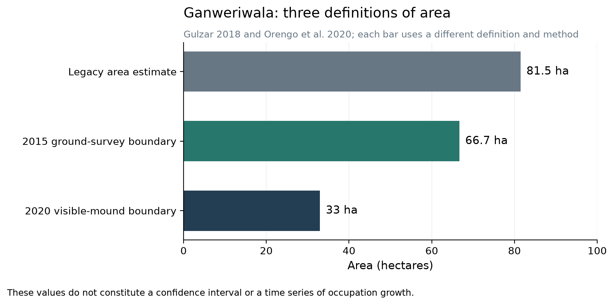
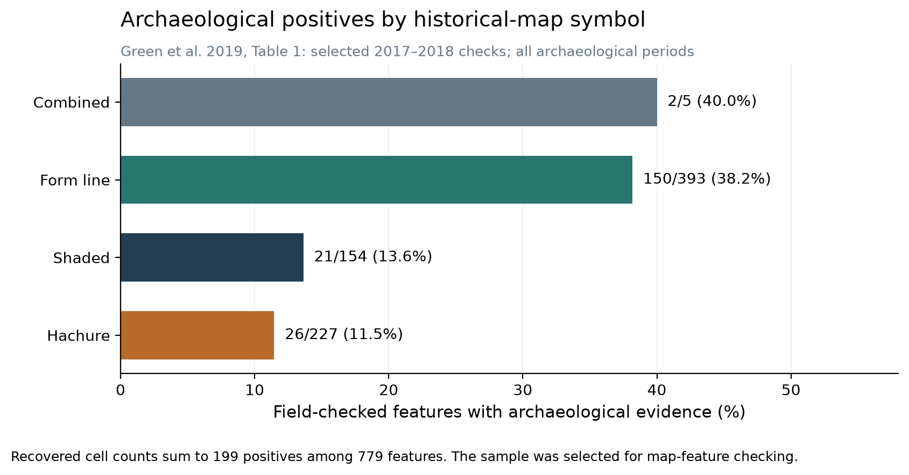
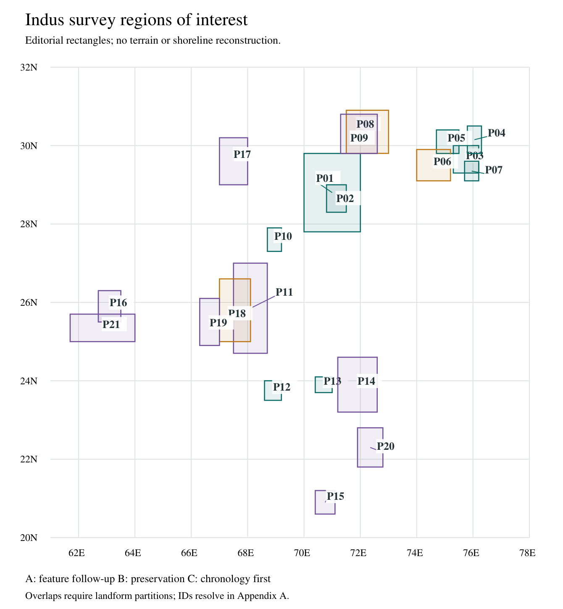
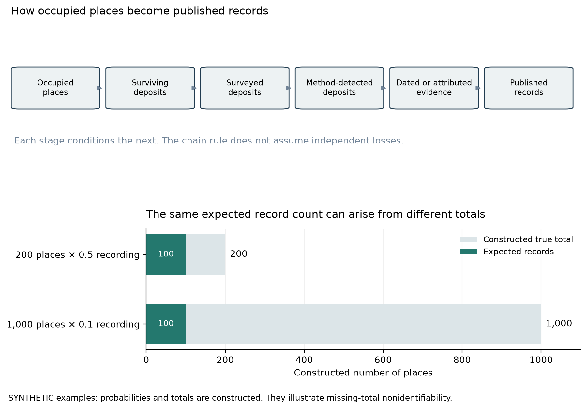

# The Indus excavation gap: what repeat surveys reveal and how to test hidden settlement landscapes

Complete working paper, 11 October 2026. Structured narrative review, published-count audit and proposed survey design. Prepared with AI research and writing assistance; author names, affiliations and a submission venue have not been assigned. No fieldwork or new analysis of satellite scenes, terrain or bathymetry was undertaken for this paper.

## Abstract

The gap between recorded and excavated Indus sites reflects selective investigation, conservation costs, uneven access and publication, and a record altered by rivers, farming and later construction. The familiar account of approximately 100 excavated sites among more than 1,000 recorded locations derives from historical inventories. Two early summaries give 96 excavated Mature Harappan sites among 1,022 or 1,056 locations; a recent review counts 142 excavated Early and Mature sites through 2024. Their different populations prevent a present excavation percentage. A 2019 field survey associated archaeological material of several periods with 199 of 779 checked historical-map features and encountered 64 additional off-map locations. It documents local recording omissions. A 2020 Cholistan analysis proposed 337 mound clusters, of which 266 were unmatched to its legacy records; their identity, date and subsequent confirmation require reconciliation. Other comparisons reveal missing cartographic features or finer mound units. This paper compares burial beneath alluvium and later cities, low-relief rural occupation, piedmont and cave contexts, and coastal change. Twenty-one overlapping regions of interest organize proposed tests with rival explanations, comparison strata and demotion rules. A reconciled site register is the first proposed task; size-stratified ground checks and a paired-landform coring pilot follow conditionally. Small settlements, intact urban deposits and environmental samples could add substantial evidence, but available data support neither a regional artifact total nor a forecast of undiscovered cities.

## 1. Questions, scope and units

The opening question is why archaeologists have excavated so few of the recorded Indus sites. It contains three different problems: how many locations are recorded, how many have received excavation, and how much of their surviving deposits has been investigated. A small test trench can put a large site into the excavated category. A long-running urban excavation can still leave most of its area unopened. A location known only from surface pottery may contain several phases, while separate mound names may refer to parts of one settlement. The numerator, denominator and unit must therefore travel together.

This paper asks what current surveys reveal about the missing record and which investigations could distinguish occupation from concealment, destruction or mistaken attribution. Its core reference interval for Mature Harappan urban occupation is approximately 2600–1900 BCE. Earlier and later sites enter the discussion when they supply a dated sequence, a regional comparison or an example of a preservation process. Calendar overlap alone does not establish Indus affiliation. Material associations and local archaeological classification remain part of that decision.

Four units are kept separate: a recorded locality; a physical mound or artifact scatter; a phase-specific occupied footprint; and an excavated deposit or feature. Remote-sensing pixels, map symbols and samples are observations associated with these units. A cemetery, quarry, seasonal camp or irrigation feature can be archaeologically significant without being a city. Several small locations may represent successive moves by a community rather than simultaneous villages. This distinction matters when reconstructing settlement density and the number of people present at one time.

The contribution is a comparative evidence audit and a survey design. Historical-map recovery, mound detection and regional geoarchaeology are established research approaches. The agenda here combines their observations across the hidden settings in the question and states what a future investigation would need to measure. [R08,R09,R10,R11,R12]

## 2. Evidence, access and shared assumptions

### 2.1 Search and source control

The review began with the project's preserved 8 October excavation outlook. Searches on 11 October followed excavation inventories, survey papers, geomorphic studies and their cited field projects. Recent searches covered 2024–2026 work on MAHSA, Kutch habitation and cemeteries, coastal reconstruction, Ghazi Shah, Lothal and Mohenjo-daro. The repository retains a search-and-access record, source observations, dated calculations, the frozen first manuscript and all commissioned reviews. A complete search-hit denominator was not retained, so the paper is a structured narrative review rather than an exhaustive systematic review.

Reading depth is recorded source by source in the final register. A local witness means an acquired PDF, XML or HTML file with a hash; it does not imply that every page was read. Conversely, a missing local witness can reflect a valid reading through a publisher or indexed primary extract. Load-bearing exceptions include Gadekar's excavation count and Possehl's historical total, read in publisher extracts; the Cambridge season account; and the 2026 Khambhat synthesis, available at abstract/introduction depth. The commissioned Codex source-check pass read the R38 primary extract. The R01 teaching chapter was subsequently acquired and its count passage visually checked; the excerpt contains no bibliography identifying its exact 2002 reference. The full Lothal 2022 publisher text was read, including its dating table. Giosan's primary article was read through a valid web route; a downloaded challenge page was excluded. Green's Table 1 was visually checked, while its row-level supplement could not be obtained. Counts are attributed at the reading depth actually achieved. [R01,R02,R10,R17,R29,R32,R34,R38]

The final register contains 72 source records, 50 with local witnesses. Raw acquired sources remain local. The deliverables contain authored notes, source pointers, hashes, aggregate calculations and original figures. A machine-readable claim register links manuscript claims to source observations and exact output files. The analysis does not use the project's inscription-focused site sample to estimate settlement coverage; that selected sample remains in supplementary run notes.

### 2.2 Chronology conventions

Calendar BCE is the comparison scale. BP conventionally uses 1950 CE as its origin. Subtracting a calendar BP age from 1950 expresses the same calendar age approximately in BCE; it does not calibrate a radiocarbon measurement. OSL ages, calibrated radiocarbon intervals, age-depth-model summaries and conventional radiocarbon BP retain their different meanings. Marine shells require calibration and a locally justified reservoir correction before archaeological comparison.

| Observation | Published time system | Calendar comparison and use |
|---|---|---|
| Mature Harappan reference interval | Approximately 2600–1900 BCE | A working comparison interval; regional phase boundaries vary |
| Studied Sutlej abandonment [R15] | Shortly after approximately 8 ka | Roughly 6050 BCE on the age-before-present scale; substantially earlier than the urban interval |
| Markanda/foothill floods [R16] | Approximately 3.9–3.8 ka | Roughly 1950–1850 BCE; near the late Mature/early post-urban boundary, not a date for every channel |
| Lothal downstream sample IUACD#20C3314 [R32] | Calibrated 3918–4385 BP; reported as 4150 ± 230 BP | Approximately 2435–1968 BCE, with the source's age range retained; marine calibration uses ΔR = −106 ± 51 years |
| Lothal downstream sample D-AMS 042905 [R32] | Calibrated 3424–3825 BP; reported as 3625 ± 200 BP | Approximately 1875–1474 BCE; the environmental transition continues after the reference urban interval |
| Mehrgarh sampled Period I cemetery [R40] | Preferred modeled start, 5223–4914 cal BCE | Pre-Indus burial-process comparison; model excludes two dates and does not date all of Mehrgarh |
| Siranda/Lower Sindh shell dates [R31] | Conventional, uncalibrated radiocarbon BP | No calendar-BCE conversion made here; sample, curve and reservoir information are needed |

The calendar conversions are orientation aids, not new age models. Published ka ages can use a measurement reference year rather than 1950, especially for OSL. The rough ka-to-BCE orientations in Table 1 use 1950 for comparability; that reference-year offset is below their stated precision, and the published ages remain the chronology evidence. Dating the old substrate beneath a site and the young sediment above it gives different constraints. An old terrace can support later occupation; a young cap can cover older occupation. Only a stratigraphically interpreted occupation horizon tests the proposed occupation age directly. [R15,R16,R31,R32,R40]

### 2.3 Regions of interest and comparison rules

The 21 rectangles in Appendix A are coarse regions of interest drawn to 0.1-degree precision. They overlap, sometimes substantially, and include landforms outside published survey footprints. Their union has not been treated as a survey area. They provide a coordinate index for the questions, with partial checks of named anchors. Published polygons and current parcel access must define an actual sampling frame. The diagram carries no coastline, terrain, deposit-depth or suitability model.

Evidence classes describe what supports the next question: A denotes documented archaeology or published feature follow-up; B denotes a preservation comparison with regional support; C denotes a need to establish chronology or cultural attribution first. These classes supply neither discovery probabilities nor field priorities. The register also gives editorial assessments made in this AI-assisted research and drafting process. Information levels distinguish a documented archaeological or record question with a discriminating comparison (I2), a regional process with an incomplete local frame or chronology (I1), and a mechanism-only lead (I0). Preservation levels describe evidence: surviving archaeological contexts documented somewhere in the region, including other periods and surface contexts (P2), a regional formation process with target-horizon survival unknown (P1), or local preservation and age unestablished (P0). P2 does not predict survival in an untested parcel. Feasibility is F0 for unverified access, F1 for confirmed data and a named partner with intervention arrangements incomplete, and F2 for confirmed relevant access and conservation arrangements. All regions currently have F0. These are separate judgments, with no combined score or elicited expert rating. Operational priority is discussed in Section 8.

Every future comparison must record prior survey effort, eligible and inaccessible units, time spent, visibility, sampled depth and volume, and dating outcomes. Candidate and comparison assignments should be concealed from surface teams and specimen classifiers where practical. Size-stratified samples are required for mound detectors, including small and low-relief proposals. Comparison units lacking a map symbol have unresolved archaeological status until investigated. A negative observation at inadequate depth or visibility remains unresolved.

The proposed tests use distinct landform strata within overlaps. In the P08/P09 overlap, older alluvium, covered margins and historically dated channels form different questions within one frame. In P11/P18, floodplain levees and backswamps are separated from fans and piedmont interfluves. Repeated visits to the same deposit or nearby pixels belong to the same correlated sampling block. Region labels never substitute for a sediment map. Any one-square-kilometre cell eligible under several region labels belongs to a shared frame, carries every applicable label and is selected once. This applies to all overlaps, including P03/P04/P07 and P05/P06. P02 known-margin transects are excluded from P01 negative draws. Correlated contexts remain in one block.

## 3. Why the excavation gap persists

### 3.1 The headline ratio is historical

The University of Lucknow teaching chapter reports at least 1,022 Mature Harappan sites and approximately 96 excavated, citing Possehl (2002) and “Setter and Korisettar” (2002) as printed in the excerpt. Possehl's primary 2002 chapter gives 1,056 Mature sites and 96 excavated, referring to his 1999 appendix. The ratios are approximately 9.4% and 9.09%, respectively. The teaching chapter's exact Possehl title and the relation between these totals remain unverified; they may draw on related historical compilations rather than separate surveys. Gadekar's review, published online in 2025 and in the 2026 issue of *Lithic Technology*, extends Uesugi's compilation to count 142 excavated Early and Mature sites through 2024. Dividing 142 by either old Mature-only denominator would mix period coverage and inventory dates. [R01,R02,R38]

Another current scale reference is MAHSA's approximately 10,000 all-period legacy entries, reported in the 2025 *Hidden in Plain Sight* paper. That resource includes archaeological periods and kinds of record beyond the Indus Civilization. Cleaning aliases, coordinates and classifications is part of its work. It supplies a route toward reconciliation, not a replacement Indus denominator. [R13,R27]

Excavation incidence measures institutional activity at localities. It says little about how much surviving cultural material has been sampled. A reconciled inventory should record survey, test excavation, substantial excavation, publication and present preservation separately, with phase assignments and cutoff dates.

### 3.2 Exposure creates continuing obligations

Excavation removes the deposit that preserves context and exposes structures to weather, salts and maintenance demands. The ICOMOS archaeological-heritage charter sets out selective investigation and maintenance principles. UNESCO's 2026 Moenjodaro conservation report documents groundwater, salinity and deterioration of exposed architecture at that site. The practical comparison is between research gained from an intervention and the ability to preserve, document and maintain what is opened. Selected trenches, coring, geophysics and rescue recording can answer questions without clearing an entire settlement. [R03,R04]

An excavation also requires specialists, laboratories, storage, records and publication. These costs continue after fieldwork. The sources reviewed here do not provide a national budget that can apportion the excavation gap among funding, staffing, permits and conservation. They establish particular constraints and cases. The paper therefore avoids assigning percentages to causes.

### 3.3 Access, priorities and destruction vary by place and date

Ganweriwala illustrates changing access rather than permanent abandonment. A 2007 Japanese project report says political turmoil postponed planned excavation. A University of Lahore account records excavation activity in 2024. The old postponement cannot describe the site's current status. Researchers also choose questions: an under-studied rural economy or a threatened workshop may justify intervention before another large urban exposure. [R05,R06,R23]

Later land use can both reveal and remove archaeology. At Lakhanjo-Daro in Sukkur, the government account describes modern construction damage in the upper deposits of 2017 trenches, surviving lower contexts and deep pits mixing ancient finds with modern garbage. Surface absence in an industrial city can therefore mean cover, truncation or displaced material, depending on the section examined. [R21]

Meadow and Kenoyer document removal of Harappa rubble for the Lahore–Multan railway alongside ancient reuse of baked bricks. Missing walls therefore need a destruction history rather than a single explanation. Existing archives can also yield new results: the 2026 Mohenjo-daro inequality study analyzes residence areas digitized from early excavation plans. More field exposure is one route to knowledge; renewed analysis of recorded contexts is another. [@@HARAPPA_BRICKS@@,@@MOHENJO_ARCHIVE@@]

Publication lag affects what appears excavated in a database: a season notice, a preliminary report and a final context catalogue answer different questions. The appropriate response is a dated activity and preservation register linked to projects and authorities.

## 4. How large could the unexcavated record be?

### 4.1 Site area depends on what was measured

Ganweriwala has an older reported area of 81.5 hectares, a December 2015 ground-survey estimate of approximately 66.7 hectares based on cultural-material spread, and a 2020 estimate of approximately 33 hectares of visible mounded area. These observations use different definitions and methods. They cannot establish that half a city disappeared or form a confidence interval around one area. Buried occupation, eroded deposits, surface transport and the distinction between mounds and scatter need separate mapping. [R07,R08]

The problem occurs at smaller sites too. Kotada in Lodrani, later announced as Morodharo, had an earlier published identification. The reported 100 by 60 metre fortified enclosure is 0.6 hectares; its dimensions do not delimit the full multi-period settlement. Resolving names, features and periods comes before counting a new site or reporting a total footprint. [R19]

For scale, a square of 1 hectare has a side of 100 metres; 5 hectares, approximately 224 metres; 30 hectares, approximately 548 metres; and 200 hectares, approximately 1.41 kilometres. These are area equivalents, not proposed shapes. A long thin settlement, a dispersed scatter and a compact mound can have the same area with different detectability. [Analysis: square-equivalent-geometry.csv]

### 4.2 Published proposals favor a substantial small-site component

In Cholistan, Orengo and colleagues proposed 337 mound clusters. Of them, 246, or 73.0%, had tentative visible areas below 5 hectares. The paper identifies six mounds above 20 hectares in its discussion and Figure 9. Khundowala, approximately 29 hectares, and Mulhiawala, approximately 20.5 hectares, are especially large remote proposals whose period attribution required testing. The observed distribution supports searching for many small places alongside some larger candidates. It covers mounded signatures detectable by those sensors, not flat camps, deeply buried occupation or all original settlement areas. [R08]

Their 25 reference mounds were large, well preserved and readily visible in high-resolution imagery. Twenty selected validation mounds were identified in the first classifier iteration; the workflow then underwent refinement and a visually chosen threshold. These observations do not estimate detection of the least visible sites. Large, exposed mounds may be easier to recognize, while city deposits under several metres of alluvium can be invisible to the same method.

Geographic proximity to Harappa, Rakhigarhi or another large site can motivate an economic-catchment hypothesis. Water, cultivable land, routes, raw materials and competition all affect plausible occupation. Proximity alone supplies no reliable area prediction: it could accompany villages, workshops, burial grounds, temporary camps or another center. A statistical size model would need phase-specific training sites, measured footprints, preserved landforms and out-of-region evaluation. Neither a river distance nor a modern administrative location supplies those data.

### 4.3 Repeat surveys give local evidence of omissions

Repeat investigations yield several kinds of change: field-confirmed recording omissions, known archaeology absent from historical maps, unconfirmed remote proposals and finer physical mound units. Table 2 separates these descriptive comparisons and their populations.

| Published comparison | Recalculated observation | What grew or was missing |
|---|---|---|
| Green 2019, historical-map field checks [R10] | 199 positives among 779 checked features; 169/199 = 84.9% unlinked to earlier reports | Archaeological material of several periods; some unlinked positives may be poorly located earlier visits |
| Green 2019, additional encounters [R10] | 64 off-map locations; 64/(199 + 64) = 24.3% of these encountered locations | No apparent map-feature association; the encountered set is not a complete regional census |
| Garcia-Molsosa 2023, PAS-to-map comparison [R11] | 123/240 = 51.3% matched; 12 of those matches were below 2 hectares | About half of this independently known all-period set lacked a matching mapped feature |
| Orengo 2020, remote-to-legacy comparison [R08] | 337 − 71 = 266 unmatched proposals; 266/337 = 78.9% | Remote mound candidates, with identity and period unconfirmed by this subtraction |
| Orengo 2020, removing 25 reference mounds [R08] | (71 − 25)/(337 − 25) = 46/312 = 14.7% matched | A descriptive non-reference overlap; it is neither field-confirmation rate nor recall |
| Cambridge 2009 season, Masudpur [R29] | Four legacy mounds at one coordinate became thirteen mapped mounds: 3.25 times as many mound units | Finer mapping changed the physical units; it does not demonstrate thirteen simultaneous settlements |

Green's checks establish archaeological material at locations unlinked to earlier reports. The PAS comparison establishes missing map associations among known all-period sites. Cholistan adds proposals awaiting record reconciliation and phase confirmation; Masudpur changes the counted mound units. Old-record error, feature splitting, mixed periods and unequal effort therefore require different explanations and cannot supply one regional growth factor. The 2020 unmatched cohort has not been comprehensively reconciled with later confirmations through 2026. A current register must determine which entries remain unmatched today.

The Cambridge project recorded 127 all-period locations within a 15 kilometre radius of Rakhigarhi. Their phase memberships overlap. Garcia-Molsosa's map pipeline moved from 13,130 extracted features to 638 after a greater-than-2-hectare threshold and 646 after manual review. The net addition of eight is a cartographic processing result, not eight new excavated sites. The 123 PAS matches include twelve features below the threshold, so subtracting all 123 from 646 would combine mismatched populations. [R11,R29]

## 5. Where archaeology can be concealed or overlooked

### 5.1 Later villages and cities

Later settlement can occupy an earlier favorable location because water, routes or elevated ground remain useful. It can also remove the old deposit through foundations, drains, quarrying or reuse. The Haryana inventory places Rakhigarhi beneath the modern villages Rakhi-Shahpur and Rakhi-Khas, providing a documented village-overlay case. The Sukkur example shows both surviving lower contexts and destruction in one locality. The proposed test reconstructs old mound descriptions, land use and ground elevations, then examines authorized sections or tests where the relevant deposits could survive. Shallow mixed finds alone do not define an intact settlement. [R21,@@RAKHI_VILLAGES@@]

This setting favors rescue partnerships with existing projects and heritage authorities. Archaeological observations from construction cuts must retain their location, stratigraphy and disturbance history. A later-city hypothesis should be demoted for a tested parcel if accessible sections demonstrate complete truncation of the relevant horizon. It remains unresolved where foundations or the water table prevent adequate observation. Occupation beneath one modern neighborhood gives no license to extend the same footprint across the city.

### 5.2 Alluvium, flooding and river movement

Alluvial deposition and erosion produce opposite archaeological predictions. Aggradation can cap a surface and preserve it; a migrating channel can scour it away. Older interfluves, levees, channel margins and younger belts therefore need separate stratigraphic descriptions. Garcia-Molsosa and colleagues explicitly distinguish older alluvium beneath Bronze Age deposits from younger channel fills cutting older remains. [R11]

Mohenjo-daro supplies a direct deep-burial example. Dales's 1965 account reports borings recovering sherds, brick, bangles and ash to 39 feet, approximately 11.9 metres, below the surrounding plain; water then stood about 15 feet below the plain. Those historical observations establish deep cultural evidence and a water-related access constraint, not today's water depth or continuous dated buildings at every level. Kenoyer's 2025 institutional lecture abstract reports Kot Diji roots identified in new work. A 2026 field-participant account traces further chronology claims to a named preliminary report that this study did not obtain; the original sample and calibration table remain necessary before adopting a precise revised foundation date. [@@MOHENJO_DALES@@,@@MOHENJO_UW@@,@@MOHENJO_PARTICIPANT@@]

River history is also time-specific. Singh's 2017 study places abandonment of the studied Sutlej route shortly after approximately 8 ka, before urban Indus occupation. The 2021 foothill-flood study records episodic flows around 3.9–3.8 ka, near the end of the working Mature interval. Both can be true because a major river avulsion and later tributary floods are different processes. Giosan's regional analysis likewise describes varied landscape stability. A present river channel does not locate every ancient settlement, and a visible paleochannel may have been inactive, medieval or recently reused during the occupation being sought. [R15,R16,R17]

Kalibangan is a documented major settlement within the P06 regional bounds; a published coordinate from an excavation participant supports that containment while retaining its coarse precision. The buried-site proposal predicts a surviving terrestrial surface of the target period within a measurable sediment sequence. Cores and sections should establish contacts, scour, paleosols and burial depths before interpreting geophysical anomalies as occupation. Dates above and below a possible floor bracket the sequence; short-lived material securely associated with the floor provides a closer occupation test. Sediment provenance can help distinguish locally deposited alluvium from reworked cultural fill. A young capping deposit is expected under burial and does not reject older archaeology beneath it. [@@KALIBANGAN_COORD@@]

### 5.3 Leveling, low-relief rural sites and historical maps

Petrie's historical-map study and subsequent detector work provide ways to recover mound information lost during agricultural alteration. Green's field checks found 199 archaeological positives among 779 checked map features. The positive counts by symbol type were recovered uniquely from Table 1's rounded percentages: form-line features, 150/393; shaded features, 21/154; hachures, 26/227; combined symbols, 2/5. Size classes also differed, with 86/501 positives in the smallest class. These are descriptors of a selected checked sample. [R09,R10,R12]

In 2017, smallest-feature checking stopped after ten negative locations per regional grid unit. In 2018, historical-map review excluded apparent ponds and dunes before visits. Excluding plausible nonarchaeological features would ordinarily raise the checked positive rate relative to the original feature list. The direction of bias from the stopping rule depends on spatial heterogeneity and is not established here. Crops, transported pottery and changing feature definitions further affect surface outcomes. Reporting these rules allows interpretation of the rates without using them as regional probabilities. [R10]

Small rural sites also deserve investigation for the questions they can answer. Parikh and Petrie describe rural ceramic economies and craft organization. Bates and colleagues' flotation work recovered evidence relevant to rice, weeds and agricultural practice from small Indus settlements. A thin scatter or modest village may add evidence about production and subsistence that is scarce in monumental exposures. [R23,R24]

### 5.4 Piedmont valleys, caves and landslides

Mountain-associated settings enter through specific routes, springs, terraces and regional sequences. Mehrgarh supplies a direct pre-Indus example of deposits covered by Bolan alluvium and exposed in a river-cut section. Its revised Neolithic cemetery chronology illustrates the difference between a preservation analogue and the Bronze Age surfaces sought here. Nausharo provides a known local-to-Indus comparison in the Bolan plain. [R39,R40,R45]

Ghazi Shah's government inventory describes Amri and Indus levels beside a perennial spring and the Bhit Range. Its 160 by 130 metre dimensions are an inventory description, equivalent to approximately 2.08 hectares, rather than a phase-specific occupied boundary. A 2025 archaeometric report abstract records recent excavation; the full report was unavailable for assigning new stratigraphy. The Kirthar piedmont has an established archaeological research history. These observations support coordinated fan/interfluve and spring-corridor comparisons. [R37,R41,R42]

Kech-Makran is a separate regional sequence. Miri Qalat includes Indus-period occupation within longer local traditions. Besenval's field synthesis describes irregular storm floods and erosion in its alluvial valleys. These observations motivate testing covered valley margins while leaving fan ages and occupation affiliation to local stratigraphy. A contemporaneous community can retain a local material tradition. [R26,@@BESENVAL@@]

The official Kai inventory describes a natural cave without architecture or an authenticated Indus date. The northern Balochistan shelter survey likewise lacks absolute chronology for its proposed attribution. Cave names and their coordinates must first be reconciled with the inventory. An archaeological cavity would need intact floors, hearths or associated remains, suitable dates and a local cultural comparison. Cave occupations could be seasonal, pre-Indus or much later, with small assemblages rather than a buried city. [R43,R44,@@KAI_COORD@@]

Swat/Malakand offers a boundary comparison: Olivieri discusses local late third-millennium traditions and Cemetery H-style objects whose local manufacture or import remained open. Official accounts locate Manda beneath Akhnoor Fort and describe Ropar's Harappan-to-medieval sequence. DAFA records Mature Harappan and later phases at Shortugaï in northern Afghanistan. These known river-margin and northern examples support regional sequence and exchange comparisons. They supply no evidence for a high-mountain or cave city. Detailed Gomal and high-Himalayan inventories remain outside this bounded regional audit. [R46,@@MANDA@@,@@ROPAR@@,@@SHORTUGAI@@]

A landslide could bury occupation, displace artifacts or remove a slope. No reviewed primary study established an Indus settlement buried by a landslide. A proposal there must first date the event, reconstruct the previous surface and show that a relevant occupation catchment existed. This paper retains landslides as a formation-process question; it assigns no slide target or discovery probability.

### 5.5 Former coasts, estuaries and submerged ground

The relevant coastline is the local shoreline during the proposed occupation. Relative sea level combines ocean level with land motion, compaction and other local effects. Delta progradation, river migration and lagoon closure can move a former shore inland even as global sea level rises. Erosion can remove occupation; sediment can preserve it beneath land or shallow water.

At a trench four kilometres downstream of Lothal, Das and colleagues use sediment, biological and geochemical proxies with calibrated chronology to infer a marine-to-estuarine transition beginning around 4150 ± 230 BP and continuing toward 3625 ± 200 BP. Table 1 and the stated reservoir correction place that transition approximately from the later Mature interval into the post-urban period. Tidal-elevation information limits the reconstructed water level. The observation is a local environmental sequence, requiring separate evidence to reconstruct a landing place or the function of Lothal's large basin. [R32]

Two 2024 Gupta studies combine historical/remote observations and computational approaches to the Sabarmati, Lothal and Nal corridor. They supply precedents for reconstructing route and water connections. Such models depend on dated channels, plausible navigation conditions and the distinction between inferred corridors and excavated installations. The 2026 Khambhat synthesis applies standardized sea-level-index-point criteria; its available abstract identifies Lothal and Vadgam as the locations satisfying full criteria, with other indicators limiting or affected by tectonics. Coastal hypotheses should inherit these local age/elevation constraints. [@@LOTHAL_JAS@@,@@LOTHAL_MARITIME@@,R34]

Kaj and Kanjetar provide coastal environmental sequences in Saurashtra. Biagi's 2024 Arabian Sea synthesis records shell middens, lithics and occupation evidence around Siranda and Lower Sindh with varied dates and attributions. Kutch's geomorphic record also documents major landscape change. Dholavira is a known urban and cemetery complex on Khadir Island; its UNESCO record documents thirteen excavation seasons between 1989 and 2005 and associated conservation. Such established projects anchor catchment questions in the Rann landscape. Buried estuary and former-lagoon tests need their own dated surfaces, including former coasts now inland. A chronology inconsistency in the Kutch review is retained in the source audit and excluded from the age argument. [R25,R31,R33,@@DHOLAVIRA@@]

Sutkagen-Dor provides a verified known-settlement anchor within the Makran region of interest. Its government inventory locates it on a sandstone outcrop beside the Dasht. Dales's 1962 coastal survey interprets uplift, alluvium and beach deposition as mechanisms of coastal advance at Sutkagen-dor and Sotka-koh; his proposed older tidal access was a hypothesis rather than a dated shore. Page and colleagues report 1–3 metres of 1945 earthquake uplift at Pasni and Ormara, with Pasni local to P21. Normand's southeast-Iran terrace study supports the regional process model but supplies no transferable Bronze Age uplift rate for the Pakistani region. These observations favor checking raised and inland former surfaces first, while localized submergence requires separate evidence. Kech and Las Bela remain external regional comparisons. [@@SUTKAGEN@@,@@MAKRAN_DALES@@,@@MAKRAN_UPLIFT@@,@@MAKRAN_TERRACES@@]

The Gulf of Khambhat/Cambay offshore habitation claim makes the association problem concrete. Kathiroli and colleagues' 2003 NIOT report describes sonar patterns, grab/dredge finds and gravity/vibro cores with terrestrial as well as marine and fluvial facies. It reports carbonized wood dated to approximately 9544–9545 cal BP. The brief report does not establish secure association between that wood, a particular built feature and a diagnostic occupation assemblage. Its habitation interpretation therefore cannot establish an Indus city or a city date. This assessment concerns the reported association, while leaving submerged archaeological potential open. [@@KHAMBHAT_OFFSHORE@@]

The offshore sequence of tests is preservation and chronology first, then archaeological association. A candidate must have been habitable at the proposed date; acoustic or bathymetric form must be distinguished from geology; and datable cultural material must remain associated with an intact surface or feature. Strong currents and redeposition can separate objects and wood from their source. Regional maritime exchange makes a coastal question reasonable but does not authenticate a seabed anomaly.

## 6. A survey agenda with outcomes that can change it

Appendix A sets out 21 regions, each with a source link, rival explanation, sampling unit, comparison and demotion rule. The units are proposed for a future protocol and have not been surveyed here. The register applies the separate information, preservation-evidence and feasibility levels defined in Section 2.3, with a rationale for each region.

A regional hypothesis is demoted for inspected units when the sampled evidence contradicts its specific premise at adequate spatial coverage, depth, visibility, effort and chronological resolution. Failure to reach a relevant horizon records an unresolved outcome. Finding another archaeological period changes the Indus attribution while preserving the archaeological result. Candidate-versus-comparison similarity weakens a claimed concentration only when precision and detection sensitivity are sufficient; a small low-power null does not establish regional absence.

Prior effort must be measured as a potential confound. Published map coverage, survey years, visited locations and intervention depths differ across these regions. A new design should include comparable landform blocks with little documented prior survey, as well as familiar candidate-rich areas. “Little documented effort” itself requires archive checking. Rates should be reported by effort, size, landform, visibility and period, with aliases and repeated mound units reconciled.

The overlap between P08 and P09 is useful for one combined sampling frame: surface survival and channel age become separate recorded attributes. P11 and P18 similarly share geographic bounds while testing floodplain and piedmont processes. Partitioning by locally mapped landforms prevents double-counting and makes a geological prediction testable.

## 7. What excavation could recover

### 7.1 Information expectations by context

More excavation could recover additional buildings, ceramics, tools, manufacturing debris, animal and plant remains, burials and occasional seals or inscriptions. The amount depends on the surviving deposit, function, excavation volume and recovery method. Common fragments can be numerous while the evidence needed for a particular historical question is scarce. Table 3 states conditional expectations rather than object totals.

| Context | Evidence worth testing for | Attribution and principal failure mode |
|---|---|---|
| Small rural settlements and covered surfaces | Ceramics, chipped stone, craft waste, bone, seeds, weeds and occupation features | Phase-supported in-situ associations; thin deposits and transported surface sherds can obscure the unit |
| Urban rescue exposures | Intact lower floors, drains, workshops and production sequences where they survive | Dated context beneath later activity; modern cuts and mixed fill can destroy associations |
| Cemeteries and habitation catchments | Burial practice, dated individuals, settlement links and environmental samples | Relationships need independent dates; a cemetery does not by itself locate or delimit a contemporaneous town |
| Caves and small shelters | Hearths, floors, small tool/food assemblages and sediment sequences | Local cultural comparison plus dates; occupation may be another period and residues may be disturbed |
| Coastal or offshore surfaces | Preserved terrestrial occupation or installations, if a dated habitable surface survives | No supported in-situ find expectation until preservation and chronology are established; reworking is a major rival |
| Seal and inscription-bearing contexts | Objects with secure find layers, associations and production history | Recovery is rare and clustered by context; no rate is estimated from regional site counts |

Harappa's project report describes almost one million potsherds recovered in five seasons. It also shows season and context differences in inscribed-object recovery. That scale demonstrates what a sustained urban project can collect; without a comparable excavated volume and deposit mixture it supplies no transferable fragments-per-hectare rate. [R30]

For a specified material class, a planning identity is Y = 10,000 × A × f × h × d × r, where A is site area in hectares, f is the opened fraction, h is mean archaeological thickness in metres, d is surviving in-ground fragments per cubic metre before collection, and r is the fraction recovered and retained. Every density and recovery term needs local calibration. Synthetic values and the associated figure from the first draft remain preserved in supplementary outputs but are omitted here because they add no empirical forecast. Inscribed objects need a context-specific occurrence model, not this bulk-fragment identity.

### 7.2 Methods can change the information gained

The useful increment is not only the number of objects. Flotation at Masudpur and Bahola recovered small plant fractions that inform cultivation and weed ecology; screening choices affect which evidence survives into the archive. A 2024 study of eleven Kotada Bhadli vessel sherds recovered lipid evidence while extracted proteins could not be confidently assigned to foods. This is a concrete reason to budget material-specific controls and report failures alongside successes. [R24,R36]

Future work should record sediment volume, mesh and flotation fraction, fragment and weight counts, joins, context integrity, dating samples and laboratory blanks. Conservation, processing and storage constrain achievable sampling. Questions about food production, craft organization, exchange and household activities can gain from carefully selected small contexts, while city-wide totals remain unavailable.

## 8. Estimation and the first investigations to undertake

### 8.1 Why observed counts alone do not identify the missing total

Let N be a phase-defined number of occupied units and q the probability that a unit survives, is visible to the available methods, is reached, correctly recognized and enters the record. Under a simplified model the expected recorded number is Nq. A recorded count can therefore be produced by many combinations of N and q. Some deposits may have detection probability near zero for the available surface method. Repeating that method does not resolve them.

For independent visits with constant detection p, the chance of at least one detection after k visits is 1 − (1 − p)^k. This identity describes an assumption, not the actual dependence of repeat archaeological visits. Ten visits at an assumed p = 0.1 give approximately 65.1% detection; repeating a method with p near zero adds little. Crops, route choices and shared sensor limits can make visits correlated. Combining historically mapped mounds with subsurface investigation can change what is observable, provided each method's performance is measured.

Two-list capture–recapture offers a possible estimation framework once records are reconciled. A simple estimate uses the product of the two list sizes divided by their overlap. It requires a common geographical footprint, period, unit definition and adequately closed population, reliable matching and defensible detection assumptions. Legacy recording and remote classification often favor the same large visible mounds; size heterogeneity and positive dependence can produce downward bias under ordinary two-list models. False matches, unmatched aliases, false-positive candidates and incompatible periods can move the result in other directions. A naive estimate is not a guaranteed lower bound.

The available Cholistan overlap lacks a reconciled legacy-list denominator within the exact classifier footprint and phase rules. Green's off-map encounters are not a separately sampled complete list. The PAS/map comparison mixes map-feature eligibility and all-period sites. Computing a missing regional total from these aggregates would hide the missing assumptions. Size-stratified, multi-method records with jointly inspected match histories could support a model with sensitivity to dependence and matching. Sites inaccessible to every method remain unidentified without external constraints; adding an invisible class to a model does not estimate its size. [@@CAPTURE@@,@@MULTILIST@@,@@HETEROGENEITY@@]

An effort-adjusted discovery curve is another useful diagnostic: cumulative first-recorded phase-defined localities against survey area, visits or searchable volume. A steep curve can indicate continuing recorded additions; a plateau can also reflect unchanged methods, restricted access or an exhausted visible class. Calendar year alone is a poor effort measure. MAHSA/gazetteer first-report dates, surveyed footprints, aliases and method histories would be needed to construct and interpret such curves. Ecological accumulation methods offer a statistical precedent only after the archaeological sampling process is defined: repeated-detection incidence histories cannot be reconstructed from counts of unique sites in disjoint tiles alone. Detectable probability coverage also differs from the fraction of all site identities found. [@@ACCUMULATION@@,@@COVERAGE@@]

### 8.2 First priority: a concordance and effort register

The first proposed task is to reconcile Orengo's clusters, Green's checked/off-map locations and Garcia-Molsosa's map/PAS observations with accessible gazetteers and MAHSA partner records. Each record receives a status: documented match, probable alias, no match or inadequate coordinates. Period, area definition, coordinate uncertainty, prior survey effort and confirmation date remain separate fields. An unmatched proposal becomes a candidate absent from the accessible reconciled record, which is a more useful local quantity than subtraction from one old list.

This desk task has the highest immediate information value because it addresses identity before intervention and can prevent duplicated discovery claims. Access to underlying project data and MAHSA records may require agreement; it has not been obtained here. No field permit is implied. Where the source files cannot be acquired, the outcome is an explicit missing-data register. If most apparent additions prove to be aliases, the next task shifts toward phase and preservation mapping.

Conditional second tasks are size-stratified, equal-effort ground checks of accessible Cholistan proposals and one buried-surface pilot in P08/P09 or P06. The first reports phase-confirmed proposals divided by adequately checked proposals within each size and visibility stratum; unresolved checks are also retained. This positive predictive value can support a forecast within a validated candidate frame, while recall requires separately sampled missed locations. The second task measures survival and reachable depth of target-age surfaces. Existing western Kutch and Kirthar projects should be approached for coordination rather than duplicated. Coast and cave proposals begin with inventory and local chronology work. Current field feasibility and a named institutional partner remain requirements for choosing a field task. [R08,R10,R11,R20,R27,R37]

### 8.3 A paired-landform pilot for P08/P09

The proposed pilot compares stable older alluvium, younger cover over older margins, young channel belts where scour is plausible, and older ground altered by leveling or building. A local geoarchaeologist defines these strata before archaeological outcomes are inspected. A proposed 24-block workload, six per stratum, is an operational example with no power claim. Blocks are sampled from a recorded accessible frame, including a matched low-prior-effort subset wherever the archive review supports that classification. Inaccessible selections and replacement rules are retained.

A block begins as a one-square-kilometre indexing cell, clipped to its eligible landform and access area. Transect orientation, core count, depth limit and dating budget must be locked by the partner's sediment pilot before the main comparison; the present literature does not justify universal spacing or reachable depth. A known-context calibration set is separate from inference blocks. Eight of the 24 sampled blocks, two per stratum, are held aside only for prediction-model evaluation; correlated landform units stay together. Their labels are released after the fitted rule and holdout predictions have been locked. Descriptive preservation reporting eventually includes all 24 blocks, while model evaluation uses the eight held-out blocks. Candidate/map status is concealed from surface observers and sample assessors where practical.

The block is the inferential unit; cores and profiles are nested observations. The report counts selected and attempted blocks, their attempted profiles, and blocks adequately resolving the target-age interval. Adequacy requires the relevant sediment unit or its missing interval to be bracketed, sufficient dating resolution, and lateral coverage suited to the proposed surface or feature. A block-level rule for surviving surface, depth, continuity and scour is locked before interpretation. The descriptive preservation proportion uses adequately resolved blocks within each stratum, with uncertainty respecting block clustering rather than treating profiles as independent replicates. Inadequate, inaccessible and undatable blocks remain separate outcomes because their exclusion can bias the proportion. A stratum with no adequate blocks remains unresolved. Six proposed blocks per stratum provide no precision guarantee; no interval has been fitted here. Inference is restricted to sampled accessible strata. Archaeological encounter rates are a later outcome. A preservation premise is demoted for tested units when adequate observations demonstrate erosion or absence of the predicted terrestrial horizon. A short core that does not reach it is unresolved. A cap age, substrate age or redeposited charcoal date alone cannot make that decision.

Only where a relevant surface survives should geophysical or small subsurface tests evaluate coherent occupation. Positive contexts require phase assessment and disturbance controls. Failure of a method to discriminate buried materials at the required depth calls for a changed method or an unresolved result. Expansion to excavation depends on the question, permits, archive capacity and conservation resources. The pilot's report includes every negative, positive, inaccessible and undatable outcome, permitting the agenda to change even if it finds no new settlement.

## 9. Conclusions and limits

The excavation gap reflects the difference between a broad location record and selective, costly investigation of surviving deposits. Its familiar numerical expression is historical; a current Mature-only ratio requires reconciled inventories. Green's field checks document local omissions from earlier reports. Other comparisons document missing map features, remote candidates or finer mound units, whose archaeological and chronological status must be kept separate.

The reviewed evidence favors an agenda that first resolves names, periods and effort, then compares preservation and detection. Numerous small settlements and activity places are plausible components of the missing record. Some larger remote proposals exist, while geography alone cannot predict their original extent. Covered urban and alluvial contexts can retain evidence; piedmont, cave and coastal proposals require local chronological and cultural tests. Excavation could add substantial material and contextual knowledge, with the largest information gain not necessarily occurring at the largest site.

The 21 regions organize questions that can be investigated and demoted. They are not discoveries or parcel selections. No detector was run on new imagery, no field access was established and no national missing-site or artifact estimate was fitted. Load-bearing source extracts, missing supplements, incomplete geographic concordance and unavailable local chronologies are recorded in the package. Resolving them defines the next research work.

## Review and reproducibility

The complete first manuscript was frozen before author-commissioned AI-model adversarial reviews. Commissioned Codex passes inspected source attribution, the manuscript, mountain/cave integration, numerical outputs and the bounded sampling design. The initial manuscript audit recorded 24 checks with one geographic failure; that bound was corrected in a new register. A quantitative integration pass then recorded 41 passing checks, and seven inline conversions have 17 implementation checks. Claude Code CLI completed two adversarial reviews using the requested `claude-opus-5-5` model. The retained CLI JSON and invocation records identify that canonical model and each completed result. Claude reviewed supplied authored packets with tools disabled and did not retrieve sources, execute code or inspect rendered images. These are commissioned AI-model passes within the project; archaeological peer review remains a separate task.

The response record documents corrections, additions and reasoned decisions on every numbered finding. Material revisions include the P18 bound, historical-map filtering, stratigraphic rejection rules, repeat-survey comparisons, estimation assumptions, regional sampling design and removal of distracting synthetic-yield and inscription-metadata passages. The released package records final source-link, register, frozen-hash and output checks, followed by a separate export and visual-inspection record for the PDF. Full review artifacts, prior versions and unresolved questions remain available in the repository.
