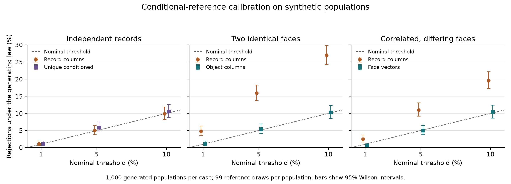

# Conditional reference laws for short inscriptions: copies, selection and fitting feasibility

Private working manuscript, 2 October 2026. Main comparisons, finite calculations and shared-quality follow-ups have completed independent audits. Authorship, affiliations and venue remain to be supplied. Computational analysis and writing used AI assistance. Code snapshots, finite tables, proposals, results and audits are retained in the project repository.

## Abstract

A permutation test compares an observed score with a reference, a set of corpora made by shuffling the observed signs. The reference's law is the probability with which it produces each table of records, given the sign counts held fixed. The test is calibrated, rejecting about 5% of chance-only populations at a 5% threshold, when that law matches the process that produced and selected the records. We examine this match for short inscriptions through exhaustive enumeration and simulations with known laws. Across 1,000 populations of literal copies, identical records of one object, shuffling individual records rejects 15.9% at nominal 5%, while shuffling whole objects rejects 5.4%; the paired excess is 10.5 percentage points, with a 95% interval of 8.5–12.6. With two imperfect faces per object, each recording the inscription with errors, rates are 11.0% and 5.0%, excess 6.0 points, interval 4.3–7.7. Six binary records with three ones per column admit 8,000 tables, including 2,880 with distinct strings, and rejection sampling is uniform on that subset. Deduplicating seven independent draws into six retained strings instead gives those tables unequal probabilities: a reference uniform on unique tables rejects 5.1537% at its 5% cutoff, while a reference matched to the selection gives 4.9407%. A constructed table with the same sign counts as a fittable one has an undefined fit; extending the score and conditioning on feasibility then give different rejection fractions among usable observations. With recording quality shared across an object's slots, the original prediction statistic rejects 4% versus 3% under broad and quality-conditioned references on 300 populations. An agreement statistic devised after that outcome, and fixed before 1,000 fresh populations were generated, gives 94.2% versus 1.0%; exact conditional tails give 95.0% versus .8%. We report the sampling law, the tables on which the statistic can be computed and the statistic's sensitivity together.

## 1. The record process belongs in the reference question

A permutation test scores the observed corpus against a reference, a set of corpora made by shuffling its signs. The shuffle holds some counts fixed, such as how often each sign occurs at each position, and the probability with which the reference then produces each table of records is its conditional law. The test is calibrated when the observed and reference tables follow the same conditional law.

The record process determines that law. A catalogue can contain independent objects, several impressions from one stamp, two faces of one object, or several descriptions of the same inscription. A reference that moves each row independently gives those cases the same freedom. A reference that keeps an object's observations together produces a different set of tables. The question is whether those tables follow the law claimed for the observed population.

We previously measured, in selected Indus transcriptions, how much a model using the preceding sign improves held-out prediction. For the chance comparison we moved signs between inscriptions of the same length, site and object type, keeping each sign at its position. For every shuffled corpus we rebuilt the groups of related records and the cross-validation folds, and repeated model selection. A sensitivity analysis rejected shuffles that created a repeated whole string. [Original methods](../001-artifact-aware-prediction/methods.md). Here we examine the conditional laws behind that procedure, using small enumerable tables and simulated populations with specified dependence, which permit exact probabilities and independent replay.

The statistical principles are established. [Phipson and Smyth (2010)](https://gksmyth.github.io/pubs/PermPValuesPreprint.pdf) describe p-values from randomly drawn references that count the observed score in the rank. [Hemerik and Goeman (2018)](https://link.springer.com/article/10.1007/s11749-017-0571-1) develop exact random-permutation testing. [Winkler et al. (2015)](https://pmc.ncbi.nlm.nih.gov/articles/PMC4644991/) permute related observations together in blocks, and [Hurlbert (1984)](https://doi.org/10.2307/1942661) explains how replicated observations depend on the experimental unit. We add, for this short-record fitting procedure, explicit table laws, measured calibration outcomes and the preserved cases in which the fit is undefined.

## 2. Statistic, sampling and checks

### 2.1 The original fitting statistic

The statistic is the held-out gain in log score, in bits per sign after a record's first sign, of a model that uses the preceding sign over the best model that ignores it. Records on the same physical object (physical aliases) or with identical whole strings are linked, transitively, into components. Five outer folds keep components intact, so no text is predicted from its own copy. Within each outer training set, three inner folds select the strength of dependence on the preceding sign and the model that ignores it: overall sign frequencies, frequencies by length and slot, or frequencies by length, slot, site and object type. The smoothing grid is 5, 20, 100, 500 and 2,000. Every observed and reference corpus repeats this nested procedure of grouping, fold allocation, selection and scoring, with unchanged copies of the original code. [Main protocol](../../experiments/2026-10-02-six-hour/null-calibration/MAIN_PROTOCOL.md), [snapshot hashes](../../experiments/2026-10-02-six-hour/null-calibration/sources/).

For 99 independently drawn reference scores, the one-sided Monte Carlo p-value is `(1 + exceedances)/100`, where exceedances counts reference scores greater than or equal to the observed score. Exact finite calculations instead sum the full tail probability. We report rejection fractions at 1%, 5% and 10%; their intervals describe the simulated populations. The rank argument assumes that the observed and reference tables follow the same conditional law and that the statistic is defined on every table that law can produce, its support.

Physical blocks and held-out components do different jobs. A physical block holds observations tied by the generating process, such as the two faces of one object. A component holds records excluded together from fitting. Rebuilding components on a shuffled table keeps copies of a held-out text out of training, but does not change that table's probability. Both structures are saved and audited.

### 2.2 Shuffling within columns

A corpus is a table with one row per record and one column per sign position, or slot. A cell holds the signs at one slot among records of one length, site and object type, and its sign counts are the table's margins. Under independent categorical draws, a table's probability depends only on those counts, so conditioning on them makes every labeled arrangement equally likely. A cell with `n` entries and category counts `m(v)` has `n!/∏m(v)!` distinct arrangements. Each is produced by `∏m(v)!` labeled permutations, so repeated signs do not favour any arrangement.

Requiring distinct whole strings restricts the set of tables. Uniform column proposals accepted only when all row strings differ remain uniform on that subset, because conditioning a uniform draw on an event leaves it uniform on the event. Rejections cost only computing time. Full enumeration and independent sampler counts verify these probabilities. [Mathematical derivation](../../experiments/2026-10-02-six-hour/null-calibration/MATHEMATICS.md).

### 2.3 Physical observations and imperfect faces

Literal copies reproduce one underlying (latent) inscription exactly, as impressions of one seal do. Their matched reference shuffles columns among objects within strata of site and object type, then writes each object's string onto all its records. Equal copy counts keep the object and record margins fixed together. Unequal counts need weighted constraints or a reference that also conditions on copy classes.

The imperfect-face experiment has twenty objects, two faces per object, three slots and eight categories. A face keeps the latent sign with probability .9 and otherwise shows one of the other seven signs at random, independently of the other face. Writing K for this observation kernel, the ordered pair of signs on an object's two faces, its face vector, has probability `r(a,b)=Σ p(x)K(a|x)K(b|x)`. Given the vector counts in a cell, every arrangement of the vectors is equally likely. The matched reference therefore moves whole vectors between objects, keeping the vector counts (the joint margins) and each face's sign counts. [Observation law](../../experiments/2026-10-02-six-hour/null-calibration/noisy-faces/METHODS.md).

We compared vector shuffling with individual-record column shuffling on the same 1,000 populations, with 99 reference corpora per method and the original nested statistic. Separate seed ranges keep the reference streams apart. An audit reconstructs all observations and proposals, joint margins, aliases, graph components, fold loads, p-values and aggregates, then repeats fifteen complete fits.

## 3. Small tables show the sampling differences exactly

### 3.1 Requiring distinct strings

Six labeled records of three binary signs, with three ones per column, form `20³=8,000` tables. Of the eight possible strings, six distinct ones with three ones per column must omit a complementary pair, such as 001 and 110. Four omitted pairs and `6!` label arrangements give 2,880 unique tables. The rejection sampler accepts with exact probability .36, and every accepted table has probability `1/2,880`.

We fitted the original nested statistic on all 2,880 unique tables. Its exact tails, counting ties, reject exactly 5% at the 5% cutoff. Independent enumeration checks table identity, permutation multiplicity, acceptance and every saved tail. Some of the 8,000 tables have too few components for the five-fold fit; they motivated the feasibility experiment in Section 5. [Exact results](../../experiments/2026-10-02-six-hour/null-calibration/exact/results.json), [independent audit](../../experiments/2026-10-02-six-hour/null-calibration/verification_exact.json).

### 3.2 Deduplication as a selection process

Drawing seven independent strings and keeping each distinct string once gives a different law. Let the probabilities of a one at the three slots be .2, .3 and .4. Condition on six retained strings with three ones per column, and assign them to row labels at random. The four possible sets of strings then have probabilities 21.3333%, 24.6667%, 26.6667% and 27.3333%, for omitted pairs `000/111`, `001/110`, `010/101` and `011/100`. A population conditioned directly on six unique strings gives each set 25%.

For a set `S`, the seven-draw probability is proportional to `∏q(x) Σq(x)` over its strings; the sum arises because one string was drawn twice. The fixed margins fix the product, while the sum varies. Each set spreads its probability over 720 row arrangements. With the existing nested scores reweighted, a reference still uniform on unique tables rejects 5.1537% at the 5% cutoff, and one matched to the selection law rejects 4.9407%. The largest excess over a nominal attainable cutoff is .6046 percentage points in this finite process. [Exact probabilities and tails](../../experiments/2026-10-02-six-hour/null-calibration/dedup-selection/results.json).

An independent recurrence over the set of strings seen after each raw draw verifies the four set probabilities without the occupancy formula and checks all 11,520 stored tail values. The example identifies the selection assumption needed to apply a uniqueness-conditioned reference beyond its selected population.

### 3.3 Copies and weighted margins

Four latent objects of three binary signs, with two ones per column, form 216 tables. Two copies per object give eight records. Independent record columns admit 343,000 tables with the same counts, of which 216 keep every copy pair identical. That ordinary reference reaches those 216 with probability about .000630; the matched object reference never leaves them.

An integer statistic that counts equal neighbouring signs permits exact tails as copies increase. With three copies per object, the ordinary reference falsely rejects 25% at its 5% cutoff, and the matched object reference rejects 2.78%. Its smallest tail holds six of the 216 tables, so tied ranks make it conservative. A separate integer dynamic program verifies the ordinary distributions for one through five copies. [Exact copy experiment](../../experiments/2026-10-02-six-hour/null-calibration/copy-tail-counts/README.md).

With unequal multiplicities `[1,1,1,2,2,3]`, fixing three ones among the objects and five among the ten expanded records leaves six compatible columns. Unrestricted object shuffling keeps the record count in only six of its twenty possible columns. Our sampler builds each column one sign at a time, choosing each next sign in proportion to its exact number of legal completions. Every final column has probability `1/6`; three slots give 216 equiprobable tables. Direct and rejection samplers both preserve the constraints in 100,000 draws each. The direct stream's Pearson statistic is 263.5194 on 215 degrees of freedom, with p=.01336 at its declared seed; exact branch probabilities and an independent replay stand beside that uneven sample count. [Weighted conditional space](../../experiments/2026-10-02-six-hour/null-calibration/unequal-copy-counts/README.md).

## 4. Calibration in the full fitting procedure

### 4.1 Independent records, selected unique records and literal copies

The original main study generates 1,000 populations under each of three laws: independent slot draws, those draws conditioned on distinct whole strings, and two identical records per latent object. Each population has forty three-slot records and eight categories in two equal strata of site and object type. Slot probabilities are `[.20,.16,.14,.12,.11,.10,.09,.08]`, cyclically shifted right by `site index + 2 × slot index`. Unique populations redraw the complete forty-record proposal whenever a whole string repeats. Copied populations have twenty latent objects, ten per stratum, each written as two identical records. Each population receives 99 reference draws. Copied populations receive both a record-column reference, which shuffles column entries among individual records, and the object-column reference of Section 2.3. This gives 3,000 observed fits and 396,000 reference fits, all repeating the complete nested statistic.

| Population and reference | Rejection at 1% | At 5% | At 10% |
|---|---:|---:|---:|
| Independent records, record columns | 1.1% | 5.0% | 9.9% |
| Unique records, uniqueness-conditioned columns | 1.1% | 5.9% | 10.6% |
| Literal copies, object columns | 1.1% | 5.4% | 10.3% |
| Literal copies, record columns | 4.8% | 15.9% | 27.0% |

At 5%, the per-method Wilson intervals are 4.162–6.979% with object references and 13.765–18.296% with record references. On the same populations, record references reject 10.5 percentage points more often, with a 20,000-draw interval of 8.5–12.6 points. The saved seed schedule gives object-reference trial `i` and record-reference trial `i+500` the same seeds, linking them in 500 pairs. Each method's own trials have distinct streams; the paired calculation resamples the 500 linked pairs as clusters to keep the covariance between methods. The independent audit reconstructs all 928,424 proposals, all 396,000 accepted groupings and fold allocations and every p-value, and repeats 33 complete fits. [Frozen results](../../experiments/2026-10-02-six-hour/null-calibration/main/results.json), [full audit](../../experiments/2026-10-02-six-hour/null-calibration/verification_main.json), [paired seed audit](../../experiments/2026-10-02-six-hour/null-calibration/paired_seed_audit.json).

### 4.2 Imperfect faces

Figure 1. Rejection fractions at nominal 1%, 5% and 10% for the original and imperfect-face studies. Bars give each method's Wilson interval. The paired literal-copy interval uses the linked-cluster calculation described in Section 4.1. [Numeric points and input hashes](../../experiments/2026-10-02-six-hour/null-calibration/plots/main/figure.json).

At nominal 1%, 5% and 10% thresholds, the matched face-vector reference rejects 0.5%, 5.0% and 10.4% of the 1,000 simulated populations. The individual-record reference rejects 2.5%, 11.0% and 19.6%. At 5%, the Wilson intervals are 3.813–6.531% and 9.208–13.091%, respectively. The paired difference is 6.0 percentage points, with a 20,000-draw bootstrap interval of 4.3–7.7 points. Both references reject 41 populations, only the record reference rejects 69, only the vector reference rejects nine, and neither rejects 881. [Frozen main result](../../experiments/2026-10-02-six-hour/null-calibration/noisy-faces/main/results.json), [full audit and paired calculations](../../experiments/2026-10-02-six-hour/null-calibration/noisy-faces/verification_main.json).

All 99,000 individual-record references change the joint vector margins, and all 99,000 matched references preserve them. Recomputed components range from fifteen to twenty in observed tables, nine to twenty in record references, and thirteen to twenty in vector references. Both methods thus rebuild components for every proposed table, but they propose tables from different laws.

Across 60,000 observed object slots, the two faces agree in 48,821. The observation kernel predicts agreement probability `142/175`, and whole-string agreement probability `(142/175)³`. Among 20,000 objects, 10,817 have equal strings on both faces. The audit also records 11,868 replacements in 120,000 face slots. These counts check the simulation against the error law we supplied.

## 5. Fitting feasibility and abstention

The original fitting algorithm needs enough components to fill five outer folds and its inner selection folds. In a constructed twenty-object table, the witness, each object shares a complete string with the next. Linking records by physical object and identical text, transitively, makes one component, and the original fit raises `ZeroDivisionError`. A single within-stratum shuffle of the face vectors gives a table with the same vector margins, twenty components and a finite score. Both tables have positive probability under the imperfect-face generator. [Witness, failure and shuffled table](../../experiments/2026-10-02-six-hour/null-calibration/domain-support/main-v2/results.json).

The reference law is well defined for the witness, while the original statistic is defined on only part of its support. A later protocol, fixed before its outcomes, compares two explicit responses on all 8,000 binary tables of Section 3.1. The first, a score extension, assigns zero gain to reference tables with fewer than five components and abstains, reporting no test, when the observed table is unusable. The second conditions the reference on the usable tables. Of all tables, 5,760 are usable and 2,240 lead to abstention.

| Nominal cutoff | Score extension, all observations | Score extension, usable observations | Feasibility-conditioned reference, usable observations | Feasibility-conditioned reference, all observations with abstentions |
|---:|---:|---:|---:|---:|
| 1% | .3250% | .4514% | .4514% | .3250% |
| 5% | 5.0000% | 6.9444% | 4.7917% | 3.4500% |
| 10% | 9.8750% | 13.7153% | 9.9653% | 7.1750% |

At 5%, the 400 rejections under the score extension are 5% of all tables but 6.9444% of usable tables. A feasibility-conditioned reference changes the denominator and rejects 276 of 5,760 usable tables. Independent graph traversal checks all component counts, and score-frequency counting checks all full and conditional tails. The experiment reuses 2,880 saved unique-table scores and adds fits for the 2,880 tables with five components. [Score-extension protocol](../../experiments/2026-10-02-six-hour/null-calibration/domain-support/GUARD_PROTOCOL.md), [exact result](../../experiments/2026-10-02-six-hour/null-calibration/domain-support/guard-exact/results.json), [verification](../../experiments/2026-10-02-six-hour/null-calibration/domain-support/verification.json).

Calibration over a declared population therefore differs from calibration after reporting only usable observations. A future reference implementation needs its score extension, abstention policy or selection law specified before fitting.

For some of the original reference laws, a constructive bound guarantees a feasible fit. Suppose each physical block carries one complete string and blocks have no other physical links. Joining equal strings then gives one component per distinct string, and the number of signs used at any slot is a lower bound on the component count. Shuffling record columns preserves this premise when every block is a single record; shuffling object columns preserves it for literal copies. The original independent and unique margins give a bound of eight components, and copied-object margins give six to eight. Five components containing scored signs suffice for the actual greedy allocation to fill every outer and inner fold. An audit checks all 3,000 margins, all 396,000 saved reference groupings and 29,169 allocation cases. Record-column references on copies make the two copies of an object differ in all 99,000 sampled tables, so the bound covers only the matched object reference. The premise also fails in the witness, whose faces differ. [Bound protocol](../../experiments/2026-10-02-six-hour/null-calibration/domain-support/SUPPORT_PROTOCOL.md), [completed support audit](../../experiments/2026-10-02-six-hour/null-calibration/domain-support/support-bound/results.json).

## 6. Estimating the error process

A follow-up fits the known symmetric observation kernel, in which a wrong sign is equally likely to be any other sign, to the 1,000 saved imperfect-face populations. How often the two faces agree identifies the shared replacement rate, on the branch where the faces are positively associated. If `H` is observed agreement, the direct estimate is `(7/8)[1−sqrt((8H−1)/7)]`, with declared handling at the boundary. A penalized likelihood of the ordered face pairs jointly estimates the rate and each cell's latent distribution. It uses fixed Dirichlet(1.5) cell penalties, a Beta(1.5,1.5) rate penalty and three starting values. Before fitting we added a baseline that applies the same shrinkage to observed frequencies without an error model. [Protocol and comparison amendment](../../experiments/2026-10-02-six-hour/null-calibration/noisy-channel/PROTOCOL.md), [method and results](../../experiments/2026-10-02-six-hour/null-calibration/noisy-channel/README.md).

The true rate is .1. Agreement and joint mean estimates are .099261 and .101605, with mean absolute errors .023162 and .022195. Inverting the kernel directly at the known rate gives 10,335 negative frequencies across 5,466 of 6,000 ten-object cells. A frequency turns negative when its category is absent from both faces, and exact absence probabilities predict 10,331.87 negatives across these 1,000 populations. We measure frequency error by total variation, half the summed absolute error. The constrained joint estimate has mean total variation .245280, compared with .334097 for the inversion projected onto valid distributions, using the agreement-estimated rate, and .227690 for the shrinkage baseline. Pooling each of the six site and slot cells across the 1,000 populations uses sixty thousand observed pairs in total. Mean cell total variation is then .012236 for the joint correction and .020967 for raw frequencies. Shrinkage is most accurate in small cells, while error correction helps in pooled cells.

An independent audit reconstructs every pair table, four thousand objectives and traces, six thousand projection checks, eight fits and the 20,000 bootstrap draws. Exact recurrences over agreement counts and category sets supply separate sampling checks. With uniform latent frequencies, an explicit example gives two observers with different error rates the same data; nonuniform frequencies identify their rate ratio under the declared kernel. [Recovery audit](../../experiments/2026-10-02-six-hour/null-calibration/noisy-channel/main/verification.json), [identification calculation](../../experiments/2026-10-02-six-hour/null-calibration/noisy-channel/IDENTIFICATION.md). A kernel with correlated faces or shared object quality needs its own observation model.

### 6.1 Quality shared across slots

A fresh follow-up gives each object a fixed, observed low-error or high-error class, with replacement rates .025 and .60, so recording quality applies to all of an object's slots. Each site has five objects of each class. Latent slots have the same distribution in both classes and remain independent. Both references move complete face vectors within strata of site and object type; the quality-conditioned reference also keeps them within quality classes. The fitting statistic keeps its original strata and ignores quality. A zero-gain extension below five components and abstention for unusable observed tables were declared before generation.

At nominal 5%, broad references reject twelve of 300 populations, or 4.0%, and quality-conditioned references reject nine, or 3.0%. The paired difference is one percentage point, interval −1 to 3. The per-method Wilson intervals are 2.303–6.860% and 1.586–5.602%. No observed or reference table needed the zero-gain extension. All 29,700 broad proposals change the class-specific vector counts, while all 29,700 conditioned proposals preserve them. The independent audit reconstructs every population and all 59,400 references, then replays sixteen fits. [Frozen quality comparison](../../experiments/2026-10-02-six-hour/null-calibration/shared-quality/main/results.json), [audit](../../experiments/2026-10-02-six-hour/null-calibration/shared-quality/verification_main.json).

In a small exact space, broad counts alone leave six columns with unequal probabilities. Adding class-specific counts leaves four equally likely columns and sixty-four equally likely three-slot tables. An independent replay checks all 20,000 sampler draws. Under the supplied mixture, the largest covariance between sign events at adjacent slots of one face is .0006072704; for ordered face vectors it is .0057955982. The exact unequal table weights show that the broad reference does not match the generating law, while the main run shows only a small paired calibration difference for the original score. [Exact laws](../../experiments/2026-10-02-six-hour/null-calibration/shared-quality/exact/results.json), [exact moments](../../experiments/2026-10-02-six-hour/null-calibration/shared-quality/analytic-moments/results.json).

### 6.2 A statistic aimed at shared quality

The small difference in the nested score led us to specify a separate diagnostic on 1,000 fresh populations. Let `A(o,i)` indicate agreement between object `o`'s two observed faces at slot `i`. The integer statistic `S=Σ_o[A(o,0)A(o,1)+A(o,1)A(o,2)]` counts agreements at adjacent slots of the same object and ranges from zero to forty. It uses the observed signs and fixed object pairs; quality labels enter the reference grouping only. The score, number of reference draws and exact-tail calculation were fixed before these populations were generated. It is a post-outcome sensitivity experiment following Section 6.1. [Diagnostic protocol](../../experiments/2026-10-02-six-hour/null-calibration/shared-quality/agreement-diagnostic/PROTOCOL.md).

| Nominal cutoff | Broad reference, 99 draws | Quality reference, 99 draws | Broad reference, exact tail | Quality reference, exact tail |
|---:|---:|---:|---:|---:|
| 1% | 79.0% | 0.0% | 84.8% | 0.0% |
| 5% | 94.2% | 1.0% | 95.0% | 0.8% |
| 10% | 97.2% | 2.2% | 97.6% | 2.1% |

At 5%, the Monte Carlo paired difference is 93.2 percentage points, with a 20,000-draw population-bootstrap interval of 91.6–94.7. The supplied generator's expected score is 18.9712, while its average broad-reference conditional expectation is 13.5058, a difference of 5.4654. The fresh run has mean observed score 18.855, broad conditional mean 13.4469 and quality conditional mean 18.8614. Broad column shuffling moves the high- and low-agreement vectors separately at each slot, breaking up the runs of agreement on high-quality objects. Quality-conditioned shuffling keeps those vectors within objects of the matching class. [Frozen diagnostic](../../experiments/2026-10-02-six-hour/null-calibration/shared-quality/agreement-diagnostic/main/results.json).

For a reference cell with `n` objects and agreement counts `a0,a1,a2`, the conditional score mean is `(a0*a1+a1*a2)/n`. A row-state dynamic program gives exact integer multiplicities for all count triples at cell sizes five and ten. A second calculation conditions on the middle column and convolves two hypergeometric overlap distributions, independently verifying all 1,547 cell distributions. Convolving the appropriate cell distributions gives the 2,000 exact population tails. The audit also reconstructs all 1,000 populations, 198,000 reference tables, 199,000 scores and every reported tail and interval. [Independent audit](../../experiments/2026-10-02-six-hour/null-calibration/shared-quality/agreement-diagnostic/verification.json).

Counting ties as exceedances, and configurations with a constant score, make the quality-conditioned tails conservative. The original nested statistic's 4% versus 3% stands beside this agreement statistic's 94.2% versus 1.0%. The two experiments show how strongly a reported calibration rate can depend on the statistic's sensitivity to the recording mechanism.

## 7. Application and availability

An archaeological application needs an observation model stating which records belong to one artifact, which objects are literal copies, how uncertain faces were encoded, and how catalogue selection or deduplication changed the population. These inputs determine the conditional table law. A new archive with unequal record counts per object can use the weighted-count calculation once those physical relations are established. A candidate-reading model for uncertain signs can preserve ordered vectors of alternatives once its observation premises are stated.

The results support selecting and testing those premises with explicit counterexamples. The original Indus analyses remain conditional on their selected transcription population, and their predictive gains and p-values have separate evidence files. The synthetic studies here measure behavior under known laws and identify the changes needed for broader sampling claims.

All finite tables, authored code, method snapshots, generated results, protocols and retrospectives are preserved privately. The [methods and evidence map](methods.md) gives reproduction paths and exact claim files. Raw archaeological corpora and source copies with unresolved rights remain local under their source manifests. The frozen results keep failed fits and earlier designs beside their documented refinements.
