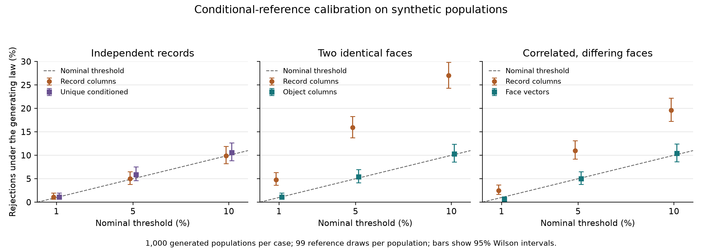

# Conditional reference laws for short inscriptions: copies, selection and fitting feasibility

Working preprint prepared for submission (GitHub Issue #16), based on frozen analyses and independent audits completed in October 2026. Author names, affiliations and venue remain to be assigned. Computational analysis and writing used AI assistance. Every experiment in this manuscript uses exact finite enumeration or synthetic populations with known generating laws, requiring no restricted archaeological corpus; code snapshots, finite tables, proposals, results and audits are retained in the project repository.

## Abstract

A permutation test compares an observed score with a reference set of corpora made by shuffling the observed signs while holding specified sign counts fixed. The probability with which that shuffling scheme produces each table of records is its conditional reference law. A test is calibrated, rejecting about 5% of chance-only populations at a 5% threshold, when that conditional law matches the process that produced and selected the observed records. We derive and test the finite conditional reference laws induced by object copying, imperfect multi-face observation, deduplication and fitting-feasibility restrictions in short inscription datasets, using exhaustive enumeration and controlled simulations scored by a grouped nested cross-validation statistic. Across 1,000 populations of literal copies (two identical records per physical object), shuffling individual records rejects 15.9% at nominal 5%, while shuffling whole objects rejects 5.4%; the paired excess is 10.5 percentage points, with a 95% interval of 8.5–12.6. With two imperfect faces per object, each recording a latent sign with independent symmetric errors, rejection rates are 11.0% and 5.0%, an excess of 6.0 points (95% interval 4.3–7.7). Six binary records with three ones per column admit 8,000 tables, including 2,880 with distinct strings, and rejection sampling is uniform on that subset. Deduplicating seven independent draws into six retained strings is an occupancy sampling process that gives those same tables unequal probabilities: a reference uniform on unique tables rejects 5.1537% at its 5% cutoff, while a reference matched to the deduplication law rejects 4.9407%. A constructed twenty-object counterexample shares exact face-vector margins with a fittable table yet causes the grouped fitting routine to fail; in the 8,000-table binary space, extending the score to unusable tables controls unconditional rejection at 5.0000% but rejects 6.9444% among usable tables, whereas conditioning the reference law on feasibility rejects 4.7917% among usable tables (3.4500% unconditionally). With recording quality shared across an object's slots, the original prediction statistic rejects 4.0% versus 3.0% under broad and quality-conditioned references on 300 populations. A post-outcome agreement statistic fixed before 1,000 fresh populations were generated rejects 94.2% versus 1.0%, and exact conditional tails give 95.0% versus 0.8%. Because these calibration properties depend jointly on the sampling law, the feasible domain of the fitting procedure and the statistic's sensitivity, we report all three together.

## 1. The record process belongs in the reference question

A permutation test scores an observed corpus against a reference distribution built by permuting the observed signs while keeping selected margin counts fixed, such as how often each sign occurs at each position within a stratum. The probability assigned to each compatible table of records is the test's conditional reference law. Exact calibration requires the observed table and the reference tables to follow the same conditional law, and the test statistic to be defined across the support of that law.

In short epigraphic catalogues, the physical and editorial record process determines that conditional law. A catalogue can contain independent objects, multiple impressions made from one stamp, two faces of one inscribed object, or repeated descriptions of one text. Shuffling individual rows independently treats every record as exchangeable. Keeping observations from one physical object together defines a smaller, structured reference space. The applied statistical question is whether the chosen reference law matches the dependence, selection and observation errors of the population being tested.

We previously evaluated, on selected Indus script transcriptions, how much a model using the preceding sign improves held-out prediction over baselines that ignore sequential order. For the chance comparison we moved signs between inscriptions of the same length, site and object type while keeping each sign at its position, and for every shuffled corpus we rebuilt the groups of related records, reassigned cross-validation folds and repeated model selection. A sensitivity analysis rejected shuffles that created repeated whole strings. [Original methods](../001-artifact-aware-prediction/methods.md). Here we isolate the conditional laws behind that procedure through enumerable finite tables and simulated populations with known dependence, permitting exact rational probabilities and complete independent replay.

Our applied analysis builds directly on four statistical foundations. [Phipson and Smyth (2010)](https://gksmyth.github.io/pubs/PermPValuesPreprint.pdf) establish exact p-values for randomly drawn permutations when the observed score is included in the rank count. [Hemerik and Goeman (2018)](https://link.springer.com/article/10.1007/s11749-017-0571-1) formalize exact testing with random permutations through group and exchangeability structure. [Winkler et al. (2015)](https://pmc.ncbi.nlm.nih.gov/articles/PMC4644991/) develop multi-level block permutation to preserve dependence among repeated or grouped measurements, and [Hurlbert (1984)](https://doi.org/10.2307/1942661) frames pseudoreplication when dependent sub-units are analyzed as independent experimental units. Two further statistical connections govern our finite counterexamples. First, deduplicating a larger sample of independent draws into a fixed number of distinct strings is an occupancy sampling problem: conditioning on the retained column margins weights each unique string set by its occupancy sum rather than uniformly (Section 3.2). Second, reporting p-values only when a grouped cross-validation procedure has enough components to run is a selective inference problem: the analysis conditions on a data-dependent feasibility event, separating unconditional calibration over all tables from conditional calibration over usable tables (Section 5).

This paper is a focused applied statistical methods study. We supply explicit finite derivations, constructive feasibility bounds, exact counterexamples and audited calibration outcomes for short-record corpora scored by a grouped nested cross-validation routine. We do not propose a general asymptotic theory of permutation testing beyond these explicit short-record constructions and preserved counterexamples.

## 2. Statistic, sampling and checks

### 2.1 The original fitting statistic

The test statistic is the held-out gain in log score, in bits per sign after a record's first sign, of a model that uses the preceding sign over the best model that ignores it. Records on the same physical object (physical aliases) or with identical whole strings are linked, transitively, into connected components. Five outer cross-validation folds keep components intact, so no text is predicted from its own copy. Within each outer training set, three inner folds select both the smoothing parameter for dependence on the preceding sign and the independent baseline: overall sign frequencies, frequencies by length and slot, or frequencies by length, slot, site and object type. The smoothing grid is 5, 20, 100, 500 and 2,000. Every observed and reference corpus repeats this complete nested procedure of grouping, fold allocation, selection and scoring, using unchanged copies of the original code. [Main protocol](../../experiments/2026-10-02-six-hour/null-calibration/MAIN_PROTOCOL.md), [snapshot hashes](../../experiments/2026-10-02-six-hour/null-calibration/sources/).

For 99 independently drawn reference scores, the one-sided Monte Carlo p-value is `(1 + exceedances)/100`, where exceedances counts reference scores greater than or equal to the observed score. Exact finite calculations instead sum the full inclusive tail probability over all compatible tables. We report rejection fractions at nominal 1%, 5% and 10% cutoffs; their intervals describe repeated sampling across the simulated populations. The exchangeability rank argument requires both that observed and reference tables follow the same conditional law and that the statistic is defined on every table that law can produce.

Physical blocks and held-out components perform different roles. A physical block groups observations tied by the generating process, such as two faces of one artifact. A connected component groups records held out together during cross-validation. Rebuilding components on each shuffled table prevents a held-out string from leaking into training, but it does not alter the sampling distribution that generated the shuffled table. Both structures are saved and independently audited.

### 2.2 Shuffling within columns

A corpus is represented as a table with one row per record and one column per sign position, or slot. A cell holds the signs at one slot among records sharing a length, site and object type, and its sign counts form the table's column margins. Under independent categorical draws within each cell, a labeled table's probability depends only on its sign counts, so conditioning on those counts makes every compatible labeled arrangement equally likely. A cell with `n` entries and category counts `m(v)` has `n!/∏m(v)!` distinct arrangements. Each arrangement is generated by `∏m(v)!` labeled permutations out of `n!`, so repeated sign values do not favour any distinct table.

Requiring all whole row strings to be distinct restricts the sample space to a subset of compatible tables. Proposing uniform column shuffles and accepting only tables with distinct row strings yields the exact uniform law on that subset, because conditioning a uniform draw on an event leaves it uniform on the event. Rejected proposals affect computing time alone. Exhaustive enumeration and independent sampler counts verify these probabilities. [Mathematical derivation](../../experiments/2026-10-02-six-hour/null-calibration/MATHEMATICS.md).

### 2.3 Physical observations and imperfect faces

Literal copies reproduce one underlying (latent) inscription exactly, as multiple impressions of one seal do. Their matched reference shuffles columns among latent objects within strata of site and object type, then copies each object's string onto all of its records. When every object has the same number of copies, shuffling objects holds both object margins and expanded record margins fixed simultaneously. When objects have unequal copy counts, preserving both margins requires weighted constraints or conditioning within copy-count classes.

The imperfect-face experiment simulates twenty objects, two faces per object, three slots and eight sign categories. Independently at each slot and on each face, the observed face keeps the latent sign with probability 0.9 and otherwise takes one of the other seven signs uniformly at random. Writing `K` for this symmetric observation kernel, the ordered pair of signs on an object's two faces, its face vector, has probability `r(a,b) = Σ_x p(x) K(a|x) K(b|x)`. Within a cell, objects yield independent face vectors with common distribution `r`, so conditioning on the multiset of face vectors makes every labeled arrangement of those vectors equally likely. The matched reference therefore permutes whole ordered face vectors across objects within each cell, preserving both the joint vector margins and each face's scalar sign counts. [Observation law](../../experiments/2026-10-02-six-hour/null-calibration/noisy-faces/METHODS.md).

We compared face-vector shuffling with individual-record column shuffling on the same 1,000 simulated populations, using 99 reference corpora per method and the unchanged nested statistic. Disjoint seed ranges keep the two reference streams independent. An independent audit reconstructs all populations and proposals, joint and scalar margins, physical aliases, graph components, fold loads, p-values and aggregates, and replays fifteen complete fits.

## 3. Small tables show the sampling differences exactly

### 3.1 Requiring distinct strings

Six labeled records of three binary signs, with three ones per column, form `20³ = 8,000` compatible tables. Because only eight binary strings of length three exist, choosing six distinct strings whose column sums all equal three requires omitting one complementary pair, such as `001` and `110`. Four choices of omitted pair and `6!` row-label arrangements yield 2,880 tables with distinct strings. Rejection sampling from uniform column shuffles accepts with exact probability 0.36 (`2,880/8,000`), and every accepted table has exact probability `1/2,880`.

We evaluated the unchanged nested fitting statistic on all 2,880 unique tables. Its exact inclusive tails reject exactly 5.0% of tables at the 5% cutoff. Independent enumeration verifies table identity, permutation multiplicity (`46,656` labeled permutations per table), acceptance probability and every saved tail. Among the full 8,000 tables, 2,240 have fewer than five distinct strings and cannot fill the five outer folds; those unusable tables motivate the feasibility analysis in Section 5. [Exact results](../../experiments/2026-10-02-six-hour/null-calibration/exact/results.json), [independent audit](../../experiments/2026-10-02-six-hour/null-calibration/verification_exact.json).

### 3.2 Deduplication as an occupancy sampling process

Drawing seven independent strings and retaining each distinct string once induces a different conditional law from conditioning six draws on uniqueness. Set the probabilities of a one at the three slots to 0.2, 0.3 and 0.4, condition on retaining six distinct strings whose column sums equal three, and assign the six retained strings to row labels uniformly at random. The four balanced six-string sets then have unequal conditional probabilities: `16/75` (21.3333%) when `000` and `111` are omitted, `37/150` (24.6667%) when `001` and `110` are omitted, `4/15` (26.6667%) when `010` and `101` are omitted, and `41/150` (27.3333%) when `011` and `100` are omitted. Conditioning six independent draws directly on uniqueness instead gives each of the four sets 25%.

This departure is an occupancy sampling effect. Obtaining a retained set `S` of six distinct strings from seven independent draws requires one string in `S` to appear twice and the other five to appear once. Summing over the six choices for the duplicated string makes the seven-draw probability proportional to `∏_{x ∈ S} q(x) · Σ_{x ∈ S} q(x)`, where `q(x)` is the probability of string `x`. Fixing the column margins holds the product `∏_{x ∈ S} q(x)` constant across all four balanced sets, whereas the occupancy sum `Σ_{x ∈ S} q(x)` varies with which complementary pair was omitted. Each set distributes its probability uniformly across `6! = 720` row arrangements. Reweighting the frozen nested scores across all 2,880 tables, a reference kept uniform on unique tables rejects `2,783/54,000` (5.1537%) at the 5% cutoff, while a reference matched to the deduplication law rejects `667/13,500` (4.9407%). For the nested score, the largest excess over any attainable nominal cutoff is `653/108,000` (0.6046 percentage points, at cutoff `187/480`). [Exact probabilities and tails](../../experiments/2026-10-02-six-hour/null-calibration/dedup-selection/results.json).

An independent dynamic recurrence tracking the set of observed strings after each raw draw verifies the four retained-set probabilities without using the closed-form occupancy polynomial and checks all 11,520 stored tail values. The example isolates the selection premise required to treat a uniqueness-conditioned reference as calibrated for a deduplicated catalogue.

### 3.3 Copies and weighted margins

Four latent objects of three binary signs, with two ones per column, form `6³ = 216` tables. Writing two identical copies per object produces eight records with four ones per column. Independent record-column shuffling admits `70³ = 343,000` tables with those record margins, of which only 216 keep every copy pair identical. Record-column shuffling therefore lands inside the copy-supported space with probability `216/343,000` (about 0.000630), whereas the matched object-column reference never leaves it.

An integer statistic that counts equal neighbouring signs within rows permits exact rational tails as the copy count increases from one to five copies per object. With three copies per object (twelve records), the ordinary record-column reference falsely rejects 25.0% (`54/216 = 1/4`) of latent tables at its 5% cutoff, whereas the matched object-column reference rejects 2.78% (`6/216 = 1/36`). Its smallest attainable tail holds six of the 216 tables, so inclusive tie counting makes the matched test conservative. A separate integer row-state dynamic program verifies every ordinary and matched distribution for one through five copies. [Exact copy experiment](../../experiments/2026-10-02-six-hour/null-calibration/copy-tail-counts/README.md).

When objects have unequal copy multiplicities `[1, 1, 1, 2, 2, 3]`, holding fixed both three ones among the six latent objects and five ones among the ten expanded records leaves six compatible columns. Unrestricted object-column shuffling preserves the expanded record count in only six of its twenty columns (exact column acceptance 0.30). Our direct conditional sampler builds each column sequentially, choosing each next entry in proportion to the exact number of valid completions computed by dynamic programming. Every valid column has exact probability `1/6`, and three independent slots give 216 equiprobable tables. Both the direct continuation sampler and rejection sampling preserve both margins across 100,000 draws each. On the declared seed, the direct stream's Pearson statistic is 263.5194 on 215 degrees of freedom (`p = 0.01336`), while the rejection stream gives 228.7693 (`p = 0.2475`); exact branch probabilities and an independent full replay stand beside those finite-sample diagnostics. [Weighted conditional space](../../experiments/2026-10-02-six-hour/null-calibration/unequal-copy-counts/README.md).

## 4. Calibration in the full fitting procedure

### 4.1 Independent records, selected unique records and literal copies

The main simulation study generates 1,000 populations under each of three known laws: independent slot draws, independent slot draws conditioned on distinct whole strings, and two identical records per latent object. Each population has forty three-slot records and eight categories divided into two equal strata of site and object type. Base slot probabilities are `[0.20, 0.16, 0.14, 0.12, 0.11, 0.10, 0.09, 0.08]`, cyclically shifted right by `site index + 2 × slot index`. Unique populations redraw the complete forty-record corpus whenever any whole string repeats. Copied populations draw twenty latent objects, ten per stratum, and write each object as two identical records. Each population receives 99 reference draws; copied populations receive both individual-record column shuffling and the matched object-column reference of Section 2.3. In total, the run completes 3,000 observed fits and 396,000 reference fits using the full nested statistic.

| Population and reference | Rejection at 1% | At 5% | At 10% |
|---|---:|---:|---:|
| Independent records, record columns | 1.1% | 5.0% | 9.9% |
| Unique records, uniqueness-conditioned columns | 1.1% | 5.9% | 10.6% |
| Literal copies, object columns | 1.1% | 5.4% | 10.3% |
| Literal copies, record columns | 4.8% | 15.9% | 27.0% |

At nominal 5%, the per-method 95% Wilson intervals are 4.162–6.979% for object-column references and 13.765–18.296% for record-column references (3.813–6.531% for independent records and 4.601–7.536% for unique records). Paired on the same 1,000 copied populations, record-column references reject 10.5 percentage points more often than object-column references, with a 20,000-draw cluster-bootstrap 95% interval of 8.5–12.6 points. An inspection of the original seed schedule showed that object-reference trial `i` and record-reference trial `i + 500` share their 99 reference seeds for `i = 0, ..., 499`, linking the 1,000 trials into 500 pairs (49,500 shared seeds across the two methods, while each method's own 1,000 trials remain distinct). Resampling those 500 linked pairs as clusters preserves cross-method covariance without altering any fitted result. The independent audit reconstructs all 928,424 proposals, all 396,000 accepted groupings and fold allocations and every p-value, and replays 33 complete fits. [Frozen results](../../experiments/2026-10-02-six-hour/null-calibration/main/results.json), [full audit](../../experiments/2026-10-02-six-hour/null-calibration/verification_main.json), [paired seed audit](../../experiments/2026-10-02-six-hour/null-calibration/paired_seed_audit.json).

### 4.2 Imperfect faces

Figure 1. Rejection fractions at nominal 1%, 5% and 10% for the original and imperfect-face studies. Bars give each method's 95% Wilson interval across 1,000 populations. The paired literal-copy interval uses the linked-cluster calculation described in Section 4.1. [Numeric points and input hashes](../../experiments/2026-10-02-six-hour/null-calibration/plots/main/figure.json).

At nominal 1%, 5% and 10% cutoffs, the matched face-vector reference rejects 0.5%, 5.0% and 10.4% of the 1,000 simulated populations. Individual-record column shuffling rejects 2.5%, 11.0% and 19.6%. At 5%, the 95% Wilson intervals are 3.813–6.531% and 9.208–13.091%, respectively. Paired on the same populations, the excess is 6.0 percentage points, with a 20,000-draw population-bootstrap 95% interval of 4.3–7.7 points. Both references reject 41 populations, only the record reference rejects 69, only the vector reference rejects nine, and neither rejects 881. [Frozen main result](../../experiments/2026-10-02-six-hour/null-calibration/noisy-faces/main/results.json), [full audit and paired calculations](../../experiments/2026-10-02-six-hour/null-calibration/noisy-faces/verification_main.json).

All 99,000 individual-record references alter the joint face-vector margins, whereas all 99,000 matched references preserve them. Recomputed component counts range from fifteen to twenty in observed tables, nine to twenty in record references and thirteen to twenty in face-vector references. Both methods rebuild components on every proposed table, yet they draw those tables from different conditional laws.

Across 60,000 observed object slots, the two faces agree in 48,821 slots. The symmetric error kernel with replacement rate 0.1 predicts slot agreement probability `142/175` (0.8114) and whole-string agreement probability `(142/175)³` (0.5343). Among 20,000 simulated objects, 10,817 have identical strings on both faces, and the audit records 11,868 sign replacements in 120,000 face slots, confirming that the simulated data match the declared error kernel.

## 5. Fitting feasibility, abstention and selective inference

The grouped nested fitting routine requires enough connected components to populate five outer folds and its three inner selection folds. In a constructed twenty-object counterexample, each two-face object shares one complete string with the next object in a chain. Linking records transitively by shared physical object and identical text collapses all forty records into a single connected component, causing the original fitting routine to raise `ZeroDivisionError`. A single within-stratum shuffle of the ordered face vectors produces a table with identical joint vector margins, twenty connected components and a finite score (`-0.003507` bits per noninitial sign). Both tables have positive probability under the imperfect-face generator. [Counterexample, failure and shuffled table](../../experiments/2026-10-02-six-hour/null-calibration/domain-support/main-v2/results.json).

The reference law is therefore well defined on tables where the original fitting statistic is undefined. Reporting p-values only when the observed table can be fitted turns the test into a selective inference problem conditioned on fitting feasibility. A pre-outcome follow-up protocol compares two explicit policies across all 8,000 balanced binary tables of Section 3.1. The first policy, a score extension, assigns zero gain to any reference table with fewer than five components and abstains, reporting no test, when the observed table is unusable. The second policy conditions the reference distribution itself on the subset of usable tables. Of the 8,000 tables, 5,760 (`18/25`) are usable and 2,240 lead to abstention.

| Nominal cutoff | Score extension, all observations | Score extension, usable observations | Feasibility-conditioned reference, usable observations | Feasibility-conditioned reference, all observations with abstentions |
|---:|---:|---:|---:|---:|
| 1% | 0.3250% | 0.4514% | 0.4514% | 0.3250% |
| 5% | 5.0000% | 6.9444% | 4.7917% | 3.4500% |
| 10% | 9.8750% | 13.7153% | 9.9653% | 7.1750% |

At nominal 5%, the score extension rejects 400 tables: 5.0000% of all 8,000 tables (controlling the unconditional error rate when abstentions count as non-rejections), but 6.9444% (`400/5,760`) among usable observations. Conditioning the reference law on feasibility changes the tail denominator and restores conditional control, rejecting 276 of 5,760 usable tables (4.7917%), or 3.4500% of all 8,000 tables when abstentions are included. Independent graph traversal verifies all 8,000 component counts, and score-frequency counting verifies every full and conditional tail. The calculation reuses the 2,880 saved unique-table scores and adds 2,880 fits for tables with five components. [Score-extension protocol](../../experiments/2026-10-02-six-hour/null-calibration/domain-support/GUARD_PROTOCOL.md), [exact result](../../experiments/2026-10-02-six-hour/null-calibration/domain-support/guard-exact/results.json), [verification](../../experiments/2026-10-02-six-hour/null-calibration/domain-support/verification.json).

Calibration over the full generating law therefore differs from conditional calibration given that a fit succeeded. Any applied permutation pipeline using a multi-fold grouped statistic must specify its score extension, abstention rule or feasibility conditioning before fitting.

Under specific structural premises, a constructive lower bound guarantees that every table in the reference space is feasible. Suppose every physical block carries exactly one complete string and has no other physical links. Merging identical strings then yields one component per distinct string, so the largest number of distinct signs appearing in any single slot is a lower bound on the number of components. Record-column shuffling preserves this premise when each physical block is a single record, and object-column shuffling preserves it for literal copies. In the main study, independent and unique margins guarantee at least eight components, and literal-copy object margins guarantee six to eight. Five components containing scored signs suffice for the greedy fold allocator to populate every outer and inner fold. An audit verifies all 3,000 observed margins, all 396,000 saved reference groupings and 29,169 allocation cases. Record-column shuffling on literal copies breaks the single-string-per-block premise in all 99,000 sampled tables, so the bound covers only the matched object reference. The premise also fails in the two-face counterexample, whose faces differ. [Bound protocol](../../experiments/2026-10-02-six-hour/null-calibration/domain-support/SUPPORT_PROTOCOL.md), [completed support audit](../../experiments/2026-10-02-six-hour/null-calibration/domain-support/support-bound/results.json).

## 6. Estimating the error process

In real archives, the observation error rate is unknown. A follow-up fits the symmetric observation kernel, a restricted instance of the latent observer-error model of [Dawid and Skene (1979)](https://doi.org/10.2307/2346806), to the 1,000 saved imperfect-face populations. On the branch where faces retain positive association with the latent sign (`0 ≤ ε < 7/8`), the observed agreement fraction `H` identifies the shared replacement rate through `ε = (7/8)[1 − sqrt((8H − 1)/7)]`, with declared boundary handling when `H < 1/8`. A penalized expectation-maximization likelihood fit ([Dempster, Laird and Rubin 1977](https://www.maths.usyd.edu.au/u/jchan/GLM/Dempster1977EM.pdf)) over the ordered face pairs jointly estimates the replacement rate and each cell's latent sign distribution, using fixed `Dirichlet(1.5)` cell penalties, a `Beta(1.5, 1.5)` rate penalty and three starting rates (`0.02`, `0.1` and `0.3`). Before fitting, we added a shrinkage baseline applying the same `Dirichlet(1.5)` smoothing directly to observed marginal frequencies without an error model. [Protocol and comparison amendment](../../experiments/2026-10-02-six-hour/null-calibration/noisy-channel/PROTOCOL.md), [method and results](../../experiments/2026-10-02-six-hour/null-calibration/noisy-channel/README.md).

Against the true rate of 0.1, the agreement and penalized joint estimators give means of 0.099261 and 0.101605, with mean absolute errors of 0.023162 and 0.022195. Direct linear inversion of the kernel at the known rate yields 10,335 negative component estimates across 5,466 of the 6,000 ten-object cells. A component turns negative whenever its category is absent from both faces in a cell, and exact rational absence probabilities predict 10,331.87 negative entries across 1,000 populations. Measuring frequency error by total variation (half the summed absolute error), the constrained joint estimate achieves mean total variation 0.245280, compared with 0.334097 for direct agreement inversion projected onto the simplex and 0.227690 for the shrinkage baseline. Pooling each of the six site and slot cells across all 1,000 populations (60,000 observed pairs in total) reverses that ordering: mean cell total variation drops to 0.012236 for the joint error-corrected fit versus 0.020967 for raw observed frequencies. Regularized shrinkage dominates in small ten-object cells, while explicit error correction reduces bias once sample sizes grow.

An independent audit reconstructs all 1,000 pair tables, 4,000 objectives and traces, 6,000 simplex-projection checks, eight full fit replays and the 20,000 bootstrap draws. Exact rational recurrences over agreement counts and observed category subsets provide separate analytical checks. Under uniform latent frequencies, an explicit calculation constructs distinct two-observer error-rate pairs that yield identical ordered-pair distributions; nonuniform latent frequencies identify the observers' attenuation ratio under the symmetric kernel, while general latent-mixture identifiability requires stronger multi-view rank conditions ([Allman, Matias and Rhodes 2009](https://arxiv.org/abs/0809.5032)). [Recovery audit](../../experiments/2026-10-02-six-hour/null-calibration/noisy-channel/main/verification.json), [identification calculation](../../experiments/2026-10-02-six-hour/null-calibration/noisy-channel/IDENTIFICATION.md).

### 6.1 Quality shared across slots

When recording quality varies across objects rather than staying constant, face errors become correlated across an object's slots. A fresh prospective follow-up assigns each object an observed low-error or high-error class, with replacement rates 0.025 and 0.60 shared across all three slots of that object. Each site contains five objects of each class; latent slots remain independent with identical distributions across classes. Both references permute complete ordered face vectors within strata of site and object type, while the quality-conditioned reference also restricts permutations within quality classes. The nested fitting statistic retains its original strata and ignores quality. A zero-gain extension below five components and abstention on unusable observed tables were declared before data generation.

At nominal 5%, broad vector references reject twelve of 300 populations (4.0%) and quality-conditioned references reject nine (3.0%). The paired difference is 1.0 percentage point, with a 20,000-draw bootstrap 95% interval of −1.0 to 3.0 points. Per-method 95% Wilson intervals are 2.303–6.860% and 1.586–5.602%. No observed or reference table triggered the zero-gain guard. All 29,700 broad proposals alter the class-specific vector margins, whereas all 29,700 quality-conditioned proposals preserve them. The independent audit reconstructs all 300 populations and all 59,400 reference tables, and replays sixteen complete fits. [Frozen quality comparison](../../experiments/2026-10-02-six-hour/null-calibration/shared-quality/main/results.json), [audit](../../experiments/2026-10-02-six-hour/null-calibration/shared-quality/verification_main.json).

An exact four-object space separates the two conditional laws analytically. Conditioning only on broad vector counts leaves six compatible columns with unequal rational probabilities (maximum-to-minimum weight ratio `449,968,615,209/97,851,664`), whereas adding quality-class counts leaves four equiprobable columns and 64 equiprobable three-slot tables. An independent replay verifies all 20,000 sampler draws. Under the supplied two-class mixture, the largest absolute covariance between sign events at adjacent slots of a single face is 0.0006072704 (`4,761/7,840,000`), compared with 0.0057955982 (`142,491,969/24,586,240,000`) for ordered face vectors. The exact weights confirm that broad vector shuffling mismatches the generating law even though the original single-face prediction score shows little calibration gap on 300 populations. [Exact laws](../../experiments/2026-10-02-six-hour/null-calibration/shared-quality/exact/results.json), [exact moments](../../experiments/2026-10-02-six-hour/null-calibration/shared-quality/analytic-moments/results.json).

### 6.2 A statistic aimed at shared quality

Because the nested score showed little separation despite the unequal conditional weights, we specified a separate post-outcome diagnostic on 1,000 fresh populations. Let `A(o, i)` indicate agreement between object `o`'s two observed faces at slot `i`. The integer statistic `S = Σ_o [A(o, 0) A(o, 1) + A(o, 1) A(o, 2)]` counts adjacent-slot face agreements on the same object and ranges from zero to forty. It reads only observed signs and fixed object pairs; quality labels enter the reference grouping alone. The statistic, reference draw count and exact-tail algorithm were fixed before the 1,000 fresh populations were generated. [Diagnostic protocol](../../experiments/2026-10-02-six-hour/null-calibration/shared-quality/agreement-diagnostic/PROTOCOL.md).

| Nominal cutoff | Broad reference, 99 draws | Quality reference, 99 draws | Broad reference, exact tail | Quality reference, exact tail |
|---:|---:|---:|---:|---:|
| 1% | 79.0% | 0.0% | 84.8% | 0.0% |
| 5% | 94.2% | 1.0% | 95.0% | 0.8% |
| 10% | 97.2% | 2.2% | 97.6% | 2.1% |

At nominal 5%, the Monte Carlo paired difference is 93.2 percentage points, with a 20,000-draw population-bootstrap 95% interval of 91.6–94.7. Under the supplied generator, the exact expected score is 18.9712 (`1,859,177/98,000`), while the expected broad-reference conditional mean is 13.5058 (`2,647,129/196,000`), a gap of 5.4654 (`42,849/7,840`). In the 1,000 fresh populations, the observed score mean is 18.855, the average broad conditional mean is 13.4469 and the average quality-conditioned mean is 18.8614. Broad shuffling disperses high- and low-agreement face vectors independently at each slot, breaking runs of agreement on low-error objects; quality-conditioned shuffling keeps those vectors within their quality class. [Frozen diagnostic](../../experiments/2026-10-02-six-hour/null-calibration/shared-quality/agreement-diagnostic/main/results.json).

In a reference cell with `n` objects and slot agreement counts `a0`, `a1` and `a2`, the conditional expectation of the cell score is `(a0 · a1 + a1 · a2)/n`. A row-state dynamic program computes exact integer score multiplicities for all count triples at cell sizes five and ten. A second independent calculation conditions on the middle column and convolves two hypergeometric overlap distributions, verifying all 1,547 cell distributions. Convolving the cell distributions yields all 2,000 exact population tails. The independent audit reconstructs all 1,000 populations, 198,000 reference tables, 199,000 scores and every reported tail and interval. [Independent audit](../../experiments/2026-10-02-six-hour/null-calibration/shared-quality/agreement-diagnostic/verification.json).

Counting ties as exceedances and the frequent occurrence of constant-score configurations make the quality-conditioned tails conservative. Placed beside the nested score's 4.0% versus 3.0% result, the agreement statistic's 94.2% versus 1.0% result demonstrates that empirical calibration failure under a misspecified conditional law depends heavily on whether the chosen test statistic responds to the omitted recording mechanism.

## 7. Application and availability

Applying conditional permutation tests to an archaeological or epigraphic archive requires an explicit observation model stating which records belong to one physical artifact, which objects are literal copies, how uncertain or damaged faces are represented, and how catalogue selection or deduplication filtered the observed population. Those structural inputs determine the conditional reference law. Archives with unequal record counts per object can apply the weighted-count continuation sampler once physical groupings are established, and multi-reading models for uncertain signs can permute ordered vectors of readings once their observation assumptions are stated.

The synthetic studies and exact finite calculations reported here evaluate calibration under known laws and supply reproducible counterexamples for copying, deduplication, fitting feasibility and shared recording quality. The earlier Indus predictive analyses remain conditional on their declared transcription cohort, with separate evidence files.

Every experiment in this paper is standalone exact enumeration or synthetic simulation and requires no restricted third-party corpus to reproduce. All finite tables, code snapshots, protocols, frozen results, independent audits and retrospectives are preserved in the project repository. The [methods and evidence summary](methods.md), the [claim-to-evidence map](claim-evidence-map.md) and the [preprint submission checklist](SUBMISSION-CHECKLIST.md) provide exact file paths, JSON keys, standalone audit commands and mathematical review items. Failed fits and earlier designs remain preserved alongside their documented refinements.

## References

- Allman, E. S., Matias, C., and Rhodes, J. A. (2009). *Identifiability of parameters in latent structure models with many observed variables*. The Annals of Statistics, 37(6A), 3099–3132. [arXiv:0809.5032](https://arxiv.org/abs/0809.5032).
- Dawid, A. P., and Skene, A. M. (1979). *Maximum Likelihood Estimation of Observer Error-Rates Using the EM Algorithm*. Applied Statistics (Journal of the Royal Statistical Society, Series C), 28(1), 20–28. [DOI 10.2307/2346806](https://doi.org/10.2307/2346806).
- Dempster, A. P., Laird, N. M., and Rubin, D. B. (1977). *Maximum Likelihood from Incomplete Data via the EM Algorithm*. Journal of the Royal Statistical Society, Series B (Methodological), 39(1), 1–38. [Dempster, Laird and Rubin (1977)](https://www.maths.usyd.edu.au/u/jchan/GLM/Dempster1977EM.pdf).
- Hemerik, J., and Goeman, J. (2018). *Exact testing with random permutations*. TEST, 27(4), 811–825. [DOI 10.1007/s11749-017-0571-1](https://link.springer.com/article/10.1007/s11749-017-0571-1).
- Hurlbert, S. H. (1984). *Pseudoreplication and the Design of Ecological Field Experiments*. Ecological Monographs, 54(2), 187–211. [DOI 10.2307/1942661](https://doi.org/10.2307/1942661).
- Phipson, B., and Smyth, G. K. (2010). *Permutation P-values Should Never Be Zero: Calculating Exact P-values When Permutations Are Randomly Drawn*. Statistical Applications in Genetics and Molecular Biology, 9(1), article 39 (with February 2011 correction). [Phipson and Smyth (2010)](https://gksmyth.github.io/pubs/PermPValuesPreprint.pdf).
- Winkler, A. M., Webster, M. A., Vidaurre, D., Nichols, T. E., and Smith, S. M. (2015). *Multi-level block permutation*. NeuroImage, 123, 253–268. [PMC4644991](https://pmc.ncbi.nlm.nih.gov/articles/PMC4644991/).
