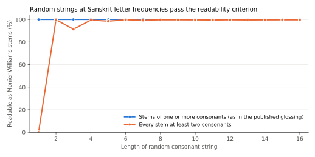

# Testing a published Sanskrit key for the Indus script against its own rearrangements

Complete working paper, 12 October 2026. Computational study of one published decipherment and its evidential argument. Prepared with AI research and writing assistance; author names, affiliations and a submission venue have not been assigned. The study assigns no sound value, meaning or language to any Indus sign.

## Abstract

A 2024 preprint by Yajnadevam proposes that the Indus script records Sanskrit and supports the proposal with Shannon's unicity distance: reading inscriptions whose combined length exceeds the distance is said to show that the readings come from the inscriptions rather than from the key. The complete sign-to-sound table behind that decipherment is public. We reconstruct it exactly and test it on 1,859 distinct complete Indus inscriptions. The key fixes only a pooled consonant skeleton; on held-out Sanskrit from the Digital Corpus of Sanskrit that skeleton has redundancy 0.167, against 0.573 for full text under the same model and 0.7 assumed in the preprint. A lexical emulation of the preprint's acceptance criterion accepts 92% to 100% of random consonant strings of four or more letters. Under an order-5 Kneser–Ney model of Sanskrit, held-out text gains 0.29 to 0.42 bits per consonant over letter frequencies; the key's skeletons score −0.39, which is 1.2 to 2.4 standard deviations above frequency-matched rearrangements of the key's own values, and their order adds nothing over those rearrangements. On synthetic corpora with the shape of the Indus corpus, the true homophonic key of Sanskrit, Latin, Old Tamil or Sumerian text stands 27 to 72 standard deviations above its rearrangements. Keys fitted to half the inscriptions transfer to the other half equally under Sanskrit, Latin, Old Tamil and Sumerian models. Signs the key reads as the same consonant do not substitute for one another in otherwise identical inscriptions beyond chance. The key therefore receives no support from the corpus beyond a partial dictionary fit, and the checks used here form a procedure for evaluating any future key.

## 1. The claim and what would support it

The preprint *A cryptanalytic decipherment of the Indus script* (compiled 13 November 2024) treats the Indus corpus as a homophonic cipher of Sanskrit. Each sign receives a consonant or vowel value, aspirates are pooled with plain stops, dental and retroflex series are pooled, and all sibilants with *h* share one value. Vowels, word division and compounding are supplied by the reader, so a sign sequence fixes a consonant skeleton and the reading fills in the rest. The preprint applies the unicity distance d = N/ρ with N = 330 effective signs and redundancy ρ = 0.7, obtains about 471 characters, and states that reading the fifty longest inscriptions beyond that length shows the information came from the inscriptions. It also states that an incorrect decipherment would not produce words at all.

Two quantities decide whether that argument works. The first is the redundancy of what the inscriptions actually fix, which is a vowel-less, pooled skeleton rather than written Sanskrit. The second is the selectivity of the criterion used to accept a reading. A criterion that accepts most random strings has redundancy near zero, and no corpus length makes a key unique under it. A criterion with real redundancy, such as the likelihood of the skeletons under a model of Sanskrit, can separate keys, and then the published key should stand far above keys with the same freedom.

The closest prior critique is Raghavendra's 2026 preprint, which reconstructs the regular-expression and dictionary search behind this key from public code and applies it to SIGIL, a constructed emblem system that encodes no sounds. That search reaches 67.7% to 97% dictionary coverage in English, Sanskrit and Tamil, keys from bootstrap samples agree on 9.3% of sign values, and SIGIL exceeds the claimed distance about 22 times. Our study works on the real Indus corpus with the complete published key and adds likelihood, rearrangement, achievable-fit, matched-language and synthetic power controls, together with a corpus-internal test of the key's homophone groups. Earlier statistical debate about the Indus corpus as a linguistic system (Rao and colleagues 2009; Sproat 2010, 2014) concerns whether the script encodes language; this paper concerns whether a particular key is supported.

## 2. Data

The inscriptions are the Lipi export of the Indus corpus (repository `yajnadevam/lipi`, commit `fc8813a5`), which gives Wells/ICIT sign codes, reading direction, completeness and object metadata for 5,680 faces. The population is the 2,930 complete single-line faces without unknown signs, read in reading order and deduplicated to 1,859 distinct sequences of at least two signs, written with 577 sign types. The key is the same repository's `xlits.csv` (716 rows: 714 signs plus two placeholders), with each ligature's empty value filled from its components in the order the repository's application uses, and the repository's own readings and glossing (`inscriptions.csv`, `glossing.csv`).

Sanskrit text comes from the Digital Corpus of Sanskrit (commit `8aeed5a1`): the Ṛgveda, Atharvaveda (Śaunaka), Śatapathabrāhmaṇa, Manusmṛti, Arthaśāstra and Rāmāyaṇa. Every tenth chapter file of each text is held out, leaving 82,311 training lines with 1.99 million consonants and 213,349 held-out consonants. The lines of the first, second and fifth texts are unsandhied with compounds split; those of the others are sandhied. Lexicons are the 116,151 distinct skeletons of Monier-Williams headwords (Cologne `csl-orig` `mw.txt`) and the 12,767 skeletons of lemmas attested in the DCS texts. Comparison languages are Latin (four Perseus texts: Caesar, Vergil, Cicero and Livy), Old Tamil (Sangam poems from a public dataset) and Sumerian (12,000 Ur III administrative tablets from ORACC). All source files remain in the local project; only aggregates and code are distributed.

## 3. Methods

### 3.1 Skeleton projection

Key values and Sanskrit text are projected onto fifteen consonant classes that match the key's pooling: k, g, c, j, t, d, n, p, b, m, y, r, l, v and s, with aspiration dropped after stops, retroflex and dental series merged, nasals merged, and ś, ṣ, s, h and visarga merged. Vowels and word spaces are deleted, because inscriptions show no vowels under the key and no word division. The key's *an/aṃ* value may be read *n* or *m*; the main analysis chooses greedily along each text and a sensitivity chooses exhaustively.

### 3.2 Redundancy and the unicity distance

Interpolated Kneser–Ney models (one discount per order) of orders 2 to 5 are trained on the training skeletons and evaluated by cross-entropy H on the held-out skeletons, giving ρ = 1 − H/log₂ 15. The same is done for the full transliteration with vowels and spaces over its 49 phonemes. The preprint's formula is then recomputed with the measured skeleton redundancy.

### 3.3 Readability

A skeleton is readable if it divides into lexicon stems of at least m consonants followed by an optional ending from {∅, s, m, n, y, t, sy}. Readable shares are computed for the inscriptions under the key, for 1,000 rearrangements of the key (below) and for random strings drawn at Sanskrit class frequencies, length by length. A fitted control maximizes the readable share by within-stratum swaps of the key's values (three runs of 20,000 proposals per lexicon).

### 3.4 Order gain and rearrangements

For a skeleton s, order gain is the order-5 log-probability minus the class-unigram log-probability, divided by the number of consonants; texts are scored from a start context with no end symbol. Positive values mean that Sanskrit sequencing predicts the string better than Sanskrit letter frequencies alone. References are held-out Sanskrit spans of one to four words from a sentence start, single held-out words, random Monier-Williams headwords and random strings with the inscriptions' lengths.

Rearrangements permute the key's value options among signs within eight sign-frequency strata (1, 2–3, 4–7, 8–15, 16–31, 32–63, 64–127 and at least 128 tokens), so that each value stays attached to a sign of similar frequency. The key's position among 1,000 rearrangements is reported as a percentile and as a z-score. Sensitivities retrain the model on the unsandhied texts only, project anusvara to *m*, or both. An order-only statistic subtracts the order gain of the same texts after shuffling their signs within each text (20 shuffles), which isolates the contribution of sign order from the choice of consonants.

### 3.5 Achievable fit and transfer

Simulated annealing over swaps of value options between signs of the same frequency stratum (300,000 to 400,000 proposals, temperature falling geometrically from 2×10⁻³ to 2×10⁻⁶) searches for the best arrangement of the key's own values. Searches start from rearrangements, are repeated on inscriptions whose signs are shuffled within each text, and are fitted on half of the texts (assigned by a hash) and scored on the other half. A search allowing swaps across all strata is reported separately because it can raise the statistic by turning frequent signs into vowels. Local ranks hold every other sign fixed and rank the key's class among fifteen by log-likelihood and by order gain.

### 3.6 Matched languages

Latin, Old Tamil and Sumerian text are projected onto at most fifteen consonant classes of their own, and order-5 models are trained as for Sanskrit. Indus signs receive token-matched class assignments for each language (signs in descending frequency take the class with the largest remaining token quota), randomized within strata, and within-stratum swaps optimize order gain on half A. Transfer to half B is measured against 30 to 50 token-matched random starts. A version scored only on half-B texts with no half-A text within one edit, and not contained in one, removes near-duplicate inscriptions.

### 3.7 Synthetic power analysis

Held-out text of each language is cut into spans with the lengths of the 1,859 inscriptions and written with the 577 Indus sign types at their Indus token frequencies by a homophonic key: signs receive classes by the token-quota rule, and each consonant is written with a sign of its class drawn in proportion to the sign's Indus frequency. Duplicate synthetic texts are discarded. The true key is placed among 200 within-stratum rearrangements of itself, annealing from random starts estimates recovery, and half-split transfer under each of the four models tests whether the language can be identified. Exact sign trigrams shared between halves are counted for the synthetic and real corpora.

### 3.8 Homophone substitution

If signs with the same value were interchangeable spellings, they would replace one another in otherwise identical inscriptions and share neighbouring signs more often than frequency-matched sign pairs. Pairs of base signs with the same pooled value are compared with the key's graphic-variant pairs, with pairs of signs that share a class in an independent graphic classification (Mayig), and with frequency-matched random pairs (2,000 relabellings, cluster bootstrap over value groups). Minimal pairs are distinct inscriptions of equal length that differ at exactly one position.

## 4. Results

### 4.1 The published readings use freedom beyond the table

For 1,747 inscriptions with their own reading in the repository, 69.2% of reading skeletons equal the key's skeleton. Most departures add consonants that no sign writes (126 additions of *s* or visarga, 57 of *m*, 43 of *t*, 33 of *d*); another 186 read the *an/aṃ* value as *m*, which the table allows. The published glossing uses 354 lemma forms of one consonant among 3,491.

### 4.2 The acceptance criterion is nearly unselective

Every one of the fifteen classes is itself a dictionary headword, so allowing one-consonant stems makes every non-empty skeleton readable. With every stem required to have two consonants, random strings of four to sixteen consonants are readable from DCS lemmas in 91.8% to 96.4% of cases and from Monier-Williams in 98.5% to 99.7% (Figure 1). The key reads 94.8% of the inscriptions from DCS lemmas, above all 1,000 rearrangements of its values (mean 88.9%, maximum 94.1%), so the values were fitted to a dictionary. Rearranging the same values to maximize readability reaches 99.4% to 99.6%; the key achieves 56% of that gain over rearrangements (38% with Monier-Williams). A rearrangement fixed by seed before inspection segments all twelve of the longest inscriptions into attested Sanskrit nouns, adjectives and verbs; record M-391, for example, becomes *dātṛ-anvita-śiras-mahiṣa-ya*.

### 4.3 The redundancy that matters is low, and the distance is larger than claimed

The order-5 model gives held-out cross-entropy 2.398 bits per phoneme for full text (ρ = 0.573) and 3.256 bits per consonant for the skeleton (ρ = 0.167), of which 0.096 comes from unequal letter frequencies alone. The preprint itself notes that a script without vowels would need its sign count multiplied by the number of vowels. With N = 330 the distance is 1,980 consonants, and 1,758 with N = 293, which drops an allowance for pooled phonemes that the fifteen classes already absorb. Order-5 models understate redundancy: proportional and absolute corrections toward the preprint's 0.7 for full text give about 1,620 and 1,120 consonants, and a larger correction about 790. The fifty longest distinct clean inscriptions supply 473 key consonants (504 across all distinct records). For the lexical criterion the effective redundancy, −log₂P(readable)/L, is between zero and 0.004 bits per consonant.

### 4.4 Under a Sanskrit model the key sits near its rearrangements

Held-out Sanskrit spans of one to four words gain 0.29 to 0.42 bits per consonant, single held-out words 0.35 and random Monier-Williams headwords 0.06. The key's skeletons score −0.393, against −0.435 for random strings of the same lengths and −0.463 (sd 0.057) for rearrangements, which places the key 1.2 standard deviations above the rearrangements (89.5th percentile). With exhaustive *n/m* choice it scores −0.351 and stays at the 90th percentile. Training only on unsandhied text, projecting anusvara to *m*, or both, moves it to 2.0, 2.1 and 2.4 standard deviations. The order-only statistic places the key inside its rearrangements in all four settings (z between −0.55 and +0.60), so its advantage comes from which consonants it assigns and none from their order. The published readings, with their added consonants, score −0.442, and their individual word forms −0.195. Longer readings score lower (−0.25 at three consonants, −0.56 at seven).

### 4.5 Better arrangements of the same values exist and use the attested order

Within-stratum searches reach +0.19 to +0.23 while keeping 7,702 to 7,882 consonants against the key's 7,833. Fitted to shuffled inscriptions they reach +0.02 to +0.04, and those keys score −0.22 to −0.33 on the real order, so the attested order carries structure that a Sanskrit model partly fits and the key does not capture. Fits on half A reach +0.29 and score −0.09 to −0.13 on half B, where the key scores −0.39 and rearrangements −0.47. Unconstrained searches reach +0.47 to +0.69 but turn 22% to 46% of sign tokens into vowels. Local ranks place the key's class 5.96th of 15 by log-likelihood (rearrangements 6.14, sd 0.12) and 6.86th by order gain (7.25, sd 0.16).

### 4.6 The corpus does not prefer Sanskrit

Fitted on half A under matched freedom, keys transfer to half B by 7.7 null standard deviations for Sanskrit, 8.6 for Latin, 8.1 for Old Tamil and 6.4 for Sumerian; as shares of the gap between random assignment and each language's own text, 0.34, 0.33, 0.35 and 0.17. Of the 927 half-B inscriptions, 356 lie within one edit of a half-A inscription and 84 are contained in one. On the remaining 568, a rerun gives 6.3, 7.0, 6.4 and 6.5. A first version of this comparison without frequency constraints failed: the optimizer placed signs on rare classes and Latin reached 8.5 bits per consonant. That run is preserved and replaced by the constrained one.

### 4.7 A correct key would stand far outside its rearrangements

In the synthetic Indus-shaped corpora the true key exceeds its rearrangements by 27.4 standard deviations for Sanskrit, 33.2 for Latin, 37.1 for Old Tamil and 72.5 for Sumerian (Figure 3); no rearrangement reached it. Annealing from random starts under the correct model recovered 37% to 83% of sign tokens in seven runs and 7% in one. Language identification by transfer depended on the random seeds: one set identified Old Tamil and Sumerian but not Sanskrit or Latin, the other identified Latin and Old Tamil, tied Sanskrit with Latin and missed Sumerian. On near-duplicate-free halves no wrong-language model exceeded 3.1, while the real inscriptions reach 6.3 to 7.0 under all four. In the real corpus 37.4% of half-B sign trigrams occur in half A and 40.5% of half-B texts share an internal trigram with half A, against 8.2% to 10.1% and 3.0% to 6.4% in the synthetic corpora. The inscriptions repeat exact sign sequences far more than a key with dozens of interchangeable signs per consonant would produce.

### 4.8 Same-value signs do not behave as interchangeable spellings

The key's 88 base signs carry 18 pooled values; *s* alone covers 93 sign codes, and the eleven values shared by ten or more codes account for 75.9% of sign tokens. Among 230 pairs of base signs with the same value, both attested at least three times, the mean number of minimal pairs is 0.083 against 0.053 for frequency-matched pairs (p = 0.13), and neighbour divergence is 0.668 against 0.677 (p = 0.21). The key's graphic-variant pairs pass both tests (0.199 against 0.018), at about the level of graphically adjacent signs that the key places in different groups, mostly stroke numerals. Substitution therefore groups graphically related signs and gives no support to the key's homophone structure.

## 5. Discussion

The unicity argument requires a criterion whose redundancy matches the ρ in the formula. Readability with free vowels, word division and compounding has redundancy near zero, so reading many inscriptions carries no evidence for the key, and the preprint's statement that an incorrect key cannot make words does not hold for this criterion. The key's dictionary fit is real: it reads more inscriptions than any rearrangement of its values. That fit is the expected result of choosing values while reading, and it reaches between a third and a half of what the same freedom allows.

A likelihood criterion has usable redundancy, and the corpus contains 7,833 key consonants among its distinct inscriptions, several times the recomputed distance. Under that criterion a correct homophonic key on a corpus of this shape would stand dozens of standard deviations clear of its rearrangements. The published key stands one to two and a half, entirely through which consonants it assigns. Its consonant order is no more Sanskrit-like than that of its rearrangements, and its readings score below random dictionary headwords. The Sanskrit model is built from running Vedic and classical text, which may differ from seal formulae; that difference does not explain the gap, because the readings are offered as grammatical Sanskrit phrases.

The matched-language results concern what a phonetic key of this kind can establish. Sequential regularities in the inscriptions transfer between halves under any of four unrelated languages, also when near-duplicate texts are removed, and the synthetic analysis shows that language identification by fitted keys is unstable at this corpus size even when the true encoding is homophonic. The high reuse of exact sign sequences points toward conventional spellings, logograms or fixed formulae; which of these applies is a question for structural work on segmentation, numerals and image–text pairs rather than for key fitting.

The study has limits that change particular readings. The fifteen-class projection follows the key's own pooling and removes all vowel information; a key that encoded vowels differently would need its own projection. Model-based statements depend on the DCS texts and on order-5 models, whose redundancy estimates are conservative. The synthetic encodings model running text with free homophone choice; formulaic or logographic encodings would behave differently. The study evaluates one key and its argument and does not decide whether any inscription records an Indo-Aryan, Dravidian or other language.

For future keys the same checks form a procedure: reproduce the table and measure departures from it; measure the redundancy of the representation the key fixes; calibrate the acceptance criterion on random strings; place the key among frequency-stratified rearrangements of its own values under more than one model, separating composition from order; find the optimum under the same freedom while holding consonant counts fixed; test transfer on near-duplicate-free halves; and compare languages only with letter frequencies held fixed.

## 6. Reproduction and evidence

The code, frozen protocol, amendments, outputs, verification and adversarial review are in `experiments/2026-10-12-published-claim-tests/`. The [evidence guide](methods.md) maps each numerical claim to its output file. The analysis runs manually from the scripts in `sanskrit-key/` and `allographs/`; raw sources and per-inscription outputs remain local under `data/raw/2026-10-12-decipherment-claim-tests/`.

## References

Chen, Stanley F., and Joshua Goodman. 1999. An empirical study of smoothing techniques for language modeling. *Computer Speech and Language* 13 (4): 359–394.

Hellwig, Oliver. Digital Corpus of Sanskrit, CoNLL-U release, repository `OliverHellwig/sanskrit`, commit `8aeed5a1`. [Repository](https://github.com/OliverHellwig/sanskrit).

Kneser, Reinhard, and Hermann Ney. 1995. Improved backing-off for m-gram language modeling. *Proceedings of ICASSP 1995*, 181–184.

Monier-Williams, Monier. 1899. *A Sanskrit-English Dictionary*. Oxford: Clarendon Press. Digital edition: Cologne Digital Sanskrit Dictionaries, `csl-orig` `v02/mw/mw.txt`. [Repository](https://github.com/sanskrit-lexicon/csl-orig).

Raghavendra, Nikhil. 2026. On the non-specificity of statistical measures used in script decipherment. arXiv:2608.02999. [arXiv](https://arxiv.org/abs/2608.02999).

Rao, Rajesh P. N., Nisha Yadav, Mayank N. Vahia, Hrishikesh Joglekar, R. Adhikari and Iravatham Mahadevan. 2009. Entropic evidence for linguistic structure in the Indus script. *Science* 324: 1165.

Shannon, Claude E. 1949. Communication theory of secrecy systems. *Bell System Technical Journal* 28 (4): 656–715.

Sproat, Richard. 2010. Last words: ancient symbols, computational linguistics, and the reviewing practices of the general science journals. *Computational Linguistics* 36 (3): 585–594.

Sproat, Richard. 2014. A statistical comparison of written language and nonlinguistic symbol systems. *Language* 90 (2): 457–481.

Yajnadevam. 2024. A cryptanalytic decipherment of the Indus script. Self-published preprint, compiled 13 November 2024. [Copy consulted](https://rarebooksocietyofindia.org/book_archive/A_cryptanalytic_decipherment_of_the_Indu.pdf); implementation in repository `yajnadevam/lipi`, commit `fc8813a5`.
